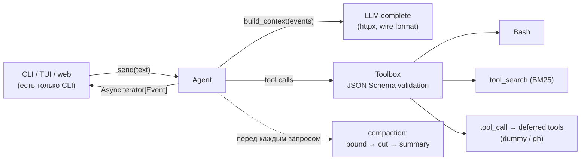

# loola-agent

Минимальный async coding-agent harness поверх OpenAI-compatible `/v1/chat/completions`: решение тестового задания из [TASK.md](TASK.md). Исходник — ~100 строк, один тул `bash`, синхронный `requests`. Результат — небольшой SDK (~1050 строк в `src/`, из них ~270 — тестовая обвязка `gh_proxy.py`) с двумя механизмами из задания:

- **динамическая подгрузка тулов и скиллов**: в промпте фиксированный маленький набор тулов, остальное модель находит сама; массив `tools` и system prompt не меняются всю сессию;
- **context compaction**: перед каждым запросом оценивается его размер и резервируется место под summary; превышение окна по счёту сервера — явная ошибка; summary-запрос попадает в KV-cache.

Рамка, в которой принимались решения: это showcase, а не продукт. Читается за минуты, без фреймворков (даже без `openai` SDK — только `httpx` и wire format), один явный путь выполнения, fail fast вместо fallback-веток.

## Быстрый старт

```bash
uv sync
cp .env.example .env          # LLM_BASE_URL, LLM_API_KEY, LLM_MODEL (+ опции ниже)

# только bash
uv run --env-file .env loola-agent "find TODOs in this repo and summarize them"

# + 91 GitHub-тул (deferred), живой read-only backend через `gh`, скиллы, компакшен
LLM_CONTEXT_WINDOW=64000 uv run --env-file .env loola-agent \
  --catalog examples/github_tools.json --catalog-backend gh \
  --skills skills \
  "Review PR #3519 in encode/httpx"

uv run pytest           # 170 детерминированных тестов: fake LLM, fake gh, без сети
uv run pytest -m live   # smoke против реального GitHub через ваш `gh` (нужен `gh auth login`)
```

| Флаг / переменная | Значения | Смысл |
|---|---|---|
| `--catalog PATH` | JSON-каталог | Дополнительные тулы (имя, описание, JSON Schema). Пример: [examples/github_tools.json](examples/github_tools.json) |
| `--catalog-mode` | `deferred` (default) / `direct` | `deferred`: через `tool_search`/`tool_call`; `direct`: все схемы в каждом запросе (baseline для замера) |
| `--catalog-backend` | `dummy` (default) / `gh` | `dummy`: детерминированный ответ-заглушка; `gh`: 14 read-only тулов через `gh api`, остальные честно отвечают «not implemented» |
| `--skills DIR` | `DIR/<name>/SKILL.md` | Скиллы в формате [Agent Skills](https://agentskills.io) |
| `--skills-mode` | `lazy` (default) / `eager` | `lazy`: в промпте только каталог; `eager`: все тела SKILL.md inline (baseline) |
| `--transcript PATH` | | JSONL-лог событий (default `~/.loola-agent/runs/<timestamp>.jsonl`) |
| `LLM_CONTEXT_WINDOW` | токены | Включает компакшен и контроль окна (см. допущения ниже) |
| `--no-compaction` | | Держать то же окно без сжатия: превышение — ошибка (baseline для замеров) |
| `LLM_COMPACT_AT` | токены | Опциональный более ранний триггер компакшена |
| `LLM_MAX_TOKENS` | default 8192 | Лимит ответа модели |
| `LLM_SESSION_HEADER` | имя заголовка | Стабильный id разговора в заголовке (OpenCode Go роутит и кэширует по нему) |

Финальный ответ идёт в stdout, ход работы — в stderr. Exit code 0 только при статусе `done`.

Живые прогоны делались на `deepseek-v4.1-flash` через OpenCode Go (значения по умолчанию в [.env.example](.env.example)); подойдёт любой OpenAI-compatible сервер, например vLLM.

## Архитектура



| Модуль | Ответственность |
|---|---|
| [llm.py](src/loola_agent/llm.py) | Протокол `LLM` и `OpenAICompatibleLLM`: timeout, retry только на 429/5xx/transport, 4xx → сразу ошибка с телом ответа, `usage` с `cached_tokens` |
| [events.py](src/loola_agent/events.py) | События сессии (append-only список) и `build_context` — чистая проекция событий в `messages` |
| [agent.py](src/loola_agent/agent.py) | `Agent.send()`: цикл, закрытие прерванных tool calls, вызов компакшена |
| [tools.py](src/loola_agent/tools.py) | Протокол `Tool`, `Toolbox` (валидация, direct/deferred), `tool_search` (свой BM25), `tool_call` |
| [compaction.py](src/loola_agent/compaction.py) | Политика, верхняя граница размера запроса, выбор среза, summary-запрос |
| [skills.py](src/loola_agent/skills.py) | Загрузка и валидация SKILL.md, секция system prompt |
| [bash.py](src/loola_agent/bash.py) | bash-тул: вывод в temp-файл, head+tail обрезка, kill process group |
| [catalog.py](src/loola_agent/catalog.py), [gh_proxy.py](src/loola_agent/gh_proxy.py) | Пример каталога + `DummyTool`; read-only прокси к `gh` для живых прогонов (тестовая обвязка) |
| [cli.py](src/loola_agent/cli.py) | Оболочка: env-конфиг, рендер в stderr, JSONL-транскрипт, exit code |

**Событийная модель.** Сессия — append-only список событий `UserMessage | AssistantMessage | ToolStarted | ToolResult | Compaction | SummaryDiscarded | RunFinished`. Контекст для LLM не хранится отдельно, а каждый раз проецируется из событий ([events.py](src/loola_agent/events.py#L69)). `AssistantMessage` хранит сообщение сервера как есть, поэтому параллельные tool calls и `reasoning_content` возвращаются серверу байт-в-байт. Любая оболочка просто итерирует события:

```python
async with OpenAICompatibleLLM(base_url, api_key, model) as llm, Bash() as bash:
    agent = Agent(llm, Toolbox([bash], deferred=github_tools), compaction=CompactionPolicy(64_000))
    async for event in agent.send("fix the failing test"):
        match event:
            case ToolStarted(_, name, args): ui.show_call(name, args)
            case Compaction(): ui.notice("context compacted")
            case RunFinished(status, answer, turns, usage): ui.done(status, answer, usage)
```

CLI — ровно такая оболочка (~100 строк): рендерит события в stderr и пишет их в JSONL. TUI или web делаются так же: подписка на тот же итератор. Отмена — обычный `asyncio` cancel: bash убивает process group, а в начале следующего `send()` каждый незакрытый tool call получает синтетический результат «interrupted, may have partial side effects, check state and re-run if needed» ([agent.py](src/loola_agent/agent.py#L42)). Не перезапуск (повторит побочные эффекты) и не удаление (соврёт модели).

## Динамические тулы

У open-source chat templates (Qwen3, gpt-oss и т.п.) массив `tools` рендерится в самое начало промпта. Любое его изменение посреди диалога — полный промах KV-cache по всей истории. Поэтому `tools` **не меняется никогда**:

- в каждом запросе: direct-тулы (`bash`) + `tool_search(query)` (топ-5) + `tool_call(name, arguments)`;
- `tool_search` — BM25 по имени, описанию и именам параметров. Возвращает найденные тулы **вместе с JSON Schema** как обычный tool result, то есть в хвост истории;
- `tool_call` диспатчит в тот же реестр, с той же валидацией.

Каталог для демонстрации — 91 тул из GitHub MCP server v2.2.0 (MIT), взятый **только как данные**: имя, описание, схема. В `direct`-режиме это ≈ 27.8k токенов в каждом запросе (o200k), в `deferred` — три схемы (`bash`, `tool_search`, `tool_call`).

Валидация ([tools.py](src/loola_agent/tools.py#L47)): `jsonschema` Draft 2020-12 поверх схемы тула плюс `additionalProperties: false`. Почти все реальные схемы молча принимают лишние ключи, и опечатка в имени аргумента иначе тихо игнорировалась бы. Ошибка возвращается модели вместе с ожидаемой схемой, поэтому и после компакшена модель восстанавливает тул «бесплатно».

## Скиллы

[Agent Skills](https://agentskills.io) с progressive disclosure. В system prompt — только каталог `<available_skills>` (name, description, путь к SKILL.md), отсортированный по имени, чтобы промпт был байт-стабилен между запусками. Тело модель читает сама через `bash cat`, и оно ложится в историю обычным tool result. Отдельного тула активации нет: `bash` уже умеет читать файлы, а лишний тул — лишняя сущность. Невалидный SKILL.md — ошибка старта, а не тихий пропуск.

В [skills/](skills) три демо-скилла под GitHub-каталог: `review-pull-request`, `fix-github-issue`, `ci-failure-triage`, с `references/` и `scripts/`. Lazy-каталог для них ≈ 408 токенов, eager ≈ 974. На 18 скиллах из `anthropics/skills` разница 2.9k vs 43k токенов в каждом запросе.

## Компакшен

Практичная оценка + явные ошибки вместо порога «на 80% окна» ([compaction.py](src/loola_agent/compaction.py)). Строгую гарантию без токенизатора и chat template конкретной модели не построить (ревью показало: шаблон DeepSeek пересериализует аргументы tool call с пробелами), поэтому выбрана простая схема, честно работающая на практике.

1. **Оценка следующего запроса** (`context_bound`): точный `prompt` последнего запроса по `usage` сервера + UTF-8 байты (+16 на сообщение) всего, что добавилось после него, включая сам ответ. BPE-токен в среднем 3–4 байта, так что на практике это переоценка. Первый запрос не оценивается.
2. **Резерв.** Обычный запрос уходит, только если `оценка + max(reply, instruction + summary) ≤ window`, то есть место под будущий summary-запрос есть всегда. `LLM_COMPACT_AT` — лишь опциональный более ранний триггер.
3. **Проверка по факту.** После каждого ответа (и summary тоже) `prompt` сервера сверяется с окном: если оценка ошиблась или первый запрос слишком велик — `CompactionError`, а не тихое переполнение.
4. **Summary-запрос** = контекст ранее отправленного измеренного запроса + инструкция в конце: влезает и совпадает по префиксу с закэшированным запросом. `tools` и `tool_choice: auto` те же (почему не `none` — см. «Находки»).
5. **Срез** (`choose_cut`) — только по границе запроса, где все tool calls отвечены; хвост ≈ 1/5 триггера сохраняется дословно.
6. **Новый контекст:** system prompt → одно user-сообщение (все сообщения пользователя дословно + summary) → дословный хвост. Соседние user-сообщения всегда склеиваются: строгие шаблоны не любят два user подряд. Инструкция просит сохранить идентификаторы verbatim и назвать активные скиллы, чтобы модель их перечитала.
7. **Явные исходы.** Если даже пустой summary не уменьшит контекст (весь объём — в последнем ходе), сжатие пропускается, когда запрос влезает, и падает с `CompactionError`, когда нет. Полный summary, который не уменьшил контекст, отбрасывается (`SummaryDiscarded`, его цена остаётся в транскрипте). Вызов тула вместо summary или обрезанный summary — ошибка.

**Допущения:** токенов не больше, чем UTF-8 байт добавленного текста + 16 на сообщение; шаблон модели не раздувает старые сообщения между запросами; первый запрос (system + tools + задача) помещается в окно. Нарушение любого из них видно как `CompactionError` по счёту сервера. Цена: для свежих tool outputs оценка пессимистична в ~3–4×, поэтому сжатие срабатывает раньше необходимого.

Стоимость всех summary-запросов (и отброшенных) входит в `usage` прогона.

## Ответы на вопросы задания

### 1. Как не инвалидировать prompt cache при компакшене и подгрузке

Prefix cache переиспользуется, только если запрос — побайтовое продолжение предыдущего. Отсюда одно правило: **всё переменное — в хвост, префикс только дописывается.**

- **`tools` фиксирован на сессию**: подгрузка идёт через `tool_search`/`tool_call`, схемы приходят tool result'ом в хвост ([tools.py](src/loola_agent/tools.py#L1)). После компакшена найденные тулы в `tools` тоже не добавляются: модель найдёт их заново.
- **System prompt фиксирован**: каталог скиллов статичен и отсортирован, тела читаются в хвост.
- **История воспроизводится байт-в-байт**: assistant message хранится в wire format как вернул сервер; контекст — чистая функция от событий.
- **Summary-запрос = предыдущий запрос + инструкция в конце**: попадает в кэш. На живых прогонах cached 4864/5020 и 9984/10229 (~97%).
- **Тот же `tool_choice`** в summary-запросе: смена на `none` у части провайдеров меняет отрендеренный промпт (см. «Находки»).
- **Компакшен редкий и цельный**: один промах кэша на компакшен (новый префикс), дальше снова только дописываем. Поэтому не делаем micro-compaction (вычистка старых tool outputs посреди истории): каждый такой шаг переписывает середину и ломает кэш после неё.
- **Привязка к реплике**: опциональный `LLM_SESSION_HEADER` со стабильным id разговора — по нему провайдер роутит запросы на реплику с тёплым кэшем.

Доля cached prompt tokens за живой прогон: 80–85% без компакшена, 51% и 78% в прогонах с компакшеном (каждый компакшен — один промах по новому префиксу).

### 2. Какие ошибки тулов отдавать модели, а какие перехватывать в harness

Критерий: **может ли модель исправить это своим следующим действием?** Да — текст в tool result. Нет (инфраструктура, конфиг, баг harness) — исключение или явный статус на границе (CLI), без попыток «уговорить» модель.

| Модели (tool result, текстом) | Harness (исключение / статус прогона) |
|---|---|
| Аргументы — невалидный JSON ([tools.py#L40](src/loola_agent/tools.py#L40)) | HTTP 4xx от LLM → `LLMError` сразу, с телом ответа ([llm.py#L67](src/loola_agent/llm.py#L67)) |
| Неизвестный тул (+ подсказка: список тулов или `tool_search`) | 429/5xx/обрыв соединения → до 3 попыток с backoff, затем `LLMError` ([llm.py#L76](src/loola_agent/llm.py#L76)) |
| Нарушение схемы, включая лишний ключ, + ожидаемая схема ([tools.py#L47](src/loola_agent/tools.py#L47)) | `finish_reason=length` → статус `truncated`; пустой ответ → `empty_reply` (не «успех», как в исходнике) |
| Ненулевой exit code, таймаут команды (с частичным выводом), обрезка вывода с маркером «как читать дальше» ([bash.py](src/loola_agent/bash.py#L32)) | Контекст не влезает даже после сжатия → `CompactionError` |
| `gh` вернул 404 / rate limit / ошибку запроса; аргумент, который backend не поддерживает | `gh` не установлен или не залогинен → `GhUnavailable` на старте |
| Тул каталога не реализован в backend | Невалидный SKILL.md, невалидная схема тула, дубли имён, окно меньше system prompt + тулов → ошибка при создании |
| Прерванный tool call → синтетический «interrupted» | Исключение внутри `Tool.run` (баг тула) не ловится: исходный `except Exception` отправлял баги harness модели как «ошибку тула» |

Ретраи на уровне harness — только для транзиентных сетевых ошибок LLM. Ошибки тулов не ретраятся: решать, повторять ли команду с побочными эффектами, должна модель.

## Решения на развилках

| Развилка | Решение | Почему |
|---|---|---|
| Нативный deferred-API (Anthropic `tool_reference`, OpenAI `tool_search`) или свой | Свой: `tool_search` + `tool_call` в фиксированном `tools` | У голого chat completions / vLLM нативного API нет; так работает на любом сервере, не трогая префикс |
| Constrained decoding / `strict` | Не используем совсем | Не поддерживать два пути; у vLLM при `tool_choice=auto` без strict его и так нет. Компенсация — валидация в harness с ошибкой модели |
| Неизвестные аргументы | Отклоняем (`additionalProperties: false` при валидации) | Иначе опечатки молча игнорируются |
| Вызов deferred-тула напрямую по имени | Разрешён | Следствие одного реестра для диспатча; совпадает с нативными API. Основной путь — `tool_call` |
| BM25 | Свои ~15 строк | `rank-bm25`/`bm25s` тянут numpy ради 91 документа и прячут механику |
| GitHub-тулы | Каталог из GitHub MCP server **как данные**, без MCP-клиента | MCP-протокол вне задания; для детерминизма — `DummyTool`, для живых прогонов — read-only `gh api` (14 тулов, мутаций нет по построению) |
| Скиллы | Каталог в system prompt + `bash cat` | Как в спеке Agent Skills, Pi, Codex; ни одного нового тула |
| Подсчёт токенов | `usage` сервера + байты как верхняя граница | Токенизатор модели неизвестен; tiktoken даст точное, но неверное число |
| Summary и пользовательские сообщения | Сообщения пользователя дословно, остальное — в summary | Задачу формулирует пользователь, её нельзя пересказывать |
| Фоновые процессы в bash | Только правило в описании тула (`cmd > log 2>&1 &`) | Отдельные `bash_output`/`kill` — оверкилл для showcase |
| Обход тулов через shell | Правило в system prompt: «предпочитай выделенный тул; нет подходящего — сначала `tool_search`» | Модель однажды обошла GitHub-тулы через `gh api`; ограничивать bash ради тестового тулсета не стали |

## Сознательно вне scope

- MCP-клиент, Responses API, streaming, `strict`/guided decoding.
- Resume сессии: JSONL-транскрипт пишется, но не загружается.
- Approval и sandbox для bash: запуск в контейнере — ответственность оператора. Из защиты только закрытый stdin и скрытые от команд переменные `LLM_*`.
- TUI/web-оболочки: SDK под них готов, построен только CLI.
- Общий лимит вывода в `Toolbox`: каждый тул режет сам (bash — head+tail, gh — с подсказкой, как сузить запрос).
- Micro-compaction и tiktoken (см. выше).
- `gh_proxy.py` — тестовая обвязка для живых прогонов. Лежит в пакете ради простоты запуска, к SDK не относится.

Цена практичной оценки: для свежих tool outputs она пессимистична в ~3–4×, поэтому с искусственно маленьким окном (40k) один ранний прогон упал явной ошибкой — по дизайну, а не тихим переполнением.

## Как это у других (кратко)

Claude Code и Codex делают то же самое: в промпте каталог + тул поиска, найденные схемы — в хвост истории. Только «развернуть схему в настоящий тул» им помогает нативный API провайдера (`tool_reference` у Anthropic, `tool_search_output` в OpenAI Responses). Pi на generic chat completions честно пересобирает `tools[]`, то есть каждая подгрузка = cache miss. GitHub MCP server свои `--dynamic-toolsets` в v1.1.0 удалил, остались статические фильтры. Скиллы везде устроены одинаково: статичный каталог + тело в хвост.

## Замеры

Один и тот же harness с выключенными и включёнными механизмами, одинаковое окно, задачи на реальном `encode/httpx` через `gh`-backend, `deepseek-v4.1-flash`, 2 повтора, все прогоны параллельно ([bench/run.py](bench/run.py)). Успех проверяется скриптом по строке `ANSWER:` против эталона, снятого через `gh` один раз до прогонов, а не по статусу `done`. В текст задач добавлено «используй только GitHub-тулы, не `gh`/`curl`/`git` в bash» (без этого модель однажды обошла тулы); в замерах обходов не было (0 вызовов `bash`).

| | «До» | «После» |
|---|---|---|
| Тулы | все 91 в `tools` (`--catalog-mode direct`, ~30k токенов в каждом запросе) | `deferred`: `bash` + `tool_search` + `tool_call` |
| Скиллы | `--skills-mode eager` | `lazy` |
| Окно | `LLM_CONTEXT_WINDOW=96000`, `--no-compaction`: превышение — провал | то же окно, компакшен включён |

- **changelog**: 4 последних смёрженных PR, описание + diff, changelog; ответ — 4 номера PR.
- **hot-files**: все 34 коммита между тегами 0.27.2 и 0.28.0, топ-3 файлов по числу коммитов (ничьи на 3-м месте засчитываются).

| Задача | Вариант | Успех | Ходов (ср.) | Prompt-токенов за прогон (ср.) | Из них cached | Компакшенов | Причина провалов |
|---|---|---|---|---|---|---|---|
| changelog | before | 1/2 | 5 | 183,129 | 58% | 0 | переполнение окна |
| changelog | after | 2/2 | 14 | 205,794 | 75% | 1 |  |
| hot-files | before | 0/2 | 14 | 676,928 | 85% | 0 | переполнение окна |
| hot-files | after | 2/2 | 20 | 659,270 | 78% | 2 |  |

Сырые данные — [bench/results.json](bench/results.json), таблица по прогонам — [bench/table.md](bench/table.md).

Что видно:
- **Успешность: «после» 4/4, «до» 1/4.** «До» тратит ~30k токенов на описания тулов в каждом запросе и упирается в окно, как только задача становится длинной; «после» проходит обе задачи (компакшен сработал в 3 из 4 прогонов).
- **Токены не «меньше любой ценой».** На короткой задаче «после» делает больше ходов (поиск тулов, `tool_call`) и в сумме тратит сопоставимо, но 75–78% prompt-токенов попадают в кэш. На длинной задаче «до» просто не доживает до конца, поэтому сравнивать суммы там некорректно.
- **Первая попытка с окном 48k провалилась у обоих вариантов** ([bench/table-48k.md](bench/table-48k.md)): «после» делал несколько параллельных вызовов с ответами `gh` по ~20 KB, и практичная (байтовая, пессимистичная в 3–4×) оценка свежего хода сама не влезала в окно — компакшен честно отказал, а не переполнил. Это и есть цена выбранной простой оценки.
- Оговорки: игрушечный набор (91 тул, 3 скилла, 2 задачи), 2 повтора, искусственное окно, одна модель. Это демонстрация механизмов, а не статистически значимый бенчмарк.

## Находки на живых прогонах

5 прогонов на `encode/httpx` через `gh`-backend (поиск последнего PR по файлу, ревью PR по скиллу, changelog по последним merged PR с компакшеном). Deferred-поиск и вызов работают; скилл ревью прочитан и выполнен, а шаг записи честно получил «not implemented». После ошибки валидации модель сама исправила аргумент. В прогонах с компакшеном он срабатывал 1–2 раза. Пример: 9 ходов, prompt 208k токенов, из них 167k cached.

- **`tool_choice: none` ломает кэш у OpenCode Go.** При `none` провайдер выкидывает tools из промпта: другой префикс, cached = 0. С `auto` у того же summary-запроса cached 8704/8776. Поэтому summary-запрос идёт с `auto`, а вызов тула вместо summary — явная ошибка.
- **gpt-6-luna не умеет tools + reasoning в chat completions**: тулы работают только с `reasoning_effort=none`. Перешли на `deepseek-v4.1-flash`.
- **DeepSeek требует вернуть `reasoning_content`**, иначе 400. Отсюда решение хранить assistant message как есть, а не пересобирать его из `content` + `tool_calls`, как делал исходник.
- **Модель обходила тулы через shell**: в одном прогоне после нескольких `tool_call` она перешла на `gh api …` в bash. Помогла одна фраза в system prompt; bash не ограничивали.
- **OpenCode Go требует `x-opencode-session` и собственный User-Agent**: стабильный session id нужен и для роутинга, и для кэша. Отсюда `LLM_SESSION_HEADER`.

## Путь в истории коммитов

`git log --oneline` читается как журнал работы: импорт исходника как baseline → фиксы базового цикла (история tool calls, `reasoning_content`, невалидный JSON, обрезка вывода, timeout/retry, `finish_reason=length`, process groups в bash) → async SDK + тонкий CLI → закрытие прерванных tool calls → deferred tools → `gh`-backend для живых прогонов → скиллы → компакшен → правило «тул важнее shell». Правила для агентов — [AGENTS.md](AGENTS.md), лог сессии разработки с агентом — [docs/session-log.md](docs/session-log.md) (только переписка), полные логи всех bb-сессий (основная + 9 субагентов, с командами и выводом) — [docs/sessions/](docs/sessions/README.md). Код ревьюил отдельный агент (GPT-6.2 Astra) в 3 раунда; все находки исправлены, каждая — с регрессионным тестом, проверенным мутацией.
