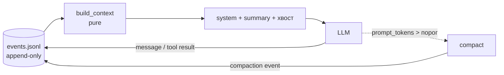

# Session log (development with a coding agent)

Conversation between the developer and the main agent (Claude Code, Opus) that built this repo, in order. **[sub-thread report]** messages are results of sub-agents it spawned (research, code review by GPT-6.2 Astra, README). Tool calls and reasoning are omitted; local paths, thread ids and emails are redacted.

---

### [developer]

Есть вот такая задача
https://app.notion.com/p/Test-Task-_-Loola-4142cf71694e8041897ed3b4606f2a71

Давай заведем отдельную директорию в директории ~/projects и туда положим этот файл, создадим нормальный проект для UV, чтобы мы могли его запускать. После этого посмотрим по нашим старым сессиям наш ресерч по динамической подгрузке тулов (скиллы пока не трогает, там все тривиально), как это устроено в Codex и Cloud Code. Не помню насчет Cloud Code, но Codex мы точно ресерчили. Сделай этот ресерч отдельным сабтредом, чтобы не забивать себе контекст, и создай еще отдельный сабтред, который проверит то же самое в PAgent, если они уже сделали динамическую подгрузку скиллов. Мне кажется, что сделали. Насколько я помню, для того чтобы динамическая подгрузка работала, на стороне провайдера моделей должна быть поддержка в API. Поправь меня, если я здесь ошибаюсь. Запусти отдельный сабтред на Astra, хотя нет, давай тоже на Opus, который в целом посмотрит этот код и предложит, что в нем важно и нужно улучшить, в смысле текущий код, который есть в задании, при этом не переусложняя его, а поддерживая вот такой вот минималистичный шоукейс-формат. Если тут есть качественные ошибки или проблемы, он тоже должен это подстветить
По компакшену пока ничего не нужно делать

### [agent]

Начинаю: сначала достану задачу из Notion и осмотрюсь в bb.

### [agent]

Notion-коннектора нет (это Claude Docs). Попробую достать публичную страницу через Notion API напрямую.

### [agent]

Задачу достал (Notion API отдаёт публичную страницу без логина). Теперь создаю uv-проект в `~/projects/loola-test-task`.

### [agent]

`uv init` создал package-layout с `src/` — для одного скрипта это overkill, переделываю в плоский проект: `agent.py` + `uv run agent.py "..."`.

### [agent]

Проверю опции spawn (environment, cwd), чтобы сабтреды работали в нужной директории.

### [agent]

Я завёл проект и запустил три сабтреда. Все работают только на чтение, на Opus 5.5 с reasoning high (по логам модель применилась). Когда они закончат, меня разбудит автоматически, и я сведу их отчёты.

**Проект:** [~/projects/loola-test-task](<local path>)
- `TASK.md`: задание, вытащил из Notion через публичный API, логин не понадобился. Код там помечен как JavaScript, хотя это Python, поправил.
- `agent.py`: оригинальный код задания, лежит в первом коммите как baseline для diff «до/после».
- Второй коммит: `LLM_*` теперь читаются из env, без этого скрипт не запустить. Запуск: `uv run --env-file .env agent.py "задача"`, шаблон в `.env.example`.
- `uv init` создал структуру пакета с `src/`. Для одного скрипта это лишнее, сделал плоский проект, единственная зависимость `requests`.
- Запустился и вышел по проверке пустого промпта. С реальной моделью ещё не гонял: endpoint пока не задан.

**Сабтреды:**
- @thread:thr_…: ищет наш прошлый ресерч по Codex и Claude Code, пробелы закрывает свежей проверкой.
- @thread:thr_…: Pi. «PAgent» я понял как Pi, он стоит локально (`@earendil-works/pi-coding-agent` 1.5.0). Смотрит динамическую подгрузку тулов, скиллы только для сравнения. Если ты имел в виду что-то другое, скажи.
- @thread:thr_…: ревью `agent.py`. Ищет баги с конкретными сценариями и улучшения в минималистичном формате, плюс список того, что трогать не стоит.

**Про «нужна поддержка в API»:** отчасти ошибаешься. Это мой предварительный ответ, сабтред его проверит.
- **С нативной поддержкой** (у Anthropic это tool search с `defer_loading`) схема тула подгружается так, что кешированный префикс не ломается. Claude Code работает именно так, у меня в этой сессии большая часть тулов отложена и подгружается через ToolSearch.
- **Без поддержки** можно сделать всё на стороне харнесса. Массив `tools` держим постоянным, в нём несколько мета-тулов: найти тул, получить его схему, вызвать тул по имени с аргументами. Схема приходит в историю как результат тула, поэтому префикс не меняется и KV-кеш цел.
- **Плохой вариант:** добавлять тулы в `tools` по ходу работы. В chat template open-source моделей тулы обычно стоят в самом начале промпта, поэтому каждая подгрузка инвалидирует весь кеш.
- **Цена варианта без API:** нет constrained decoding по схеме подгруженного тула, так что аргументы должен валидировать харнесс. Это заодно часть ответа на второй вопрос задания: какие ошибки возвращать модели, а какие ловить детерминированно.
- **Для задания** это главное. Там голый OpenAI-compatible endpoint, скорее всего self-hosted, так что нативной поддержки, видимо, не будет и придётся делать на стороне харнесса.

Компакшен, как ты просил, не трогал. Ещё не сделан `AGENTS.md`: по заданию его нужно оставить в репо вместе с логом сессии, добавлю, когда определимся с реализацией.

---

### [sub-thread report]

[bb system]

@thread:thr_… completed:

Сделал, в проекте ничего не трогал. Отчёт: [pi-dynamic-tools.md](<local path>). Сверял локальную 1.5.0 с upstream `main` @ `8209929` (уже после v1.6.0), по этой теме там только фиксы.

- **Динамическая подгрузка в Pi есть.** Каждый тул получает `exposure`: `direct`, `model-only`, `codemode`, `deferred` или `hidden`. Встроенный `tool_search` (по умолчанию выключен) ищет BM25 по ещё не объявленным тулам и включает найденные. Модель видит их только со следующего запроса: в ответе поиска приходят имена и одна строка описания, а полная схема приезжает следующим запросом как обычное объявление тула. Описание `tool_search` намеренно статично и не перечисляет тулы.
- **Набор тулов хранится в истории, а не в запросе.** Первое `system`-сообщение несёт промпт по секциям и начальные тулы. Каждое изменение дописывается в историю отдельным `system`-сообщением со списком добавленных и удалённых тулов. Текущий набор получается проигрыванием этих сообщений по порядку, история только дописывается.
- **Как изменение уходит провайдеру, решают флаги модели.** Где есть нативное API, Pi его использует:
  - Anthropic: бета `inline-tools-2026-09-15`. Список `tools[]` фиксирован и включает пустой тул-заглушку с `defer_loading`, объявленный с первого запроса; без неё первая же подгрузка давала полный промах (по их замеру). Новые тулы приходят блоками `tool_addition` / `tool_removal`.
  - OpenAI Responses: `additional_tools`, либо Pi сам вставляет в историю пару `tool_search_call` / `tool_search_output`.
  - Kimi: нестандартное `{"role":"system","tools":[…]}` прямо в Chat Completions.
- **Официальный Anthropic tool search Pi не использует**, поиск всегда свой, на клиенте. В июльской версии (PR #6474) было `defer_loading` + `tool_reference`, но потом от этого отказались: переопределение тула с тем же именем ломало кэш.
- **Generic `/v1/chat/completions`, то есть наш случай, нативной поддержки не имеет.** Pi там честно пересобирает полный `tools[]` и вклеивает все изменения промпта в первое сообщение. Каждая подгрузка = промах кэша, и Pi это прямо пишет в своих доках. Механизм экономит размер промпта, но кэш не бережёт.
- **Кэш не трогают:** подгрузка через нативные транспорты, обновления секций промпта, дописанные в хвост, и вызовы через `codemode`. В `codemode` модель пишет JS-скрипт, который зовёт тулы, и их схемы вообще не объявляются, поэтому это работает на любом провайдере.
- **Кэш сбрасывают:** любая смена тулов на generic-транспорте, удаление или переопределение тула в режиме «только добавления» (один раз), полная замена промпта и компакция.
- **Скиллы для контраста:** в промпте только имя, описание и путь каждого скилла; модель сама читает `SKILL.md` через `read`, текст ложится в хвост истории. Отдельной активации у скиллов нет.

**Что это значит для нас:** их транспорт для generic chat completions копировать бессмысленно, он кэш не сохраняет. Брать стоит три вещи: хранение набора тулов как дописываемых событий в истории, стабильный `tool_search` на BM25 и правило ничего не менять в префиксе. Сам префикс лучше держать неизменным: фиксированный набор `core + tool_search + call_tool(name, args)`, схема найденного тула возвращается в ответе поиска, а аргументы проверяет наш harness. Цена — для отложенных тулов теряется строгая генерация аргументов по схеме (constrained decoding / strict). Сам Pi так не делает, это моя рекомендация, она расписана в §5 отчёта.

### [agent]

Pi-сабтред закончил, два других ещё работают. Сведу всё, когда придут оставшиеся отчёты.

Главное по Pi ([отчёт](<local path>)): ты прав, динамическая подгрузка тулов там есть. Это встроенный `tool_search` на BM25, по умолчанию выключен. Каждое изменение набора тулов дописывается в историю отдельным событием.

Твою гипотезу про API это уточняет так:
- **Где у провайдера есть нативная поддержка, Pi её использует.** Для Anthropic это inline-бета, для OpenAI Responses — `additional_tools`, для Kimi — своё расширение. Кэш при подгрузке сохраняется.
- **На голом `/v1/chat/completions` (наш случай) Pi пересобирает весь список `tools[]`.** Каждая подгрузка даёт промах кэша, и они это прямо пишут в доках. Экономится размер промпта, но не кэш.
- **Обойтись без API можно, но не тем способом, который Pi использует для generic-провайдеров.** Префикс фиксирован: `core + tool_search + call_tool(name, args)`. Схема найденного тула приходит в результате поиска, аргументы проверяет наш харнесс. Это совпадает с тем, что я предлагал раньше. Сам Pi так не делает, это рекомендация сабтреда.
- **Что берём у Pi:** набор тулов как дописываемые события в истории и статичное описание `tool_search`.

Название беты Anthropic (`inline-tools-2026-09-15`) я сам не проверял, его подтвердит или поправит сабтред про Codex и Claude Code.

---

### [sub-thread report]

[bb system]

@thread:thr_… completed:

Ложная тревога: `pgrep -f fake_server.py` находил мой собственный шелл, у которого эта строка есть в командной строке. Фейковых серверов не осталось.

Отчёт: [code-review.md](<local path>). Репозиторий не трогал (`git status` чистый, HEAD 1d6d373). Скрипты экспериментов и логи лежат рядом, в [exp/](<local path>).

Сам цикл устроен правильно, и prompt cache он не мешает. Но длинную задачу убивает любая мелочь: одна кривая генерация, один большой вывод команды или один сбой сети. История при этом теряется, и всё это я воспроизвёл. Плюс агент не отличает успех от провала и не считает токены, так что замерить «до/после», как требует задание, сейчас нечем.

**Critical:**
- **C1. Кривой JSON в аргументах роняет весь агент.** Если аргументы tool call — невалидный JSON или пустая строка, `json.loads` падает с traceback. Типичный случай: ответ обрезан по `max_tokens` посреди длинного heredoc.
- **C2. Вывод команды не обрезается.** После `seq 1 300000` следующий запрос весил 2.29 MB. Дальше сервер отвечает 400 из-за длины контекста, и агент падает.
- **C3. Ответ модели пересобирается вручную.** На каждый параллельный tool call создаётся отдельное сообщение, текст дублируется, а `reasoning_content` выбрасывается. DeepSeek в thinking mode из-за этого вернёт 400 уже на втором шаге: по их [документации](https://api-docs.deepseek.com/guides/thinking_mode) это поле обязательно возвращать. Исправление на самом деле упрощает код: одна строка `messages.append(msg)`.

**High:**
- **Сеть:** у запроса нет timeout (на зависшем сервере агент висит вечно), нет retry, а `raise_for_status` прячет тело ошибки — например, «maximum context length».
- **Ложный успех:** обрезанный ответ (`finish_reason=length`) и пустой ответ дают `✅ Agent finished` с exit 0.
- **Нет результата и метрик:** `usage` выбрасывается, exit code 0 даже после лимита ходов.
- **`run_bash`:**
  - stdin наследуется: `cat` прочитал stdin родителя, а `git commit` без `-m` повиснет на 120 с.
  - Команда с `server &` ждёт все 120 с и возвращает «timed out», хотя сервер запустился.
  - После таймаута дочерние процессы остаются жить.
  - Частичный вывод при таймауте теряется.
  - Невалидный UTF-8 в выводе превращается в исключение: команда успела что-то сделать, а модель не видит ни exit code, ни вывода.

**Medium:** `LLM_API_KEY` виден подпроцессу: `env` отдал ключ прямо в контекст. Широкий `except` смешивает ошибки модели с багами самого кода, а `{"command": ["ls","-la"]}` молча выполнил голый `ls`.

**Улучшения:** 7 обязательных и 6 желательных пунктов, в сумме около +40 строк. Файл вырастет примерно со 100 до 140 строк и останется в формате showcase. Самое важное — передавать сообщения модели как есть, отдавать ей ошибки аргументов как результат тула, обрезать вывод, добавить timeout и retry, явно обрабатывать провалы и считать `usage`.

**Не трогать:** фреймворки и даже `openai` SDK (сейчас видно протокол, в этом смысл showcase), Pydantic для сообщений, запасной парсер кривого JSON, approval и песочницу в коде, streaming и async, лишние тулы, разбиение на модули, tiktoken.

**Что помешает будущим задачам:**
- `call_llm` отдаёт только `(content, tool_calls)` и прячет `usage` и `cached_tokens`. Без них не будет ни триггера compaction, ни метрик кэша.
- Список `tools` нельзя менять по ходу сессии. У Qwen/vLLM он входит в system-префикс, и любое изменение — полный промах кэша. Динамическую подгрузку стоит строить так, чтобы список оставался прежним.

<details><summary>Как проверял</summary>

- Написал фейковый OpenAI-compatible сервер со скриптованными ответами, всего 11 сценариев. Он пишет каждый входящий запрос в jsonl, так что видно, что агент реально отправил в API.
- Агент запускал из venv проекта в пустой временной директории, с фейковыми `LLM_*`.
- Баги `run_bash` проверял прямыми вызовами функции, а таймаут п

[... output truncated ...]

### [agent]

Ревью готово, ждём ещё сабтред по Codex и Claude Code ([отчёт ревью](<local path>)). Репо он не трогал. Сам цикл агента устроен правильно и prompt cache не ломает, но длинную многошаговую задачу сейчас обрывает любая мелочь: одна кривая генерация модели, один большой вывод команды или один сбой сети. Все падения он воспроизвёл на фейковом OpenAI-compatible сервере, скрипты лежат в [exp/](<local path>).

**Критичное (агент падает целиком):**
- **Невалидный JSON в аргументах тула:** `json.loads` бросает исключение. Типично, когда ответ обрезан по `max_tokens` посреди длинной команды.
- **Вывод команд не обрезается:** после `seq 1 300000` следующий запрос весит 2.3 MB, сервер отвечает 400.
- **Ответ модели пересобирается вручную:** на каждый параллельный tool call создаётся отдельное сообщение, а `reasoning_content` теряется. На thinking-моделях вроде DeepSeek это 400 уже на втором шаге. Исправление проще текущего кода: `messages.append(msg)`.

**Серьёзное:**
- **Сеть:** у запроса нет timeout, поэтому на зависшем сервере агент висит вечно. Нет retry, а тело ошибки от сервера не показывается.
- **Ложный успех:** обрезанный или пустой ответ печатает «✅ Agent finished» и выходит с кодом 0. Расход токенов (`usage`) выбрасывается.
- **`run_bash`:**
  - stdin наследуется, так что `git commit` без `-m` висит 120 с;
  - `server &` упирается в таймаут, хотя сервер запустился;
  - после таймаута остаются живые процессы-сироты;
  - невалидный UTF-8 в выводе превращается в исключение.
- **Ключ API:** `LLM_API_KEY` доступен внутри bash, `env` отдаёт его прямо в контекст модели.

Всё лечится примерно +40 строками, файл вырастет со ~100 до ~140 и останется читаемым showcase. Не добавлять: фреймворки, `openai` SDK, Pydantic, запасной парсер кривого JSON, streaming, разбиение на модули.

Две находки задевают наши будущие задачи:
- **Нечем мерить «до/после»:** `call_llm` скрывает `usage` и `cached_tokens`, а без них задание (расход токенов и успешность) не выполнить. По этим же числам будет срабатывать компакшен.
- **Список `tools` подтверждён как часть кешируемого префикса** (Qwen/vLLM), значит менять его по ходу работы нельзя. Это ещё один голос за схему с фиксированным набором из мета-тулов.

---

### [developer]

Так, давай пока кодекс работает, мы чуть разгоняем. Почему список тулс менять плохо для кэша — это очевидно. Мне не очевидно, чего делать с вариантом, когда мы не используем нативное API. Мы теряем constraint decoding. То есть модель у нас не гарантирует правильный вызов тула, даже если мы дадим схему. Да, мы сможем его детерминировано проверить, но если он не подойдет, то придется перезапускать модель. Таким образом мы потенциально увеличиваем длину агентного цикла. Наверное, нас в этом случае это устроит. Да, вероятность таких проблем у современных моделей мала и вряд ли агентный цикл сильно разрастется из-за таких ошибок, но может быть у тебя есть хорошие идеи, как это можно еще сделать.

---

### [sub-thread report]

[bb system]

@thread:thr_… completed:

Отчёт готов: [recall-codex-claude-code.md](<local path>)

- **Что нашлось в прошлых сессиях.** Codex и Pi разбирались в @thread:thr_…, пример bridge-тулов `tool_search`/`tool_describe`/`tool_call` из hermes-agent — в @thread:thr_…. Целевого ресерча по Claude Code не было, только следы бета-хедеров в @thread:thr_…. Поэтому Claude Code я проверил сейчас: по бинарю 2.1.321, по докам и по поведению этой сессии.
- **Codex** (исходники, клон от 14.11). В `tools` лежат только direct-тулы и один `{"type":"tool_search","execution":"client"}`. Отложенных тулов в массиве нет, модель видит только список источников. На `tool_search_call` Codex сам делает BM25-поиск и возвращает item `tool_search_output` с полными схемами. Схемы попадают в историю, а не в `tools`. Это фича Responses API (gpt-5.4+), а chat completions Codex больше не поддерживает.
- **Claude Code.** Все отложенные тулы лежат в `tools[]` с `defer_loading: true`, но сервер не рендерит их в префикс. Изначально модель видит только имена: анонсы `deferred_tools_delta` дописываются в хвост переписки. Откладываются не только MCP, но и редкие встроенные тулы. Свой клиентский `ToolSearch` возвращает `tool_result` с блоками `tool_reference`, и API раскрывает их в полные схемы прямо в этом месте.
- **Новое в API Anthropic.** В `messages` можно дописать `role:"system"` с блоками `tool_addition`/`tool_removal`: по ссылке (бета `mid-conversation-tool-changes`) или с полным определением (бета `inline-tools`). Так набор тулов меняется посреди диалога, а `tools[]` остаётся нетронутым.
- **Почему кеш цел.** В обоих API найденная схема дописывается в хвост контекста, префикс не меняется.
- **Гипотеза «нужна поддержка в API» верна наполовину.** API нужен, чтобы найденный тул стал настоящим нативным: модель обучена на этом формате, сервер проверяет имя и схему. Саму подгрузку без потери кеша можно сделать в харнессе.
- **Голый chat completions (vLLM).** В шаблонах Qwen3 и gpt-oss тулы стоят в самом начале промпта. Поэтому любое изменение `tools` заставляет заново считать KV-кеш всего диалога.
- **Рекомендация:** фиксированный `tools` из основных тулов плюс мета-тулы `search_tools`/`describe_tool`/`call_tool`. Схемы отдаём текстом в результатах тулов, аргументы `call_tool` проверяем по схеме в харнессе. По сути это то же самое, что нативные API делают внутри.
- **Гипотеза для спайка:** описать тул в хвосте и дать модели звать его напрямую по имени. Парсер hermes в vLLM имена по `tools` не фильтрует. Будет ли модель реально так делать, я не проверял.

<details><summary>Что не проверено</summary>

- Попадание в кеш у Claude Code после `ToolSearch` живым запросом не мерил: опираюсь на доки и старые логи.
- Как сервер OpenAI превращает `tool_search_output` в токены, не видно. Есть только формат запроса и формулировка доки.
- Парсеры vLLM кроме hermes (qwen3_coder, harmony) не смотрел.

</details>

Sources: [Anthropic: Tool search tool](https://platform.claude.com/docs/en/agents-and-tools/tool-use/tool-search-tool), [Claude Code: MCP tool search](https://code.claude.com/docs/en/mcp), [OpenAI: Tool search](https://developers.openai.com/api/docs/guides/tools-tool-search), [OpenAI community: 500 on repeated tool_search](https://community.openai.com/t/responses-api-500-when-tool-search-is-used-again-after-loading-both-top-level-and-namespaced-tools/1376159)

### [agent]

Пока отвечаю, быстро проверю один ключевой факт: используется ли в vLLM constrained decoding при `tool_choice="auto"`. От этого зависит, что мы вообще теряем.

### [agent]

Пришёл последний отчёт, про Codex и Claude Code ([отчёт](<local path>)). Все три сходятся на одной схеме для голого chat completions: фиксированный `tools` из основных тулов плюс мета-тулы поиска и вызова, а схемы найденных тулов приходят в результатах тулов. Твоя гипотеза верна наполовину. API нужен, чтобы подгруженный тул стал полноценным нативным. Саму подгрузку без потери кэша можно сделать в харнессе.

**По constrained decoding: на vLLM мы почти ничего не теряем, потому что по умолчанию его там нет.** Проверил по [докам vLLM](https://docs.vllm.ai/en/latest/features/tool_calling.html): при `tool_choice="auto"` vLLM просто парсит сырой текст модели («vLLM extracts tool calls from raw text»). Грамматика включается, только если у тула стоит `strict: true` или задан флаг сервера `--tool-strict-level`. Оригинальный `agent.py` `strict` не ставит, так что гарантий сейчас нет и у нативного `bash`. Ошибку C1 из ревью (кривой JSON роняет агент) это и подтверждает. Реальная потеря одна: тул, который приходит в хвосте контекста, менее привычен модели, чем объявленный в `tools`.

**Что предлагаю:**
1. **Базовый путь.** `call_tool(name, arguments)` объявляем с `strict: true`. Так грамматикой гарантируется хотя бы конверт вызова и валидный JSON, но не схема конкретного тула. Аргументы проверяем по схеме в харнессе. При ошибке возвращаем модели точное сообщение валидатора вместе со схемой. Это один дополнительный ход, и его префикс почти весь в кэше, так что по деньгам дёшево. Считаем такие ошибки как метрику в замере «до/после»: так твоё «вряд ли цикл сильно разрастётся» станет цифрой, а не предположением.
2. **Повышение тулов на компакшене.** Компакшен и так переписывает префикс, кэш в этот момент теряется в любом случае. Значит, именно тогда можно бесплатно пересобрать `tools`: тулы, которые реально использовались, становятся нативными со `strict` и полной гарантией по схеме. Механизмы друг другу помогают, и это хороший пункт для ответа на вопрос 1 задания. Стоит немного, если компакшен всё равно будем делать.
3. **Constrained repair — только если метрика покажет проблему.** При невалидных аргументах харнесс делает повторный запрос с той же историей и `response_format: json_schema` = схема аргументов тула. Это ограничение на этапе декодинга, а не часть промпта, поэтому префикс остаётся в кэше. Результат гарантированно валиден, а история не засоряется ошибкой. По стоимости это примерно тот же один запрос, что и в варианте 1. Но это вторая ветка выполнения, то есть ровно тот фолбэк, который ты не любишь. Поэтому по умолчанию не делаю.

<details><summary>Что ещё нового в отчёте по Codex и Claude Code</summary>

- **Codex:** в `tools` лежат только direct-тулы плюс `{"type":"tool_search","execution":"client"}`. Поиск BM25 Codex делает сам и возвращает `tool_search_output` с полными схемами в историю. Это фича Responses API, chat completions Codex больше не поддерживает. Прошлый ресерч был в @thread:thr_….
- **Claude Code:** отложенные тулы лежат в `tools[]` с `defer_loading: true`, но в префикс не рендерятся. Модели в хвост дописываются только имена. `ToolSearch` возвращает `tool_reference`, и API раскрывает его в схему прямо в этом месте. Отложены не только MCP, но и редкие встроенные тулы.
- **Новое у Anthropic:** блоки `tool_addition`/`tool_removal` внутри `messages`. Название беты `inline-tools`, которое дал Pi-сабтред, это подтверждает.
- **Спайк на подумать:** описать тул в хвосте и дать модели звать его прямо по имени, без `call_tool`. Парсер hermes в vLLM имена по `tools` не фильтрует. Модели так привычнее, но не проверено, и зависит от конкретного парсера.
- Все три отчёта лежат в `thread-storage/thr_…/reports/`.

</details>

Дальше нужно решить, на какой модели и каком endpoint гоняем замеры «до/после». От этого зависит, есть ли `strict` и `response_format`: у vLLM и SGLang есть, у произвольного OpenAI-compatible сервера может не быть. Если в задании подразумевается их endpoint, понадобятся адрес и ключ. Иначе могу предложить поднять self-hosted модель или взять OpenRouter.

---

### [developer]

Смотри, давай в рамках этого задания тогда не будем завязываться вообще на strict подход, да, чтобы не поддерживать несколько разных вариантов. И более того, мы, наверное, не будем после compaction тулы добавлять в общий список tools, потому что это чревато тем, что после 20 compactions у нас список тулов сильно разрастется, и там будут даже те, которые сейчас уже неактуальны. Вот для легковесного агента это не нужно. Если что, он после compaction еще раз просто найдет нужный tool. Но прежде чем мы пойдем реализовывать skills и тулы, давай мы сначала, ну, в смысле тулы, skills, compactions — это все. Давай мы сначала поправим базовый код агента, те ошибки, которые ты нашел, и еще поищем у меня в GitHub Gists. У моих был где-то NanoGem. Это минимальная реализация агента. Он там чисто Gemini-specific, но там многие хорошие подходы используются. Давай мы посмотрим, есть ли смысл оттуда что-нибудь забрать полезное, или может быть это просто наведет нас на какие-то вопросы или мысли.

### [agent]

Сначала найду NanoGem в gists: он может повлиять на то, как чинить базовый код. Параллельно прочитаю полный отчёт ревью.

### [agent]

NanoGem прочитал. Перед правкой кода загружаю твои code-guidelines, они обязательны для такой работы.

### [agent]

Теперь регрессионные тесты: фейковый OpenAI-compatible сервер поднимается в потоке, сценарии взяты у ревьюера.

### [agent]

Базовый код починил и закоммитил (`aba8673`). Написал 19 регрессионных тестов на фейковом OpenAI-compatible сервере, все зелёные. На старом коде воспроизвёл три бага `run_bash` (утечка ключа, блокировка на `&`, падение на не-UTF-8), на новом их нет. Твои решения принял: `strict` нигде не используем, после компакшена тулы в `tools` не добавляем.

**Что исправлено** (все баги из ревью, кроме мелочей):
- **Ответ модели кладётся в историю как есть.** Параллельные вызовы остаются в одном сообщении, `reasoning_content` не теряется.
- **Кривые аргументы, неизвестный тул, `{"command": [...]}`** — теперь это сообщение об ошибке модели, а не падение агента. Это заодно ответ на второй вопрос задания.
- **Вывод тула обрезается до 10 KB** (начало и конец) с пометкой, сколько вырезано.
- **HTTP:** есть timeout и 3 попытки с backoff на 429/5xx и сетевых сбоях. Остальные 4xx и ответ без `choices` сразу падают с телом ответа в сообщении.
- **Исходы прогона:** обрезанный (`truncated`) или пустой (`empty_reply`) ответ и лимит ходов дают exit 1.
- **Метрики для замера «до/после»:** считаются токены prompt/cached/completion. Каждый прогон пишется в `runs/<ts>.jsonl`, это заодно лог сессии для сдачи.
- **`run_bash`:**
  - stdin закрыт;
  - переменные `LLM_*` не видны командам;
  - на таймауте убивается вся группа процессов, а уже полученный вывод сохраняется;
  - фоновый `server &` больше не висит 120 с;
  - вывод не в UTF-8 не роняет вызов.

Вывод пишется в файл, а не в pipe: одна эта смена закрыла сразу три бага.

**Чего не ожидал:** `agent.py` вырос со 100 до ~185 строк, а ревьюер обещал ~140. Основной прирост дали retry, учёт токенов и транскрипт. Читается по-прежнему линейно, но если хочешь компактнее, ужмусь.

**Не проверено:** что реальный сервер примет сообщение ассистента обратно со всеми полями (`refusal: null`, `annotations` и т.п.). Узнаем на первом же живом прогоне.

**NanoGem** ([gist](https://gist.github.com/aff2b3cbbf2557badcb233263ad973f7)) в основном подтвердил направление: сообщение модели как есть, явная проверка аргументов, остановка на `finishReason != STOP`, убийство группы процессов. Из него взял разделение вывода (ответ в stdout, трейс в stderr, удобно для скриптов замера) и JSONL-лог. Undo/fork/resume, мультимодальность и интерактивный режим не брал, в задании они не нужны.

Ещё он навёл на два вопроса к следующему шагу:
1. **Контекст как проекция журнала событий.** В NanoGem история — это append-only журнал, а то, что видит модель, собирается из него на каждом шаге (так работает его `rewind`). Pi так же хранит набор тулов. Для нас компакшен и подгрузка тулов станут просто событиями в журнале. Полная история остаётся для лога и замеров, а модель видит только проекцию. Предлагаю строить на этом.
2. **Откуда взять «десятки тулов».** Чтобы показать динамическую подгрузку, нужен правдоподобный каталог тулов, а у нас пока только `bash`. Варианты: набор как в NanoGem (read/write/edit) плюс выдуманные доменные тулы, или настоящий MCP-сервер.

И главное, что блокирует замеры: на какой модели и каком endpoint гоняем прогоны «до/после»?

<details><summary>Что ещё мелкого не трогал</summary>

- `max_tokens=4096` и `temperature=0.1` остались захардкожены: это зависит от модели, решим вместе с endpoint.
- `MAX_TURNS=1000` не менял (в NanoGem 30). Лимит по токенам можно сделать, когда будет компакшен.
- System prompt оставил как был, чтобы поведение до и после было сопоставимо. «ONE tool» поменяем вместе с динамической подгрузкой.
- Отчёт ревью: [code-review.md](<local path>), тесты в `tests/test_agent.py`.

</details>

---

### [developer]

Так, про группу процессов расскажи коротко. Я не знаю, не будет ли это оверкиллом для текущей задачи. Расскажи, что мы решили с фоновыми процессами. Есть ли у нас полноценный способ запускать Bash в фоне в данный момент. Расскажи, как мы валидируем сейчас аргументы, или, например, вызов неизвестного тула. Расскажи про контекст, как ты предполагаешь лучше его устроить. Я вот не совсем понял, что ты написал про nanogem и про P. И давай сразу здесь подумаем, как мы это будем хранить после compaction, когда у нас будет и исходная история храниться, и компактизированные сообщения будут храниться, как мы будем из них собирать сессию. По десяткам тулов отправь отдельный сабреддит поискать, какие тулы у нас есть в проекте Telegram марафон bot. Там они автоматически генерируются из SDK. Вот я думаю, можем оттуда их взять для примера. Или если там слишком запарно будет, то возьмем просто стандартные тулы, как в P, просто один сделаем обязательным, и он будет в контексте, а остальные будут deferred.

### [agent]

Сначала запущу сабтред про тулы, а потом отвечу на вопросы. Проверю, какой проект имеется в виду под «Telegram марафон bot».

### [agent]

Запустил сабтред @thread:thr_…. `automarathon-operator` — это только обёртка над API бота, исходников там нет. Сабтред найдёт сам бот (через историю сессий, `~/projects` и мак), посмотрит, как тулы генерируются из SDK, и проверит, нет ли в схемах приватных данных: репо будет публичным. Если окажется слишком запарно, возьмём стандартный набор тулов.

## Группа процессов

Это две строки: `start_new_session=True` при запуске и `os.killpg(...)` на таймауте. Без них таймаут убивает только `/bin/sh`, а его дети (`pytest`, `npm run dev`, `sleep`) остаются жить сиротами и держат порты. Ревьюер это воспроизвёл. На длинной задаче такое накапливается, и следующий запуск сервера падает с `EADDRINUSE`, а модель чинит несуществующую проблему. За две строки это не оверкилл.

## Фоновые процессы

Полноценного механизма нет, только работающая базовая часть:
- `cmd > app.log 2>&1 &` возвращается сразу, процесс живёт. Это стало возможно, потому что вывод теперь пишется во временный файл, а не в pipe.
- Дальше модель управляет процессом обычным shell: `echo $!` для PID, `tail app.log` для вывода, `kill PID` для остановки.

Есть два пробела:
1. **Вывод без перенаправления в файл пропадает молча.** Если модель напишет просто `server &`, вывод уйдёт во временный файл, который удаляется после возврата. В описании тула об этом ничего не сказано.
2. **После выхода агента фоновые процессы продолжают жить.** Для серии прогонов «до/после» это опасно: сервер от прошлого прогона займёт порт.

Предлагаю дописать в описание тула строку «для долгих процессов: `cmd > file.log 2>&1 &`» и при выходе агента убивать все запущенные им группы процессов, это ~4 строки. Отдельные тулы `bash_output`/`kill` как в Claude Code не делать: для showcase это лишнее. Ок?

## Валидация сейчас

Всё в `call_tool`, проверка написана вручную под один `bash`:
- **Неизвестный тул:** модель получает в результате `Error: unknown tool 'X'. Available tools: bash.`
- **Невалидный JSON:** модель получает ошибку парсера и просьбу повторить вызов.
- **JSON не объект или `command` не строка:** модель получает ошибку с примером правильной формы. Лишние ключи игнорируются.
- **Остальное харнесс ловит сам, модель об этом не узнаёт:** сетевые сбои с retry, 4xx (падаем сразу), обрезанный или пустой ответ (прогон помечается провалом), собственные баги харнесса (исключение).

Для deferred-тулов ручная проверка не масштабируется. Предлагаю проверять аргументы против JSON Schema через библиотеку `jsonschema`, это одна зависимость. В ошибку класть сразу и сообщение валидатора, и схему тула. Тогда модели не обязательно сначала запрашивать схему: если угадала аргументы, всё сработало, если нет, схема придёт вместе с ошибкой.

## Что я имел в виду про NanoGem и Pi

**NanoGem:** на диске лежит `session.jsonl`, в который события только дописываются. Событие `content` — это сообщение, событие `rewind {contentCount: N}` — «откатить до N сообщений». Список сообщений для модели не хранится, а собирается заново на каждом шаге: события проигрываются по порядку, `content` добавляет сообщение, `rewind` обрезает список. Undo ничего не удаляет, а просто дописывает событие `rewind`.

**Pi:** тот же приём, только для набора тулов. Изменение набора («добавлены X, убраны Y») — это событие в истории. Текущий набор получается проигрыванием этих событий.

Общая идея: **журнал событий — единственный источник истины, а контекст модели — чистая функция от журнала.**

## Компакшен: хранение и сборка сессии

Журнал (append-only JSONL, в памяти это просто список):

```
#0  message  system
#1  message  user (задача)
#2…#40  message  assistant / tool …
#41 compaction  {summary: "...", keep_from: 33}
#42… message …
#90 compaction  {summary: "...", keep_from: 81}
#91… message …
```

Сборка контекста, `build_context(events) -> messages`:

```
system prompt                         ← не меняется никогда
user: "[Summary of earlier work] …"   ← summary ПОСЛЕДНЕГО compaction
сообщения с #keep_from до конца       ← хвост последних ходов дословно
```

Правила:
- **Учитывается только последний compaction.** Новый summary строится из предыдущего summary плюс всего, что после него, так что прошлые компакшены сами в нём учтены.
- **Хвост режется только по границе хода.** Нельзя оставить `tool`-результат без породившего его assistant-сообщения с `tool_calls`. Это детерминированная проверка, в хвост попадают только целые ходы.
- **Summary кладётся user-сообщением после system prompt, а не внутрь него.** Тогда даже после компакшена префикс system + tools остаётся в KV-кэше, и теряется только кэш истории. Это сразу аргумент для первого вопроса задания: компакшен — единственный осознанный промах кэша, а между компакшенами история только дописывается.
- **Для подгрузки тулов отдельное событие не нужно.** Схемы приходят обычными результатами тулов. После компакшена модель при необходимости найдёт тул заново, как ты и сказал.
- **Полная исходная история остаётся в журнале.** Из неё строится лог сессии для сдачи и считаются метрики, а модель видит только проекцию.

`build_context` — чистая функция, её легко покрыть юнит-тестами (границы хода, несколько компакшенов подряд). Бонусом resume после падения почти бесплатен: прочитать журнал и собрать контекст. Делать его сейчас не предлагаю.



Это не сделано: так я предлагаю устроить компакшен, когда до него дойдём. Сейчас жду два решения: фон (описание тула + убийство групп процессов при выходе) и `jsonschema` для валидации. Каталог тулов будет после отчёта сабтреда.

---

### [sub-thread report]

[bb system]

@thread:thr_… completed:

Отчёт готов: [tools-catalog.md](<local path>). Ни в одном проекте ничего не менял: в репо бота `git status` пустой, операций не вызывал, tunnel не открывал.

1. **Где исходники и как генерируются тулы.** Код бота лежит в `<local path>` (на GitHub `toolittlecakes/telegram_marathon_bot`, репо **приватный**, лицензии нет). `automarathon-operator` — только обёртка над собранным клиентом админского API. Все тулы описаны в одном месте: `agentOperations` / `agentViews` в `app/contracts/agent.ts`. Каждая запись — zod-схема входа, роли и описание. Из неё бот строит HTTP-маршруты, Pi tools и SDK. Для Pi tool:
   - **name** — имя операции с `_` вместо точки (`chat_sendText`);
   - **description** — фраза из контракта как есть;
   - **схема** — `z.toJSONSchema` из zod, из которой вырезаны ограничения (длины, форматы, min/max).

2. **Сколько тулов и какие схемы.** Всего 40: 34 операции, 2 тула просмотра файлов и 4 локальных (`knowledge_read`, `knowledge_search`, `web_fetch`, `turn_end`). По ролям: куратор видит 27, ассистент общего чата 24, админ 34.
   - Весь каталог занимает ≈ 3.4k токенов, в среднем ~85 на тул.
   - Схемы маленькие: 0–8 полей. Вложенность доходит до 7 только из-за вариантов «одно из» (`anyOf`).
   - Ни у одного из 101 поля нет своего описания. Описание тула — одна русская фраза на 8–62 токена.
   - Список с одной строкой на каждый тул — в отчёте.

3. **Стоимость извлечения и приватность.** Генератор и сборка не нужны, а готового файла со схемами в репо нет. Контракты — чистый zod, `node_modules` уже установлены, так что хватает ~30 строк на bun. Я такой скрипт написал для замеров: [measure.ts](<local path>) запускался из `/tmp`, результат — [catalog.json](<local path>) с 36 тулами. Четырёх локальных тулов там нет, их нужно дописать вручную по `tools.ts`.
   - Имён, ссылок и Telegram ID в схемах и описаниях не нашёл.
   - Но публикация раскрывает внутреннюю модель продукта приватного репо: баллы, возвраты, платное восстановление, роли. Это решение за тобой.
   - У операторского клиента свой каталог из 27 REST-эндпоинтов. Описаний у них нет, есть только метод, путь и права, поэтому для демо он хуже. `help` у клиента работает без сети, я запускал его без загрузки credential.

4. **Вердикт: каталог марафона основным не брать.**
   - На coding-задаче эти тулы модели не нужны, исполнить их без бота нельзя, только моками. Значит, замеры «до/после» и процент успешных выполнений на них ничего не покажут.
   - 3.4k токенов — слишком мало, чтобы показать проблему «десятков описаний в промпте».
   - Описания на русском и без описаний полей, поиску по англоязычным запросам цепляться почти не за что.

   Голый набор Pi тоже не подходит: это 7 тулов, и откладывать `read`/`edit` у coding-агента бессмысленно, они нужны на каждом шаге.

**Предлагаю так:**
- **Всегда в контексте:** `bash` плюс `tool_search` и `tool_call`.
- **Deferred:** 30–40 настоящих локальных тулов в стиле Pi, с английскими описаниями и описаниями полей:
  - файлы: read/write/edit/grep/find/ls;
  - git: status/diff/log/blame;
  - проверки: pytest, ruff, проверка типов;
  - данные: sqlite, json, http_get.
- **Опционально:** каталог марафона на английском и с моками, которые возвращают явную ошибку, как шум. Это проверит, что поиск не цепляет лишнее, но нужно твоё ок из-за приватного репо.

<details><summary>Как я нашёл исходники</summary>

В `~/projects` бота нет. `bb thread search "automarathon"` / `"Curator SDK"` вывели на bb-проект `telegram_marathon_bot`, а у проекта указан путь к checkout на сервере. Устройство SDK описано в `docs/agent-sdk.md`, раздел «Каталог», и в тредах @thread:thr_… и @thread:thr_…. Checkout сейчас на ветке `fea

[... output truncated ...]

### [agent]

Сабтред закончил ([отчёт](<local path>)). Каталог марафона для демо брать не советует, и я согласен.

**Почему марафон не подходит:**
- Репо приватный, и публикация схем раскроет внутреннюю модель продукта: баллы, возвраты, роли.
- На coding-задаче эти тулы модели не нужны, а без бота они работают только на моках. Замер «до/после» на них ничего не покажет.
- Весь каталог — 40 тулов на ~3.4k токенов, проблему «десятков описаний в промпте» на таком объёме не видно.
- Описания на русском и без описаний полей, поиску почти не за что зацепиться.

Голый набор Pi (7 тулов) тоже мимо: `read`/`edit` нужны coding-агенту на каждом шаге, откладывать их бессмысленно.

**Что предлагаю:** собрать ~30 своих deferred-тулов, но не писать каждый как отдельную функцию. Тул задаётся записью в каталоге: имя, описание, JSON Schema аргументов и шаблон shell-команды. Например, `git_log {path, limit}` превращается в `git log -n {limit} -- {path}`, `pytest_run {path, k}` — в `pytest -q {path} -k {k}`. Исполнитель один: проверяет аргументы по схеме (`jsonschema`), экранирует их и запускает через `run_bash`. Тулы настоящие, а кода почти нет: каталог в отдельном `tools.py`, `agent.py` остаётся коротким. Наборы: файлы, git, тесты и линтеры, sqlite/json/http. «До» — все 30 тулов прямо в `tools`, «после» — обязательный тул плюс `tool_search` и `tool_call`.

Решения за тобой:
1. **Какой тул обязательный.** Я за `bash`: это coding-агент, и без shell он слепнет. Риск в том, что модель будет всё делать через `bash` и редко искать тулы. Тогда «после» сэкономит токены, но саму подгрузку покажет слабо. Это поправимо формулировкой в system prompt и задачей для замера, где специализированные тулы реально удобнее. Альтернатива: обязательный `read` и никакого `bash`. Подгрузка покажется ярче, но агент станет искусственным.
2. **Шаблонный каталог из ~30 тулов**, как описал выше. Ок?
3. **Два пункта из прошлого сообщения:**
   - фоновые процессы: строка в описании тула про `cmd > file.log 2>&1 &` и убийство групп процессов при выходе агента;
   - валидация аргументов через `jsonschema`.

---

### [developer]

Так, про фоновый процесс я согласен, отдельные тулы для аутпута и отдельные неявные обёртки мы тут не будем делать, это сильный оверкил, мы лучше агенту напишем просто явное правило, как вот ты правильно заметил, тут я согласен. 

Проверку вручную не надо писать по валидации. Давай мы вместо этого, ну, явно JSON-схему подключим

И, кстати, давай раз уж на то пошло, переделаем немножко код, чтобы, во-первых, он был асинхронный by design, а во-вторых, чтобы он был именно как SDK, знаешь, который можно либо напрямую в коде вызывать, как вот в случае с py, либо вокруг которого можно было бы сделать какую-то небольшую интерактивную оболочку в виде текстового UI, или в виде веба, например, либо какого-то нативного приложения. Сами эти оболочки мы строить не будем, просто хочу, чтобы ты подготовил вот такое явное разделение слоев

А давай мы знаешь что сделаем? Мы просто поищем GitHub MCP и возьмем тулы для него. Ну у него, насколько я помню, там дофига разных тулов было. Я не знаю, может быть, они это уже поправили. Вот он будет нашим showcase примером. Непонятно, конечно, зачем он нужен, когда есть консольная команда gh, но для задачи пойдет. (отправь отдельный сабтред этим заниматься)

### [agent]

Сначала запускаю сабтред по GitHub MCP, он будет работать параллельно с моим рефакторингом.

### [agent]

Теперь ядро: события, `build_context` и цикл агента.

### [agent]

Теперь публичный API пакета и CLI-оболочка.

### [agent]

Всё сходится. Коммичу.

### [agent]

Переделал агента в async SDK с тонкой CLI-оболочкой и подключил JSON Schema валидацию. Правило про фоновые процессы — просто текст в описании тула, отдельных тулов и обёрток нет. Закоммитил (`ed21859`), 30 тестов зелёные. Сквозной прогон CLI на фейковом сервере тоже прошёл: успешный сценарий отдаёт exit 0 и полный транскрипт, ответ 400 — exit 1 с текстом ошибки сервера. Живой модели всё ещё не было, endpoint не выбран.

**Слои** (`src/loola_agent/`, ~385 строк):

| Файл | Что внутри |
|---|---|
| `llm.py` | протокол `LLM` + `OpenAICompatibleLLM` на httpx: timeout, retry, нормализация `usage` |
| `tools.py` | протокол `Tool`, `Toolbox` (валидация по JSON Schema + диспетчеризация), `Bash` |
| `agent.py` | события, `build_context(system_prompt, events)` (чистая функция), `Agent.send()` |
| `cli.py` | оболочка: конфиг из env, вывод трейса в stderr, JSONL-транскрипт, exit code |

```python
async with OpenAICompatibleLLM(url, key, model) as llm, Bash() as bash:
    agent = Agent(llm, Toolbox([bash]))
    async for event in agent.send("fix the failing test"):
        ...  # UserMessage / AssistantMessage / ToolStarted / ToolResult / RunFinished
```

- **Ядро не трогает env и ничего не печатает.** Ресурсы создаёт и закрывает вызывающий код. TUI или веб — просто ещё один потребитель потока событий, как CLI.
- **Один `Agent` — один разговор.** Повторный `send()` продолжает ту же историю, это задел для интерактивных оболочек.
- **История — список событий, контекст модели собирается из него на каждом ходу.** Компакшен встанет сюда как новый тип события, как обсуждали.
- **Валидация:** `Toolbox` проверяет схемы тулов при создании, при кривой схеме падает сразу. Ошибка модели (невалидный JSON, нарушение схемы, неизвестный тул) возвращается ей текстом, со схемой тула в сообщении.
- **Фоновые процессы:** в описании `bash` есть правило «`cmd > file.log 2>&1 &`, процессы убиваются при выходе агента». `Bash` убивает оставшиеся группы процессов при выходе; тест на это падает, если убийство отключить.

Запуск: `uv run --env-file .env loola-agent "задача"`. Транскрипт по умолчанию пишется в `~/.loola-agent/runs/`, путь можно задать через `--transcript`. Раньше он лежал рядом с кодом, но у установленного пакета код в site-packages, поэтому перенёс.

Пока не закрыта одна дыра. Если отменить прогон посреди выполнения тула (Ctrl+C или отмена задачи в UI), в истории останется сообщение модели с `tool_calls` без ответов на них. Следующий `send()` такую историю отправит, и сервер, скорее всего, вернёт 400. Для CLI это не важно, для интерактивных оболочек важно: исправлю, когда до них дойдёт, или сейчас, если скажешь.

Каталог тулов GitHub MCP ищет сабтред @thread:thr_…. Отчитаюсь, когда закончит.

---

### [developer]

не, давай сразу исправим, чтобы при следующей загрузке сессии с невыполненным tool_calls они перезапускались (либо просто запрос за вызов тула без реального вызова удалялся из сессии, если так будет проще, тут смотри сам)

---

### [sub-thread report]

[bb system]

@thread:thr_… completed:

Ресерч и спайк сделаны. Каталог реально снят, read-only вызовы на публичных репо проходят через официальный SDK. В репо задания ничего не трогал.

**Выжимка (github-mcp-server v2.2.0 от 16.11.2026):**
- **Размер каталога:** `--toolsets all` даёт 91 тул, ≈27.8k токенов. По умолчанию 46 тулов (≈13.4k), с `--read-only` 57 тулов (≈16k), со всеми feature flags 134 (≈36.4k). Считал tiktoken o200k по `{name, description, input_schema}` каждого тула, это порядок величины. Точную цифру для замера «до/после» лучше снять `count_tokens` провайдера. Ещё ≈1.6k токенов сервер отдаёт в `instructions` при старте.
- **Какие toolsets включены по умолчанию:** context, copilot, issues, pull_requests, repos, users. Так пишет `--help` и так выходит по факту; в README список устарел, там нет copilot.
- **Своей подгрузки тулов по требованию у сервера больше нет.** `--dynamic-toolsets` удалили в v1.1.0 (PR #2512) как техдолг. Он включал toolset целиком через мета-тулы, без поиска и только в локальном режиме. Остались статические фильтры: toolsets, отдельные tools, `--read-only`, фильтр по scopes токена, lockdown. Для нашего отчёта это хороший тезис для сравнения.
- **Как достать каталог:** отдельной команды для JSON-дампа нет. Работает обычный `tools/list` по stdio, токен для него не нужен. Бинарь из релиза (30 MB, проверен checksum) лежит в scratch-папке.
- **Токен:** `gh auth token` подходит, это OAuth-токен со scopes `gist, read:org, repo, workflow`. Читается внутри процесса и передаётся серверу через env, нигде не печатается. Работает и локально, и с remote `api.githubcopilot.com/mcp/...`. Но у remote другой набор тулов: в `x/all/readonly` 75 тулов, 18 из них есть только там.
- **SDK:** официальный `mcp` 2.3.0 работает. API в v2 перешло на snake_case (`input_schema`, `is_error`), мой первый код по памяти на этом упал, так что версию надо пинить.
- **Схемы:** все проходят jsonschema Draft 2020-12, `$ref` нет. Но `additionalProperties:false` стоит только у 1 тула из 91, поэтому аргументы с опечатками проходят валидацию, и сервер их просто игнорирует.
- **Результаты бывают огромные:** `list_issues` с perPage=30 весит ≈28k токенов, файл `typing.py` ≈32k. Сам сервер ничего не обрезает, так что обрезка с явным маркером нужна обязательно.
- **Ловушка без токена:** сервер не падает, а возвращает текст device-flow «Visit github.com/login/device…» как успешный результат. Harness должен сразу падать, если токен не получен.
- **Мутации:** `--read-only` не регистрирует write-тулы вообще. Вызов `create_issue` в таком режиме приходит как JSON-RPC ошибка `unknown tool`, а не как `isError`.
- **Rate limits:** обычные запросы 5000/ч, search 30/мин, `search_code` всего 10/мин.

**Рекомендация, как подключать:** локальный бинарь v2.2.0 по stdio через официальный SDK `mcp>=2.3,<3` (`ClientSession` + `stdio_client`, stderr сервера направить в лог через `errlog=`).
- Рабочий каталог для демо: `stdio --toolsets all --read-only`.
- Для замера «до» можно дополнительно снять `--toolsets all` (91 тул) без вызовов и подписать, что это другой конфиг.
- Цикл в harness: `tool_search` по каталогу → `tool_call` → валидация `Draft202012Validator` → `call_tool` → склейка text- и resource-блоков → обрезка с маркером.

Свой тонкий JSON-RPC клиент тоже работает (≈30 строк), но с параллельными запросами, ping и elicitation разрастётся до 100–150 строк протокольного кода, который придётся защищать на ревью.

**Артефакты:**
- Отчёт: [github-mcp.md](<local path>)
- Каталог: [catalog.json](<local path>) (91 тул, к каждому добавлены toolset, read_only, in_default, tokens_o200k)
- Спайки и сырые дампы других конфигураций: в `reports/github-mcp/spike/` и `reports/github-mcp/raw/`

<details><summary>Почему в справочнике 147 тулов, а не 91</summary>

`list-scopes --toolsets=all --output json` показывает

[... output truncated ...]

### [agent]

Сделаю третий вариант, он надёжнее обоих предложенных. В начале следующего `send()` на каждый `tool_call` без ответа дописывается синтетический `ToolResult`: «вызов прерван, возможны частичные побочные эффекты, перезапусти, если ещё нужно». Почему не два других:
- **Перезапуск** опасен. Команда могла частично выполниться (`rm`, миграция, `git push`), а отменили её, возможно, именно потому что она была плохой.
- **Удаление** врёт модели. Побочные эффекты остались, а модель о них не знает и может повторить действие вслепую.

Так же делает Claude Code. Работает и при будущей загрузке сессии из JSONL: проверка смотрит только на события.

### [agent]

Отчёт по GitHub MCP пришёл, разберу его после фикса. Сначала дописываю обработку прерванных вызовов.

### [agent]

32/32. Мутационная проверка: без нового цикла тест должен падать.

### [agent]

Фикс прерванных вызовов готов и закоммичен (`0071731`). Если прогон отменили посреди вызова тула, в начале следующего `send()` каждый вызов без ответа получает явный результат: «вызов прерван, возможны частичные побочные эффекты, проверь состояние и перезапусти, если ещё нужно».

Перезапуск и удаление, которые ты предложил, оба хуже:
- **Перезапуск** может повторить частично выполненное действие (`rm`, миграцию, `push`). К тому же вызов могли отменить как раз потому, что он плохой.
- **Удаление** скрывает от модели, что что-то уже успело выполниться.

Так же делает Claude Code. Проверка смотрит только на список событий, поэтому сработает и при будущей загрузке сессии из JSONL. Отменённая bash-команда теперь тоже убивает всю свою группу процессов. 32 теста зелёные. Мутационная проверка (тест должен падать, если фикс убрать) прошла.

## GitHub MCP как каталог тулов

По [отчёту](<local path>) он подходит хорошо:
- **Размер каталога:** v2.2.0 с `--toolsets all --read-only` даёт 57 тулов, это ≈16k токенов. Это и есть «десятки описаний в промпте», на них будет видна экономия.
- **Своего механизма против раздувания у сервера больше нет.** `--dynamic-toolsets` (включение целого toolset через мета-тул, без поиска) удалили в v1.1.0 как техдолг. Это хороший тезис для сравнения в отчёте.
- **Как получить каталог:** `tools/list` по stdio работает без токена. Каталог уже снят ([catalog.json](<local path>)), бинарь скачан.
- **Подключение:** официальный SDK `mcp` 2.3 работает. Свой тонкий JSON-RPC клиент на ~30 строк тоже работает, но с параллельными запросами, ping и elicitation разрастётся до 100–150 строк протокольного кода.
- **Токен:** `gh auth token` подходит, читается внутри процесса и не печатается. Read-only вызовы на публичных репо проверены.
- **Безопасность:** с `--read-only` пишущие тулы вообще не регистрируются.

Подводные камни, которые надо учесть в коде:
1. **Результаты огромные.** `list_issues` на 30 штук даёт ≈28k токенов, а сервер ничего не обрезает. Обрезка с маркером нужна для всех тулов, а не только для `bash`, так что вынесу её в `Toolbox`.
2. **Опечатки в аргументах молча проходят.** `additionalProperties:false` стоит только у 1 тула из 91, поэтому лишние ключи проходят валидацию, и сервер их игнорирует. Предлагаю при валидации запрещать неизвестные аргументы: модель получит «unknown argument `repo_name`» вместо тихо проигнорированного фильтра.
3. **Без токена сервер не падает.** Он возвращает как успешный результат текст про device-flow («Visit github.com/login/device…»). Если `gh auth token` не сработал, harness должен падать сразу.
4. **Rate limits:** `search_code` разрешает всего 10 запросов в минуту. Для длинного прогона это важно.

План следующего шага — динамическая подгрузка:
- **`McpTool`.** Адаптер, который превращает каждый тул MCP-сервера в обычный `Tool`. Сервер запускается из бинаря через SDK `mcp>=2.3,<3`, путь к бинарю задаётся через env, скачивание описываю в README.
- **«До»:** `bash` + все 57 тулов GitHub в `tools`.
- **«После»:** `bash` + `tool_search` (BM25 по имени и описанию, без зависимостей, ~20 строк; так же делают Codex и Pi) + `tool_call(name, arguments)`. Найденные схемы приходят результатом `tool_search`, массив `tools` не меняется.

Перед реализацией нужно от тебя:
- ок на пункт 2: запрещать неизвестные аргументы при валидации;
- модель и endpoint для замеров.

Задачу для замера можно определить позже: многошаговое исследование публичного репо через GitHub-тулы плюс `bash`.

---

### [developer]

mcp как стандарт мы не будем подключать, это сильно за рамки задания выходит. Мы эти тулы из из github mcp просто как пример входа должны взять, то есть просто как список тулов с описаниями. А тестить будем на dummy реализациях
и убедись что ты пофиксил часть с невыполненным тул-коллом. Меня устраивает твой вариант со специальным возвращенным значением

### [agent]

Сначала подтверждаю фикс с прерванными вызовами: он уже в коммите `0071731`. Прогоняю его тесты отдельно, чтобы показать доказательство, и смотрю формат каталога тулов.

### [agent]

Разношу код по модулям: `Bash` уезжает в `bash.py`, а в `tools.py` остаются `Toolbox`, BM25-поиск и мета-тулы.

### [agent]

Фикс с прерванным вызовом на месте, коммит `0071731`. В начале следующего `send()` каждый вызов тула без ответа получает специальный результат «вызов прерван, возможны частичные побочные эффекты, проверь и перезапусти». Тест отменяет прогон посреди выполнения тула и проверяет, что следующий запрос к модели корректен: сообщение модели, два результата «interrupted», новое сообщение пользователя. Если убрать фикс, тест падает. Второй тест проверяет, что отменённая bash-команда убивает всю свою группу процессов.

MCP не подключал. Динамическая подгрузка сделана на каталоге GitHub как на списке данных и закоммичена (`3b62d26`). 43 теста зелёные, но с живой моделью ещё не гонял: всё проверено на фейковом LLM.

**Что сделано:**
- **Каталог** `examples/github_tools.json`: 91 тул из github-mcp-server v2.2.0 (имя, описание, схема, группа) с указанием источника и лицензии MIT. Каждый тул исполняется заглушкой `DummyTool`, которая возвращает `{"tool", "arguments", "result": "dummy..."}`.
- **`Toolbox(direct, deferred=...)`:**
  - модели объявляются только direct-тулы плюс `tool_search` и `tool_call`;
  - `tool_search` ищет BM25 по имени, описанию и названиям параметров (~20 строк, без зависимостей) и возвращает найденные тулы вместе со схемами;
  - `tool_call(name, arguments)` проверяет аргументы по схеме целевого тула и запускает его.
- **Режимы CLI для замера «до/после»:** `--catalog examples/github_tools.json --catalog-mode direct|deferred`. На фейковом сервере видно, что объявленный набор тулов не меняется ни в одном запросе ни в одном режиме, то есть закэшированный префикс не ломается:

| Режим | Объявлено тулов | Объём в каждом запросе |
|---|---|---|
| direct (до) | 92 | ~27k токенов |
| deferred (после) | 3 | ~0.4k токенов |

- **Качество поиска** на реалистичных запросах: 8 из 9 находят нужный тул с первого места. Промах на «review comments on a pull request diff»: нужная операция спрятана в параметре `method` тула `pull_request_read`. Для BM25 это нормально, модель переформулирует запрос.

**Что решил сам, скажи, если не так:**
- **Неизвестные аргументы отклоняются.** Почти у всех схем каталога разрешены лишние ключи, поэтому опечатку вроде `repo_name` тул молча проглотил бы. Теперь модель получает ошибку `'repo_name' was unexpected` вместе со схемой. Ты это не подтвердил, откатить — одна строка.
- **Из system prompt убрал «You have access to ONE tool: bash».** В режиме с каталогом это неправда. Промпт общий для обоих режимов, так что сравнение честное.
- **Deferred-тул можно вызвать и напрямую по имени, без `tool_call`.** Если модель так сделает, валидация та же.

**Что нужно для замеров:**
1. **Модель и endpoint.** Нужны адрес и ключ, если в задании подразумевается их endpoint; иначе выбрать self-hosted или OpenRouter.
2. **Задача и заглушки.** Сейчас заглушка на любой вызов отвечает одинаково, и на такой длинной задаче успешность не измерить. Нужна многошаговая задача и заглушки с заскриптованными ответами для её тулов: например, найти issue, прочитать связанный PR и файл, написать вывод. Остальные 88 тулов останутся простыми заглушками.

---

### [developer]

1. мы bm25 сами реализовывали? какой зависимостью можно было бы это закрыть? стоит того?
2. в каком виде tool_call возвращает ошибку, если аргументы некорректны? видит ли ее агент? 
3. неизвестные аргументы отклоняются – норм, в более сложной системе могли бы это сделать опциональным при объявлении тула, но не будем усложнять
4. deffered тул можно вызвать без tool_call – в целом ок. просто расскажи, как ты пришел к этому решению. где-то в аналогах увидел?
5. давай создадим отдельный сабтред, который кроме Dummy вызово для тетерминированных проверок еще сделает простую реализацию, которая будет просто как прокся к моей gh команде – это нужно только для того, чтобы протестить реальную работу агента на реальной задаче с реальынм инструментом
6. Еще отправь отдельный сабтред подумать, как теперь реализовать скиллы, чтобы это было достаточно идиоматично и все еще супер просто (чтобы нативно ложиться в наш демо-стиль)

### [agent]

Отвечу по пунктам, но сначала запущу оба сабтреда, чтобы они работали параллельно. Прокси к `gh` пишет код в репо, а я репо пока не трогаю. Сабтред по скиллам только проектирует и в репо не пишет.

### [agent]

Сабтреды запущены. Для ответа на вопрос 2 покажу настоящий вывод, а не пересказ.

### [agent]

Оба сабтреда запущены, ответы по пунктам ниже.

**1. BM25 — да, своя реализация**, класс на ~15 строк плюс токенизатор в `tools.py`. Чем можно заменить:
- **`rank-bm25`.** Это `BM25Okapi(corpus).get_scores(query)`, но заменит только сам класс, токенизатор всё равно наш. Тянет numpy и не обновлялся с 2022 года.
- **`bm25s`.** Быстрый, со стеммингом, но тянет numpy/scipy. Скорость нужна на миллионах документов, у нас их 91.

Не стоит. Формула стандартная, код читается за минуту, а зависимость заменила бы ~10 строк и спрятала механику, которую в showcase как раз полезно показать. Если на ревью спросят, замена тривиальная.

**2. Ошибка — обычный текст в результате тула**, для того же `tool_call_id`. Модель видит его следующим сообщением `role: tool` и может исправить вызов. Отдельного флага ошибки в протоколе chat completions для tool-сообщений нет, поэтому сигнал — префикс `Error:`. Реальный вывод:

```
Error: invalid arguments for 'issue_read' at issue_number: '7' is not of type 'number'. Expected schema: {...}
Error: invalid arguments for 'tool_call' at <root>: 'arguments' is a required property. Expected schema: {...}
```

Есть два уровня: сначала аргументы самого `tool_call` (`name`/`arguments`), потом аргументы целевого тула по его схеме. Схема всегда приходит в ошибке, поэтому модель может исправиться за один ход, даже если не делала `tool_search`. Тест агента проверяет это сквозным прогоном: ошибка уходит модели, прогон продолжается.

**3. Принято.** Оставляю как есть, без флага на уровне тула.

**4. Честно: сначала решение вышло из простоты кода, обоснование я нашёл потом.** У `Toolbox` один реестр всех тулов. Отдельная проверка «этот тул deferred, значит, только через `tool_call`» была бы лишней веткой, а запрещать нечего: аргументы валидируются одинаково. Потом сверился с аналогами, и это совпало с нативными API:
- **Anthropic tool search (Claude Code):** после `tool_reference` найденный тул становится полноценным, и модель зовёт его прямо по имени, обёртки нет.
- **Codex / OpenAI Responses:** то же самое. `tool_search_output` загружает тулы, дальше они вызываются по имени.
- В отчёте про Codex и Claude Code это было гипотезой для спайка: парсер hermes в vLLM не фильтрует имена по `tools`, так что прямой вызов дойдёт до харнесса. Но модель не обучена звать то, чего нет в `tools`. Поэтому основной путь — `tool_call`, а прямой вызов просто не мешаем.

Не проверено на живом endpoint: при `strict` или guided decoding сервер не даст сгенерировать имя, которого нет в `tools`. Мы `strict` не используем, так что для нас это неважно.

**5.** @thread:thr_… делает прокси к твоему `gh`:
- read-only, 8–15 тулов под реалистичную задачу (issues, PR, файлы, коммиты, поиск);
- остальные тулы каталога в этом режиме возвращают явную ошибку «not implemented», а не фейковый успех;
- выбор реализации флагом `--catalog-backend dummy|gh`;
- токен он не трогает: `gh` аутентифицируется сам.

Он сейчас единственный, кто пишет в репо, и закоммитит, когда тесты будут зелёные. Попросил его выбрать, где резать большие ответы GitHub: внутри прокси или общей обрезкой в `Toolbox`. Посмотрю его выбор на приёмке.

**6.** @thread:thr_… проектирует скиллы, код не пишет. Сравнит устройство в Agent Skills, Claude Code, Codex и Pi и даст нам 2–3 варианта. В каждом будет видно, что происходит с prompt cache и с компакшеном, и как показать скиллы в замере «до/после». Потом рекомендация с эскизом кода и парой демо-скиллов под GitHub-задачи.

Модель и endpoint для живых прогонов всё ещё не выбраны: прокси без них проверяется только прямыми вызовами.

---

### [developer]

давай пока они работают, коротко подумаем про компакшн. где есть неочевидные проблемы? наверняка есть те, которые связаны с пересечением компакшена и динамической загрузки тулов или скиллов. в рамках задачи я предлагаю не требовать явного запоминания туллов и скиллов, но мб могут быть еще какие-то проблемы, о которых я не подумал

### [agent]

Компакшен я пока не трогал, ниже только разбор. Самое неочевидное, по убыванию важности:

**1. Сам запрос на summary может не влезть в окно.** Компакшен запускается, когда контекст почти полон, а запросу на summary нужны вся история, инструкция и место под ответ. Если порог 90%, запрос на summary переполнит окно. Порог надо ставить с запасом: окно минус `max_tokens` ответа минус инструкция, то есть примерно 70–80%.

**2. Summary можно сделать почти бесплатно для кэша.** Если запрос на summary — это тот же префикс (system + tools + вся история) плюс одно сообщение «summarize», он попадает в KV-кэш, и пересчитывается только хвост. Если делать отдельным запросом со своим system prompt и без tools, будет полный пересчёт ~100k токенов. Нюанс: чтобы модель не вызвала тул вместо summary, нужен `tool_choice: "none"`. У vLLM по умолчанию тулы при этом остаются в промпте, то есть префикс тот же, но это надо проверить на живом endpoint. Это хороший пункт для первого вопроса задания.

**3. Исходную задачу нельзя пересказывать.** При пересказе теряются точные требования, и агент начинает дрейфовать. Сообщения пользователя короткие, их стоит оставлять в проекции дословно, а сжимать только работу агента. Отсюда же ловушка шаблонов: «user(задача), user(summary)» — это два user-сообщения подряд, а часть chat templates требует чередования ролей и такое отвергает. Задачу и summary надо склеивать в одно сообщение.

**4. Компакшен может зациклиться.** Если после сжатия summary плюс оставленный хвост всё ещё выше порога (например, хвост с тремя параллельными выводами по 10 KB), компакшен сработает на каждом ходу. Хвост надо выбирать по бюджету токенов, а не по числу ходов. Если даже последний ход сам не влезает в бюджет, нужна явная ошибка, а не цикл.

**5. Токены можно посчитать без токенизатора.** Сервер на каждый запрос отдаёт точный `prompt_tokens`. Разница между двумя соседними запросами — это точный размер сообщений, добавленных между ними. Значит, бюджет хвоста считается точно, без tiktoken и без грубой оценки «символы / 4».

**6. Повторные компакшены теряют детали.** Summary строится из прошлого summary плюс новой истории, и при каждом пересказе что-то пропадает. Особенно точные строки: пути, номера issue, SHA, имена тулов. В инструкцию надо явно написать «сохраняй идентификаторы дословно; что сделано, что проверено, что осталось, какие были ошибки» и ограничить длину summary.

**7. Пересечение с тулами и скиллами.** Явно запоминать их, как ты и предложил, не нужно, но два эффекта есть:
- **Тулы.** В оставленном хвосте могут быть вызовы тула X, чья схема ушла в summary вместе с результатом `tool_search`. Модель вызовет X по памяти, и если ошибётся, получит ошибку валидации со схемой внутри. То есть наш формат ошибок уже закрывает этот случай.
- **Скиллы.** Опаснее. Если тело скилла ушло в summary посреди процедуры, модель продолжит выполнять её «по памяти», частично и уверенно. Дешёвая мера без состояния в харнессе: строка в инструкции для summary — «перечисли скиллы, которые использовались; перечитай их тела, если продолжаешь процедуру».

**8. Граница среза и прерванные вызовы.** Резать можно только по границе хода: `tool_calls` без своих результатов сломают протокол. Прерванные вызовы надо закрывать до компакшена, это наш свежий фикс.

**9. Замеры.** Запрос на summary — это тоже вызов LLM, его токены надо включать в итог, иначе экономия будет завышена. В транскрипт стоит писать событие компакшена с размерами до и после. На графике `cached_tokens` будет провал в момент компакшена — это ожидаемо, его стоит объяснить в отчёте.

<details><summary>Опционально: «умный» компакшен в два этапа</summary>

Задание просит «умный» компакшен. Дешёвый вариант: сначала детерминированно, без LLM, вычищать старые объёмные результаты тулов (особенно `tool_search` со схемами и большие выводы), заменяя их на `[output elided, re-run if needed]`. Пересказ через LLM запускать, только если этого не хватило. Claude Code делает похожее под названием microcompaction. Минусы: вычистка меняет середину истории, поэтому кэш теряется так же, как при полном компакшене, и это ещё одна ветка кода. Я бы не делал, но для отчёта можно упомянуть как идею.

</details>

Предлагаю для реализации пункты 1–6 и 8: это одна понятная ветка. Пункты 7 и 9 закрываются строкой в инструкции для summary и событием в транскрипте.

---

### [sub-thread report]

[bb system]

@thread:thr_… completed:

Отчёт готов: [skills-design.md](<local path>). Рядом лежит рабочий прототип: [reports/skills/proto](<local path>). Его 6 тестов проходят против текущего SDK из репо; сам репо я не трогал.

**Рекомендация: в system prompt только каталог скиллов, тело модель читает через `bash cat`** (вариант A). Так советует спека Agent Skills, и так делают Pi и Codex.

- **Как работает:** в system prompt одна секция `## Skills` с `<available_skills>`, где у каждого скилла name, description и путь к SKILL.md. Когда задача подходит под описание, модель делает `cat`, и тело приходит обычным `ToolResult` в хвост истории.
- **Объём кода:** `skills.py` на ~50 строк (`Skill`, `load_skills`, `skills_prompt`) и ~6 строк в CLI (`--skills DIR`, `--skills-mode lazy|eager`). `Agent`, `Toolbox` и `build_context` не меняются. Добавляется зависимость `pyyaml`.
- **Prompt cache:** секция собирается один раз на старте и сортируется по имени, так что байты стабильны. Массив tools не меняется, тело скилла дописывается в хвост. Сквозной тест это подтверждает: system prompt и tools в запросах до и после `cat` совпадают байт-в-байт.
- **Compaction:** system prompt она не трогает, поэтому каталог остаётся всегда. Если тело скилла ушло в summary, модель перечитывает файл. Для этого в секции есть статичная фраза «перечитай скилл, если его больше нет в разговоре», а в промпт суммаризатора нужно добавить пункт «какие скиллы используются». Повторное чтение стоит ~300 токенов. Claude Code вместо этого сам заново прикладывает тела после summary. Это стоит добавлять, только если замер покажет, что модель не перечитывает скилл.
- **Замер «до/после»:** `--skills-mode eager` кладёт все тела в system prompt, `lazy` — только каталог. Это симметрично существующему `--catalog-mode`.

Сколько prompt-токенов уходит на каждый запрос:

| Набор | lazy (каталог) | eager (все тела) |
|---|---|---|
| 3 демо-скилла | 408 | 974 |
| 18 скиллов из `anthropics/skills` | 2 944 | 43 309 |

Почему не два других варианта:
- **Отдельный тул `load_skill`** (как в Claude Code) даёт точный учёт загруженных скиллов, но это лишний тул при работающем `bash` и дополнительная логика в compaction.
- **Скиллы в `tool_search`** нарушают главный принцип спеки: каталог должен быть виден всегда. Модель чаще не догадается загрузить нужный скилл, а без `--catalog` скиллы вообще не работают.

**Демо-скиллы.** Все три описывают GitHub-задачи поверх уже существующих deferred-тулов; имена тулов и параметров сверены с `github_tools.json`.
- `fix-github-issue`: от issue до PR с `Fixes #n`.
- `ci-failure-triage`: разбор упавшего CI, с готовым скриптом `first_error.sh`, который находит первую ошибку в логе.
- `review-pull-request`: review одним пакетом комментариев плюс вердикт, с чеклистом в `references/checklist.md`.

**Что всплыло при проверке:**
- **Обрезка длинных файлов.** Bash-тул отдаёт максимум 10 КБ вывода, а у 7 из 19 скиллов Anthropic SKILL.md больше. Обрезка видна модели (маркер подсказывает `sed -n`), и в секцию я добавил фразу «если вывод обрезан, дочитай через `sed -n`». Свои скиллы держим меньше 10 КБ.
- **Строгая проверка вместо мягкой.** Спека советует грузить кривые скиллы с предупреждением, но мы грузим только свои, поэтому невалидный SKILL.md — ошибка старта с путём к файлу. На `anthropics/skills/claude-api` это сработало: description длиннее 1024 символов, и loader его отклонил.
- **Оговорка для итогового отчёта.** Когда кэш префикса работает, тела в eager-режиме тоже кэшируются, и разница в деньгах сжимается до цены закэшированных токенов. Основной выигрыш lazy — в бюджете контекстного окна и внимании модели. Поэтому в замере показываем prompt- и cached-токены рядом с успешностью.

<details><summary>Как это устроено в Claude Code, Codex и Pi (проверено по докам и исходникам)</summary>

- **Agent Skills (спека):** т

[... output truncated ...]

### [agent]

Сабтред по скиллам закончил ([отчёт](<local path>), [прототип](<local path>)). Его рекомендация — самый простой вариант, и я с ней согласен.

**Как работает.** В system prompt лежит только каталог скиллов: имя, описание, путь к `SKILL.md`. Когда задача подходит, модель сама читает тело через `bash cat`, и оно ложится в хвост истории обычным результатом тула. Так советует спека Agent Skills, так делают Pi и Codex.

**Цена:** `skills.py` на ~50 строк, ~6 строк в CLI и зависимость `pyyaml` для заголовка `SKILL.md`. `Agent`, `Toolbox` и `build_context` не меняются. Прототип с 6 тестами проходит против текущего SDK.

**Кэш:** каталог собирается один раз на старте и отсортирован, поэтому system prompt и tools не меняются ни в одном запросе. Сквозной тест сравнивает их до и после `cat`, совпадение байт-в-байт.

**Компакшен:** каталог живёт в system prompt, поэтому после сжатия не пропадает. Если тело скилла ушло в summary, модель перечитает файл, это ~300 токенов. Подсказку «перечитай, если тела больше нет в разговоре» сабтред заранее положил в секцию скиллов. Это совпадает с моим пунктом 7 про компакшен.

**Замер «до/после»:** флаг `--skills-mode eager|lazy`, по аналогии с `--catalog-mode`.

| Набор | lazy (каталог) | eager (все тела) |
|---|---|---|
| 3 демо-скилла | 408 токенов | 974 |
| 18 скиллов из `anthropics/skills` | 2 944 | 43 309 |

На трёх демо-скиллах разницы почти не видно. Для замера стоит взять больший набор, например эти 18 из `anthropics/skills` как фон к нашим трём.

**Демо-скиллы** под GitHub-задачи: `fix-github-issue`, `ci-failure-triage` (со скриптом поиска первой ошибки в логе), `review-pull-request` (с чеклистом). Имена тулов в них сверены с каталогом.

**Что всплыло при проверке:**
- **Длинные SKILL.md обрезаются.** Bash отдаёт максимум 10 KB, а у 7 из 19 скиллов Anthropic тело длиннее. Модель видит маркер обрезки и подсказку дочитать через `sed -n`. Свои скиллы держим меньше 10 KB.
- **Кривой `SKILL.md` — ошибка на старте с путём к файлу,** а не предупреждение, как советует спека: мы грузим только свои скиллы. На одном из скиллов Anthropic так и сработало, у него описание длиннее лимита в 1024 символа.
- **Для отчёта о замерах.** При работающем кэше тела в eager-режиме тоже кэшируются, и разница в деньгах сжимается. Главный выигрыш lazy — место в окне и внимание модели. Поэтому prompt- и cached-токены надо показывать рядом с успешностью.

Реализовывать начну, когда gh-прокси закоммитит: в репо сейчас пишет он.

Нужно от тебя:
1. **Ок на реализацию скиллов** по варианту A, вместе с `pyyaml`.
2. **Компакшен:** беру пункты 1–6 и 8 из прошлого сообщения, а 7 и 9 закрываю строкой в инструкции для summary и событием в транскрипте?

---

### [sub-thread report]

[bb system]

@thread:thr_… completed:

Готово, закоммичено одним коммитом `7406389`. Добавил gh-бэкенд: 14 read-only тулов каталога ходят в реальный GitHub через ваш залогиненный `gh`. Агента целиком на реальной задаче я **не прогонял**: в репо и env нет `LLM_*`, а тратить ваши ключи без спроса не стал (подробнее в открытых вопросах).

Новый модуль [gh_proxy.py](<local path>) и тесты [test_gh_proxy.py](<local path>). В `cli.py` добавлен флаг `--catalog-backend`, в `pyproject.toml` — маркер `live`. `agent.py`, `llm.py`, `bash.py` и `tools.py` не тронуты.

**Что проксируется** (каждый тул — один вызов `gh api`; REST всегда с `--method GET`):

| Тул | gh-вызов |
|---|---|
| `get_file_contents` | `repos/{o}/{r}/contents/{path}?ref=` (если задан `sha`, он важнее `ref`); файл возвращается текстом, у директории `fields` выбирает поля |
| `get_repository_tree` | `repos/{o}/{r}/git/trees/{tree_sha\|HEAD}?recursive=1`, `path_filter` фильтрует через jq, в выдаче `{path,type,size}` |
| `list_commits` | `repos/{o}/{r}/commits?sha&path&author&since&until&page&per_page` |
| `get_commit` | `repos/{o}/{r}/commits/{sha}`; `detail`: `none` убирает files/stats, `stats` убирает patch, `full_patch` отдаёт всё |
| `list_issues` | `gh api graphql` с фиксированным query: курсор `after`, `states`, `labels`, `orderBy`, `since`, `fields` превращаются в выборку полей |
| `issue_read` | `issues/{n}` + `/comments`, `/sub_issues`, `/parent`, `/labels` в зависимости от `method` |
| `search_issues` / `search_pull_requests` | `search/issues?q=… is:issue\|is:pr [repo:o/r]` |
| `list_pull_requests` | `repos/{o}/{r}/pulls?state&head&base&sort&direction` |
| `pull_request_read` | все 9 методов: `pulls/{n}` (у `get_diff` заголовок `Accept: …diff`), `/files`, `/commits`, `/comments`, `/reviews`, `issues/{n}/comments`, `commits/refs/pull/{n}/head/status` и `/check-runs` |
| `search_code` | `search/code` с заголовком text-match |
| `search_repositories` | `search/repositories`; при `minimal_output` поля урезаются через jq |
| `list_releases`, `list_branches` | `repos/{o}/{r}/releases`, `/branches` |

Остальные 77 тулов каталога, включая все write, возвращают `Error: '<tool>' is not implemented in the gh backend (a read-only proxy). Implemented tools: …`.

**Как запустить:**
```bash
loola-agent --catalog examples/github_tools.json --catalog-backend gh [--catalog-mode deferred|direct] "задача"
uv run pytest            # детерминированные тесты (101), без сети
uv run pytest -m live    # живой смоук на публичных репо
```

**Что проверено:**
- **Детерминированные тесты:** 101 из 101 проходят.
  - маппинг аргументы → argv для всех 14 тулов;
  - явные ошибки на неподдержанные тулы и аргументы;
  - инварианты против каталога: каждый проксируемый тул помечен `read_only`, имена аргументов совпадают со схемой, вызов — GET или GraphQL query для всех значений `method`;
  - поведение раннера на fake-`gh` (настоящий subprocess): нет stdin, timeout, обрезка, fail-fast.
- **Live-смоук** (`pytest -m live`) проходит: файл из `octocat/Hello-World`, `list_issues` с пагинацией, 404 возвращается модели текстом.
- **Ad-hoc прогон всех 14 тулов** (все методы `issue_read` и `pull_request_read`) на `encode/httpx`: все отвечают корректно.
- **CLI:** без `gh` в PATH завершается с `❌ 'gh' not found…` и exit 1. В deferred-режиме `tool_search` находит тул, `tool_call` выполняет его в реальном GitHub, write-тул получает явную ошибку.

**Решения:**
- **Read-only заложен в саму конструкцию.** Маппинг умеет собрать только GET или фиксированный GraphQL `query`, поэтому даже ошибочный вызов модели ничего не изменит в GitHub. Тест проверяет это для каждого тула.
- **Поддержанные аргументы = сигнатура python-функции маппинга.** Аргумент, который схема разрешает, а прокси не умеет (например, `field_filters` или `after` у `pull_request_read`), возвращается модели как ошибка, а не теряется молча.
- **`list_issues` через GraphQL, о

[... output truncated ...]

### [agent]

Прокси закоммичен. Перед тем как отчитываться, проверяю его коммит сам: размер, где сделана обрезка, прогон тестов.

### [agent]

Принял работу gh-прокси (коммит `7406389`), сам проверил: 101 тест зелёный, репо чистое, ядро (`agent`, `llm`, `bash`, `tools`) не тронуто. Живьём агента целиком не гоняли: endpoint для LLM всё ещё не выбран.

**Что получилось:**
- **14 read-only тулов каталога ходят в реальный GitHub** через твой `gh`. Это файлы, дерево репо, коммиты, issues (`list_issues` через GraphQL), PR (все 9 методов `pull_request_read`), поиск по коду, issues, PR и репо, релизы, ветки.
- **Остальные 77 тулов**, включая все пишущие, возвращают модели явную ошибку «not implemented in gh backend».
- **Мутировать GitHub прокси не может по устройству:** он умеет собрать только GET или фиксированный GraphQL-запрос на чтение, и тест проверяет это для каждого тула.
- **Аргументы, которые схема разрешает, но прокси не поддерживает,** возвращаются модели ошибкой, а не теряются молча. Тот же принцип, что с неизвестными аргументами.
- **Токен** в процесс агента не попадает, `gh` авторизуется сам. Если `gh` не установлен или не залогинен, CLI падает сразу на старте.
- **Запуск:** `loola-agent --catalog examples/github_tools.json --catalog-backend gh "задача"`. Живой смоук-тест: `uv run pytest -m live`.

**Что смущает:** `gh_proxy.py` — 267 строк, это самый большой модуль, больше ядра. Код аккуратный. Объём оправдан тем, что маппинг честно повторяет семантику схем каталога: `method`, `fields`, пагинация. Но это тестовая обвязка, а не SDK. Предлагаю вынести его из пакета в `examples/`, чтобы ядро читалось отдельно от демо-обвязки. Урезать до 5–6 тулов тоже можно, но тогда беднее задача для живого прогона.

Ещё одна мелочь: обрезка вывода теперь сделана в двух местах по-разному. У `bash` это 10 KB, начало и конец; у прокси 20k символов, только начало, с подсказкой сузить запрос. Каждый тул сам решает, как резать, и это нормально. Но в `Toolbox` общего лимита нет, так что новый тул без своей обрезки может раздуть контекст.

Нужно от тебя:
1. **Скиллы:** ок на вариант A (каталог в system prompt, тело через `bash cat`), с зависимостью `pyyaml`?
2. **Компакшен:** ок на пункты 1–6 и 8 из моего разбора, а 7 и 9 закрыть строкой в инструкции для summary и событием в транскрипте?
3. **`gh_proxy.py`:** выносим в `examples/` или оставляем в пакете?
4. **Модель и endpoint для живых прогонов:** без них нельзя проверить ни агента целиком, ни замеры.

---

### [developer]

Да, всё устраивает. Очень хорошо сделал, достаточно просто. Единственное, давай, ну как бы вот по поводу порога для Compaction. Ты там написал про 70-80 процентов, но это тоже как бы не гарантия. Да, давай подумаем, как сделать, чтобы это было гарантировано, чтобы какой бы порог мы не выставили, то это всё равно было с нужным запасом. Ну вот ты тут пишешь про max токен ответа, да, минус инструкция. В целом это кажется окей, просто это не нужно завязывать на 70-80 процентов. И знаешь что? Наверное, Compaction можно делать прямо отдельным каким-то запросом. Хотя ладно, давай не будем его сейчас делать отдельным запросом. Сделаем, как ты говоришь, без инвалидации prompt cache. Но в целом здесь инвалидировать prompt cache не сильно страшно, потому что после compaction он всё равно инвалидируется. Понятно, что там контекста будет поменьше сильно после compaction, но всё равно это не какая-то супер критичная штука здесь. Вот по всем остальным пунктам меня всё устраивает. GitHub proxy можно не выносить в examples, можно пока оставить в пакете. Но это просто у нас для внутреннего тестирования, пускай будет. Потом ещё раз разберёмся. Модель и endpoint, давай возьмём GPT Luna, последнюю, какая там вышла. И OpenAI API ключ у тебя есть в моём глобальном .env файле. Перенеси его вслепую к себе в .env файл проекта.

### [agent]

Беру в работу. По порогу: запас гарантирую структурно, а не процентом, схему распишу, когда реализую. Сначала `.env` и модель. Ключ переношу, не выводя его: проверяю только факт наличия и длину.

### [agent]

Ключ записан. Теперь нужны base URL и точный id модели в OpenCode Go, смотрю документацию.

### [agent]

OpenCode Go требует заголовок `x-opencode-session`. Читаю, что именно в нём ожидается.

### [agent]

102 теста зелёные. Первый живой прогон: deferred-режим, gh-бэкенд, реальная многошаговая задача на публичном репо.

### [agent]

108 тестов зелёные. Прежде чем гонять скилл вживую, смотрю, что он велит делать: в gh-бэкенде есть только чтение.

### [agent]

Агент вызывает `complete(..., tool_choice="none", max_tokens=...)` и читает `llm.max_tokens`. Расширяю протокол `LLM` и адаптер.

### [agent]

158 зелёные, правило прогресса тоже под мутационной проверкой. Коммичу компакшен.

### [agent]

Всё, о чём договорились, сделано и закоммичено: модель, скиллы и компакшен с гарантированным запасом. 158 тестов зелёные, пять прогонов на реальной модели с реальным GitHub через `gh`. Один из них намеренно упал — ниже почему.

**Модель.** Luna не подошла: в `/v1/chat/completions` она не принимает тулы вместе с reasoning (400 при любом effort, кроме `none`). По твоему выбору перешли на `deepseek-v4.1-flash` через OpenCode Go:
- ключ записан в `.env` через защищённую форму bb, я его не видел;
- OpenCode Go требует заголовок `x-opencode-session` со стабильным id на разговор и собственный User-Agent, оба добавлены;
- адаптер теперь шлёт `max_completion_tokens` и не шлёт `temperature`, иначе reasoning-модели отдают 400;
- `reasoning_content` возвращается модели как есть, и сервер его принимает.

**Скиллы** (`d397058`): перенёс прототип сабтреда. Вживую модель сама сделала `cat SKILL.md`, открыла чеклист и прошла процедуру review. На пишущем шаге получила «not implemented» и честно написала, что review не опубликован.

**Компакшен** (`ecc1118`): запас гарантирован при любом пороге, без процентов.
- **Граница размера** следующего запроса берётся сверху. Что сервер уже измерил, считается точно по его `usage`. Что ещё не измерено, считается в UTF-8 байтах: токенов не может быть больше, чем байт.
- **Обычный запрос** уходит, только если в окне остаётся резерв под будущий запрос на summary. Порог `compact_at` лишь позволяет сжимать раньше.
- **Запрос на summary** — это префикс ранее отправленного и измеренного запроса плюс инструкция. Он влезает по построению и попадает в кэш: вживую закэшировано 9984 из 10229 токенов.
- **Сообщения пользователя** остаются дословно. Если даже последний ход не влезает в окно, это явная ошибка, а не цикл.
- **Проверка гарантии:** симулятор сервера с худшим токенизатором (1 токен на байт) прогоняется на 40 сетапах. Проверил шестью намеренными поломками, каждая роняет тесты.

**Что выяснилось на живых прогонах и исправлено:**
- **`tool_choice: "none"` ломал кэш summary.** OpenCode Go при нём выкидывает тулы из промпта, и префикс меняется (8764 → 3048 токенов, `cached=0`). Перешёл на обычный `auto` с инструкцией «без вызовов тулов». Если модель всё же вызовет тул, будет явная ошибка.
- **Бесполезный компакшен.** Когда почти весь контекст — один свежий огромный вывод тула, summary стоил денег и ничего не сжимал (≤29.5k → ≤31.8k). Теперь результат оценивается до запроса: если сжать не выйдет, компакшен пропускается, а если без него не влезает, сразу ошибка.
- **Граница пессимистична для свежих выводов тулов,** примерно в 3–4 раза. С искусственно маленьким окном (40k) первый прогон из-за этого упал явной ошибкой: на этом его падение и держалось. После уточнения границы сразу после сжатия тот же прогон проходит: 11 ходов, 2 сжатия. При реальном окне модели этого запаса не видно.

**Решить до замеров «до/после»:**
1. **Модель обходит deferred-тулы через `bash` + `gh api`.** После компакшена она сама нашла `gh` в shell. Для замера динамической подгрузки это портит картину. Предлагаю в окружении `bash`-тула сделать `gh` неавторизованным, например через пустой `GH_CONFIG_DIR`: прокси работает от имени харнесса и это не затронет. Ок?
2. **Окно для компакшена.** Реальный размер окна у `deepseek-v4.1-flash` я не проверял, поэтому `LLM_CONTEXT_WINDOW` в `.env` не задан и компакшен по умолчанию выключен. Посмотрю окно в доках провайдера, если не против.

После этого остаются сами замеры (задача, прогоны в обоих режимах, таблица), README с ответами на два вопроса задания, `AGENTS.md` и лог сессии. Логи прогонов лежат в [runs/](<local path>).

---

### [developer]

давай просто в системном промпте пропишем, что сначала нужно поискать тул, а потом уже искать соответствующий bash инструмент. не хочу нашим тестирующим инструментом (github тулсет) менять основной механизм агента (реализацию bash тула)

какие у нас задачи для замеров?

### [agent]

Ок, правлю только system prompt, реализацию `bash` не трогаю. Формулирую правило так, чтобы оно было верно в обоих режимах: в direct-режиме `tool_search` нет, и там остаётся только «специализированный тул лучше shell».

### [agent]

Правило добавил в system prompt, `bash` не трогал. Закоммичено (`63a090c`), тесты зелёные. Сработает ли правило на живой модели, проверим первыми же прогонами замеров.

**Задач для замеров у нас пока нет.** Те пять прогонов были отладочными, на них нельзя автоматически проверить успех. Предлагаю так.

**Что сравниваем.** Задание просит «до и после изменений». Честнее всего держать один и тот же исправленный харнесс и переключать только механизмы, тогда разница идёт именно от них. Исходный код из задания каталог тулов и скиллы вообще не умеет, сравнивать с ним бессмысленно.

| | До | После |
|---|---|---|
| Тулы GitHub | все 91 в каждом запросе (~27k токенов) | `tool_search` + `tool_call` |
| Скиллы | все тела в system prompt | только каталог |
| Компакшен | выключен | включён |
| Окно | искусственно 64k (как у self-hosted vLLM) | то же |

С окном 64k «до» на длинной задаче должно упираться в переполнение. Именно это и показывает, зачем нужны механизмы, а не только сколько они экономят.

**Задачи.** Каждая многошаговая, успех проверяется скриптом, а не на глаз:
1. **Changelog по реальному репо** (gh-бэкенд, только чтение). «4 последних смёрженных PR в encode/httpx: описание, diff, changelog, какие трогали публичный API». Проверка: номера PR совпадают с эталоном, который скрипт снимает через `gh` в момент замера, и правильно указан PR с изменением API.
2. **Починка бага в локальном репо-фикстуре** (bash + скилл `fix-github-issue`). Делаем маленький Python-проект с 2–3 багами и упавшими тестами, текст issue выдаёт тул-заглушка. Проверка: проходят скрытые тесты, которые агент не видел.
3. **Длинное исследование под компакшен** (gh-бэкенд, только чтение). «Для 10 последних релизов httpx найди, какие PR в них вошли и какие файлы менялись чаще всего». Выводов много, контекст точно переполнится. Проверка: топ файлов сверяется с эталоном.

**Что пишем в таблицу.** Для каждой пары задача × режим: успех, ходы, prompt / cached / completion токены, число компакшенов, стоимость (OpenCode Go возвращает её в `usage`). Каждую комбинацию гоняем 3 раза: модель недетерминирована, одиночный прогон ничего не доказывает. Получается 3 задачи × 2 режима × 3 повтора = 18 прогонов. Судя по отладочным прогонам, это порядка 1–3 млн prompt-токенов.

Что решить:
1. Ок на такую схему «до/после» с искусственным окном 64k?
2. Набор задач: все три, или заменить какую-то? Вторая требует сделать фикстуру, это самая большая часть работы.
3. 3 повтора на комбинацию — хватит?

---

### [developer]

1. схема ок
2. давай только 1 и 3 проверим
3. давай два повтора, все равно на игрушечной задаче с игрушечным набором скиллов и тулов это не супер корректный тест, но нас устраивает

----

Но прежде чем прогонять эти запросы, во-первых, чтобы ты оформил это как публичный репозиторий GitHub сейчас. Во-вторых, я хочу, чтобы ты запустил subagent review loop с Астрой 6.2 на high thinkinge. И очень важно, чтобы ты передал исходный контекст и какие-то вводные от меня. Не обязательно всё, но вот самые важные, которые формируют то, что и почему мы хотим построить, чтобы она не пыталась с этим спорить и не строила там какой-то enterprise комбайн, а вот с призмы нашей реальной цели смотрела на работу и, может быть, помогла подсветить, если мы где-то сделали ошибку или что-нибудь не учли, или что-то можно сделать проще и тематичнее, или где-то сократить код и так далее. Вот. И ещё параллельно запусти subthread на Opusе, чтобы он просто собрал README, такой, который человеку будет комфортно прочитать за 10 минут, в котором будет описано коротко и как устроен сам проект. И самое важное — к каким решениям мы приходили, на какие условности мы забили, какие важные изменения мы сделали, какие решения мы приняли на развилках и так далее. Чтобы человек, прочитав за 10 минут вот этот ёмкий README, он, во-первых, понял, как проект устроен, а во-вторых, он понял, что конкретно мы здесь делали, в чём наша работа заключается. А чего мы наоборот решили не делать, потому что решили, что это out of scope, например. Вот, как-то так.

### [agent]

Делаю три вещи по порядку:
1. Публикую репо на GitHub. Перед этим проверю, что в нём нет секретов и приватных путей.
2. Пишу один бриф с твоими вводными и нашими решениями. Он нужен и ревьюеру, и автору README, чтобы оба смотрели с позиции нашей цели.
3. Запускаю review loop на Astra 6.2 и сабтред README на Opus.

Сначала загружаю скилл review loop: в нём описан протокол.

### [agent]

Репо на GitHub опубликован, оба сабтреда работают. Замеры не гоняю, пока не закончатся ревью и README.

**Репо:** https://github.com/toolittlecakes/loola-agent, public, ветка `master`, последний коммит `63a090c`.
- Перед публикацией проверил: секретов, приватных путей и id тредов в файлах нет, `.env` в `.gitignore`.
- Коммиты подписаны твоей git-идентичностью `sne` с твоим email: это твой обычный конфиг, оставил как есть.
- В репо лежит `TASK.md` с текстом задания Loola. Это даёт читателю контекст, но формально публикует их текст. Если не хочешь, уберу.

**Бриф** ([brief.md](<local path>)): один документ и для ревьюера, и для автора README. В нём:
- задание;
- твоя рамка: минималистичный showcase, без enterprise, один путь и fail fast, протокол виден;
- 15 решений на развилках с причинами;
- что сознательно вынесено за scope;
- находки живых прогонов и план замеров.

Ревьюеру прямо сказано: с целями и одобренными решениями не спорить, а судить работу через них. Новые абстракции, фолбэки и пункты из out of scope не предлагать. Более простые реализации тех же решений приветствуются.

**Сабтреды:**
- @thread:thr_… — ревью на `gpt-6.2-astra`, high, только чтение. Ищет дефекты (гарантия компакшена, стабильность кэшируемого префикса, корректность истории, отмена), лишнюю сложность и упущенное относительно `TASK.md`. В конце даёт вердикт «fully approved» или «not approved» со списком блокеров. Я разберу его находки, отправлю ему план исправлений и повторю цикл до вердикта «fully approved».
- @thread:thr_… — README на Opus, на русском, на 10 минут чтения. Пишет только `README.md` и коммитит локально без push. Раздел замеров будет заготовкой, цифры впишу после прогонов.

Схема замеров зафиксирована по твоим ответам: задачи 1 и 3, по 2 повтора, окно 64k. Вернусь с итогом первого раунда ревью.

---

### [sub-thread report]

[bb system]

@thread:thr_… completed:

README готов, лежит одним локальным коммитом **`c936c6b`** (`docs: add README explaining the design, decisions and answers to the task questions`). Не запушен, другие файлы не тронуты.

Разделы:
1. **Что это**: исходник → SDK и рамка «showcase, один путь, fail fast».
2. **Быстрый старт**: `uv sync`, `.env.example`, команды CLI, `pytest` и `pytest -m live`, таблица всех флагов и `LLM_*`.
3. **Архитектура**: mermaid-схема потока, таблица модулей, событийная модель, пример кода оболочки поверх `Agent.send()`, отмена и прерванные tool calls.
4. **Динамические тулы**: почему `tools` не меняется, `tool_search`/`tool_call`, BM25, валидация с `additionalProperties: false`.
5. **Скиллы**: progressive disclosure, цифры lazy vs eager.
6. **Компакшен**: гарантия окна по шагам, от верхней границы размера запроса до явных ошибок.
7. **Ответы на 2 вопроса задания**: prompt cache; таблица «отдаём модели vs ловим в harness» со ссылками на строки кода.
8. **Решения на развилках**: таблица «развилка → решение → почему».
9. **Сознательно вне scope** и цена гарантии компакшена (граница в 3–4× пессимистичнее реальной, прогон с окном 40k упал явной ошибкой).
10. **Как это у других**: Claude Code, Codex, Pi, GitHub MCP, в 4 строки.
11. **Замеры**: заготовка с планом (2 задачи × до/после × 2 повтора, окно 64k, метрики) и пометкой TBD.
12. **Находки на живых прогонах**: `tool_choice: none` ломает кэш, Luna, `reasoning_content` у DeepSeek, обход тулов через `gh api`, требования OpenCode Go.
13. **Путь в истории коммитов**.

Что стоит знать:
- **Доля кэша.** Бриф даёт только кэш summary-запросов (~97%), поэтому долю cached-токенов за прогон я посчитал по логам сам. Честный диапазон: 80–85% без компакшена, 51% и 78% с компакшеном. Отдельно ~97% у summary-запросов.
- **AGENTS.md и лог сессии.** В README написано, что они «будут добавлены отдельно»: в репо их пока нет, а задание их требует.
- **Объём.** Около 2.7k слов, это 10–12 минут чтения. Ужимал там, где не терялся смысл.
- **Mermaid** я не рендерил, но перевёл подписи стрелок на канонический синтаксис `-->|text|`.
- **Мой промах с коммитом.** Первый коммит проскочил до правки mermaid: шаги в команде были разделены переводом строки, а не `&&`, и упавший скрипт их не остановил. Исправил через amend этого же локального коммита.

<details><summary>Откуда цифры в README</summary>

- 91 тул ≈ 27.8k токенов; GitHub MCP убрал `--dynamic-toolsets` в v1.1.0: отчёт по GitHub MCP.
- Скиллы 408 vs 974 токена (3 демо-скилла), 2.9k vs 43k (18 скиллов из `anthropics/skills`): отчёт по дизайну скиллов.
- cached 8704/8776 при `tool_choice: auto`, Luna, `reasoning_content`, `x-opencode-session`: бриф.
- 9 ходов / 208k prompt / 167k cached; summary cached 4864/5020 и 9984/10229; ошибка «37001 tokens» при окне 40k; обход тулов через `gh api` в bash: логи прогонов.
- 158 тестов проходят, live-тест 1 passed: прогнал сам перед написанием.
- ~1050 строк в `src/`, 14 тулов в gh-proxy: посчитал по коду.

</details>

### [agent]

README готов. Пока Astra ревьюит, проверяю его на приватные данные и смотрю, нормально ли он читается.

### [agent]

README готов: локальный коммит `c936c6b`, ~2.7k слов, примерно 10–12 минут чтения. В GitHub его пока нет: запушу после ревью, чтобы в репо не попало то, что ревью может поменять. Приватных данных в нём нет: путей, имён и email не нашёл.

**Что внутри:**
- что это и быстрый старт с таблицей всех флагов;
- архитектура со схемой;
- динамические тулы, скиллы и компакшен, с упором на «почему»;
- ответы на 2 вопроса задания со ссылками на код;
- таблица решений на развилках;
- что вне scope и во что обходится гарантия компакшена;
- как это сделано в Claude Code, Codex, Pi и GitHub MCP, в 4 строки;
- заготовка раздела замеров;
- находки живых прогонов.

**Доля кэша за прогон:** автор README посчитал её по логам сам: 80–85% без компакшена, 51% и 78% с ним. У самих запросов на summary — около 97%.

**AGENTS.md и лог сессии:** в README сказано, что их добавим отдельно. Задание их требует, сделаю перед финальным push.

Жду первый раунд ревью от Astra (@thread:thr_…), потом вернусь с разбором находок.

---

### [sub-thread report]

[bb system]

@thread:thr_… completed:

Reviewed `63a090c` from an isolated copy. **158 tests passed, one live test deselected.** The checkout and parallel README edit were untouched.

1. **High — The compaction bound can admit an oversized request.** With system prompt `s`, user message `a`, and one minimal tool, `context_bound()` returned **201**. DeepSeek V4.1 Flash’s published encoder counted **266** prompt tokens in thinking mode. With a 1,024-token reply allowance, the harness admits a 1,225-token window although the request needs 1,290. The template adds tool instructions that the JSON-byte calculation never counts. The test double counts serialized JSON and therefore misses this failure. The guarantee needs a justified bound for the supported template, including its fixed tool preamble and the cost of rendering a generated reply back into history. [compaction.py:66](<local path>), [compaction.py:69](<local path>), [test_compaction.py:35](<local path>), [DeepSeek encoder](https://huggingface.co/deepseek-ai/DeepSeek-V4.1-Flash/blob/314113f8a7dadb388215396ba5fbee2c610a04d6/encoding/encoding.py)

2. **High — Compaction rejects recoverable runs and accepts summaries that grow the context.** In a 7,000-token window, the harness reported that compaction could not shrink a bound of 5,336. A short summary at the same cut gave **5,284 + 1,676 reserve = 6,960**, which fits. In a separate run, it committed a compaction from **4,732 to 5,371**. Both follow from adding a *token* cap to a *byte*-based estimate, then checking only `fits` after the summary arrives. Simplify the preflight to what an empty summary can prove. Check the returned summary for both fit and strict reduction, and retain its paid usage even when discarded. [agent.py:83](<local path>), [agent.py:98](<local path>)

3. **High — A truncated tool batch still executes.** I supplied `finish_reason="length"` with one parseable tool call. The agent dispatched it, requested another completion, and finished `done`. A partial batch can therefore cause side effects and score as a successful run. Handle `length` before dispatch and leave a protocol-valid history for the next `send()`. The existing truncation test covers text only. [agent.py:53](<local path>), [test_agent.py:64](<local path>)

4. **High — Overlapping sends corrupt tool-call history.** I paused one iterator at `ToolStarted`, ran a second `send()`, then resumed the first. The second send recorded the still-live call as interrupted. The first then appended its real result **for the same ID, after an unrelated assistant message**. The next request contained both. One active-send guard, released in `finally`, preserves the approved cancellation behavior without adding a queue. [agent.py:39](<local path>), [agent.py:67](<local path>)

5. **High — The required before/after result is missing, and the two arms do not yet share an enforced window.** In this commit, setting `LLM_CONTEXT_WINDOW` enables compaction and unsetting it removes the local limit. On a larger-window endpoint, the baseline can continue beyond 64k. For the planned eight runs, enforce the same 64k limit in both arms, pin the task inputs, and score the requested outcome independently of `RunFinished("done")`. A model can finish normally after a required write returned “not implemented.” Include failed runs and summary costs. The explicit answers to both task questions, `AGENTS.md`, and the development-session log are also pending at this SHA. [cli.py:60](<local path>), [agent.py:

[... output truncated ...]

### [agent]

Ответ Astra обрезан. Дочитываю полный текст из лога треда.

### [agent]

Первый раунд ревью разобран, план исправлений отправлен Astra на критику. Код пока не трогаю, правлю после её вердикта.

**Ревью коммита `63a090c`:** вердикт «not approved», 158 тестов у неё проходят. Каждую находку она подтвердила экспериментом.

**Принимаю:**
- **Обрезанный ответ с вызовами тулов (`finish_reason=length`) всё равно исполнял тулы.** Прогон потом мог закончиться как успешный. Исправление: такие вызовы не исполнять, вернуть модели «не выполнено, ответ обрезан» и завершить прогон статусом `truncated`.
- **Два одновременных `send()` портят историю.** Один и тот же вызов получает и «interrupted», и настоящий результат. Исправление: второй `send()` во время активного падает с ошибкой.
- **Предпроверка компакшена складывала байты с токенами.** Из-за этого она могла отказать там, где сжатие помогло бы, и пропустить summary, после которого контекст вырос. Исправление: предпроверка с пустым summary. После ответа summary применяется, только если контекст реально уменьшился. Иначе summary отбрасывается, но его стоимость всё равно идёт в итог прогона.
- **Два user-сообщения подряд** появлялись в двух местах: после отмены `send()` и в запросе на summary. Исправление: одно общее правило в `build_context` — соседние user-сообщения склеиваются. Оно же упрощает сборку контекста после компакшена.
- **Тул `bash` на самом деле запускал `/bin/sh`** (на этой машине это dash, и `set -o pipefail` падает). Исправление: явно `/bin/bash`.
- **Параметр `limit` у `tool_search`:** с `-1` возвращались 52 схемы, ~62 KB. Убираю параметр, всегда топ-5.
- **В замерах «до» не ограничен окном 64k.** Без `LLM_CONTEXT_WINDOW` харнесс не следит за окном вообще, и «до» спокойно ушёл бы за 64k на модели с большим окном. Исправление: для «до» тот же лимит, но без компакшена, то есть при превышении явный провал. Успех оцениваем скриптом по эталону, снятому через `gh`, а не по статусу `done`.

**Принимаю частично:**
- **Граница не учитывает преамбулу шаблона** (DeepSeek добавляет инструкции для тулов). Это правда: у Astra 201 по оценке против 266 реальных токенов. Калибрую накладные расходы шаблона по первому запросу сессии, его размер сервер уже измерил точно. Не покрыт только сам первый запрос, его меряет сервер. Если он не влезает, сервер вернёт 400, и это явная ошибка. Формулировку «никогда не превышает» в README заменю на точную.
- **Тулы:** объявления тулов зафиксирую один раз при создании `Toolbox`, чтобы префикс гарантированно не менялся.
- **gh-прокси:** таймаут, HTTP 401 и 5xx будут падать на уровне CLI, а 404, 422 и rate limit останутся ошибкой для модели.

**Отклоняю:** не буду насильно ставить `additionalProperties: false` поверх явного `true` в схеме. Явная схема — контракт автора тула, а в нашем каталоге таких схем нет.

**Что ещё требуется для сдачи:** `AGENTS.md` и лог сессии. Ответы на оба вопроса задания уже есть в README.

---

### [sub-thread report]

[bb system]

@thread:thr_… completed:

1. **High — F1 still undercounts the second request.** I reproduced this with DeepSeek V4.1 Flash’s published encoder. The first prompt measured 467 tokens against a byte estimate of 1,149, so calibration yielded **zero**. A valid tool call containing 500 integers took 1,038 generated tokens. When the encoder rendered that call back into history, it reserialized the array with spaces. After a two-character tool result, the harness bound was **1,575** and the rendered prompt was **2,016**. With a 2,800-token window and a 1,200-token reply allowance, the proposed check admits a request that exceeds the window by **416 tokens**. A fixed-preamble simulator misses this case. Use the measured **prompt** as the anchor and bound what the template replays for the assistant message. The first-request exception also relaxes brief v1’s guarantee and needs owner approval unless sizing is fixed there too. [compaction.py:69](<local path>), [brief.md:39](<local path>), [DeepSeek encoder](https://huggingface.co/deepseek-ai/DeepSeek-V4.1-Flash/blob/314113f8a7dadb388215396ba5fbee2c610a04d6/encoding/encoding.py)

2. **High — F5 can manufacture a baseline failure before turn one.** With the actual 91 direct tools, Bash, eager skills, and a short task, I measured a first-request byte bound of **117,694** against **29,805 rendered tokens**. The existing constructor rejects even the empty-history baseline at 64k. Bypassing that check and relying on a 400 has the opposite problem on an endpoint with a larger window. Both arms need the same effective 64k limit. Distinguish a conservative local rejection from an actual overflow, and reserve only the regular reply in the arm that cannot summarize. Capture ground truth **once per pinned task revision** and use it across all four runs for that task. [agent.py:36](<local path>), [compaction.py:50](<local path>), [brief.md:54](<local path>)

3. **High — F2 can turn a soft trigger into a failure and lose paid usage.** If the original context fits and the returned summary makes it exceed the window, the plan raises `CompactionError`. Discard that candidate and send the fitting original. Also, `(compaction, paid_usage)` returns nothing on exception. A paid invalid or oversized summary disappears from the failed-run total. A discarded summary held only in a local accumulator also disappears if a later request fails before `RunFinished`. Record summary usage when the response arrives, independently of whether the summary is applied, and verify the total from a failed run’s transcript. [agent.py:91](<local path>), [agent.py:99](<local path>), [cli.py:65](<local path>)

4. **Medium — F7 retains an explicit contract change.** Brief v1 requires rejection of unknown top-level arguments and rules out a per-tool exception. Keeping `additionalProperties: true` contradicts that decision even if the example catalog never exercises it. Normalize the effective top-level schema once, snapshot its nested data, and use it for validation, declaration, discovery, and error text. A free-form dictionary can still be a named argument. Preserving free-form *top-level* keys requires an owner-approved brief change. [tools.py:36](<local path>), [tools.py:64](<local path>), [brief.md:33](<local path>)

5. **Medium — The `gh` policy still sends infrastructure failures to the model.** A DNS or TLS failure matches nei

[... output truncated ...]

### [agent]

170 зелёные. Мутационная проверка новых исправлений: по очереди убираю каждое и смотрю, ловят ли это тесты.

### [agent]

Исправления по первым двум раундам ревью закоммичены (`35180ff`), Astra проверяет их в третьем раунде. 170 тестов зелёные. Каждое из 10 исправлений проверено мутацией: если его убрать, тесты падают.

**Твои решения в коде:**
- **Компакшен — простая практичная оценка.** Берётся точный prompt последнего запроса по данным сервера плюс байты всего, что добавлено после. Первый запрос не оценивается. После каждого ответа размер сверяется с окном по счёту сервера, и превышение — явная ошибка. Поэтому любая ошибка оценки видна, а не проходит тихо. Допущения перенесу в README после ревью.
- **Явный `additionalProperties: true` уважается.** Оба решения записаны в бриф как ревизия v2, ревьюер принимает их как контракт.

**Остальное по ревью:**
- **Обрезанный ответ с вызовами тулов** больше ничего не исполняет.
- **Второй одновременный `send()`** запрещён.
- **Два user-сообщения подряд** склеиваются одним правилом.
- **`bash`** реально запускает bash.
- **Объявления тулов** фиксируются при создании `Toolbox`.
- **У `tool_search`** больше нет параметра `limit`.
- **Сбои инфраструктуры `gh`** (сеть, 401, rate limit, 5xx, таймаут) завершают прогон, а не уходят модели.
- **Флаг `--no-compaction`** держит то же окно без сжатия — это «до» в замерах. Direct-режим с 91 тулом теперь стартует при окне 64k.
- **Отброшенный summary:** если сжатие не помогло, он отбрасывается, а его цена всё равно попадает в лог. Это сработало на живом прогоне.

**Нужно решение от тебя.** Правило в system prompt не удержало модель: в последнем живом прогоне она снова ушла в `bash` + `gh pr view` / `gh pr diff`. Похоже, после большого и неудобного ответа `list_pull_requests`. Для замеров это критично: «после» может обойти deferred-тулы, и мы будем мерить не то. Варианты:
1. **Ограничение в тексте задачи для замера** (рекомендую): «используй только GitHub-тулы, не `gh` и не `curl`». Одинаково для обоих режимов, `bash` и тулсет не трогаем.
2. **Оставить как есть** и считать обход реалистичным поведением, но тогда в отчёте отдельно отмечать прогоны, где модель ушла в `gh`.

Пока жду твоего ответа и вердикта Astra, замеры не запускаю. Если Astra даст «fully approved», обновлю README, допишу `AGENTS.md` и лог сессии и запушу.

---

### [developer]

Давай мы прям в задание ей напишем, ага

---

### [sub-thread report]

[bb system]

@thread:thr_… completed:

**170 tests passed, one live test deselected.** Six material issues remain in `35180ff` under brief v2.

1. **High — Summary responses bypass the required window check.** I supplied a summary reporting 19,950 prompt tokens and 115 completion tokens against a 20,000-token window. The agent applied it and finished `done`. `_check_window` runs only for regular responses and hardcodes the regular reply limit. Check summary responses with `summary_max_tokens`, record their paid usage, and raise on a measured violation. [agent.py:64](<local path>), [agent.py:84](<local path>), [agent.py:109](<local path>)

2. **High — Compaction counts the initial user message twice.** `first.usage.prompt` already includes the first task. `_message_bytes(head)` charges for that task again. With an 8,000-byte task and the repo’s one-byte-per-token simulator, the agent rejected a compacted prompt estimated at **18,503**. The simulator measured **10,428**, leaving ample room for the **1,676** reserve. Keep the first measured prompt and charge only for additions to its user content. This fixes duplicate accounting within the approved practical estimator. [compaction.py:78](<local path>), [events.py:85](<local path>)

3. **High — A tool call returned instead of a summary can still end in success.** At a soft threshold I reproduced three such responses, three `SummaryDiscarded` events, then `done`. Decision 13 still requires an explicit error for this outcome. Record the cost and raise. Continuing with the original context is appropriate for a **complete** summary that fails to shrink it. The current test exercises only the hard-limit path. [agent.py:114](<local path>), [test_compaction.py:168](<local path>), [brief.md:40](<local path>)

4. **Medium — `RunFinished` is observable before the conversation accepts a follow-up.** Breaking from `async for` on `RunFinished("done")` and immediately calling `send()` raised `RuntimeError: send() is already running`. Release the guard before yielding the terminal event, while keeping it held throughout active work. Add that exact two-send test. [agent.py:39](<local path>)

5. **Medium — The schema snapshot can diverge from validation or be overwritten by a caller.** After changing a tool’s nested parameter type, the cached declaration still advertised `string` while dispatch rejected strings and required `integer`. Separately, `toolbox.schemas().clear()` erased all subsequent declarations. Build validation and declarations from the same owned snapshot, and return a copy at the public boundary. This preserves v2’s explicit `additionalProperties: true` decision. [tools.py:33](<local path>), [tools.py:40](<local path>)

6. **Medium — A wrong repository can abort `list_issues` as an infrastructure failure.** This tool uses GraphQL. GitHub can return HTTP 200 with a `NOT_FOUND` error, and `gh` prints the GraphQL error message without an `(HTTP nnn)` suffix. The new classifier therefore raises `GhUnavailable` for a repository typo the model could correct. Recognize the structured GraphQL `NOT_FOUND` result while retaining fatal handling for transport, authentication, and quota failures. [gh_proxy.py:108](<local path>), [gh_proxy.py:236](<local path>), [GitHub CLI error formatting](https://github.com/cli/cli/blob/v2.45.0/pkg/cmd/api/a

[... output truncated ...]

### [agent]

Принято: ограничение «используй только GitHub-тулы, не `gh` и не `curl`» будет прямо в тексте задач замера, одинаково для обоих режимов.

Пока Astra проверяет третий раунд, готовлю стенд для замеров. Это отдельная папка `bench/`, ревью она не мешает. Сначала калибрую задачу 3 по реальным данным httpx: сколько релизов и коммитов между ними. От этого зависит, будет ли задача длинной, но выполнимой.

### [agent]

Пришёл третий раунд ревью. Дочитываю обрезанный хвост.

---

### [developer]

нужно, чтобы задача выполнилась за 10 минут (скоро дедлайн). так что давай мы еще небольшое контекстное окно сделаем

### [agent]

Дедлайн: укладываемся в 10 минут, окно делаю меньше. Сначала быстро разбираюсь с падениями тестов.
