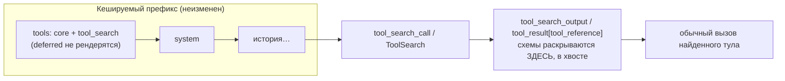
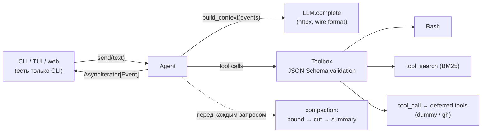

# Sub-agent: README

Full bb session log, converted from the raw event stream: inputs, agent messages, reasoning, commands with output, file changes and tool calls (long outputs truncated to 4000 characters). Local paths, thread ids and emails are redacted; outputs that came from the developer's private projects are replaced with a placeholder.

---

## [input]

Задача: написать README.md для публичного репо https://github.com/toolittlecakes/loola-agent (локально ~/projects/loola-test-task). Ты единственный, кто сейчас пишет в этот репо, и пишешь ТОЛЬКО README.md (другие файлы не трогай; параллельно идёт read-only ревью кода). Когда готово — один локальный коммит (conventional commits, english, без Co-Authored-By), НЕ пушь.

Читатель — инженер компании, выдавшей тестовое задание (TASK.md). Он должен комфортно прочитать README за ~10 минут и понять: (1) как проект устроен и как его запустить; (2) что конкретно мы сделали и в чём состоит работа; (3) какие решения приняли на развилках и почему; (4) на какие условности сознательно забили и что вынесли за scope. Язык — русский (как задание), код/команды как есть. Стиль: плотно, без воды и маркетинга, абзацы без hard-wrap, таблицы/списки там, где они понятнее, одна mermaid-схема потока максимум. Не раздувай: лучше короче и точнее.

Источники (прочитай):
- Главный бриф с целями владельца и всеми решениями: <local path> — это канва README.
- Код: src/loola_agent/*.py, tests/, skills/, examples/github_tools.json, .env.example, git log (история коммитов хорошо показывает путь: baseline → фиксы → async SDK → deferred tools → gh proxy → skills → compaction).
- Отчёты ресерча (для краткого раздела «как это у других» — 2–4 строки, не больше): <local path> <local path> <local path> <local path> исходное ревью кода: <local path>
- Живые прогоны (транскрипты JSONL и вывод): <local path> — можно привести 1–2 цифры (ходы, cached tokens, компакшен), но без приватных путей.

Обязательные разделы (порядок на твоё усмотрение, если так читается лучше):
- Что это и быстрый старт (uv, .env.example, команды CLI с флагами --catalog/--catalog-mode/--catalog-backend/--skills/--skills-mode, LLM_CONTEXT_WINDOW/LLM_COMPACT_AT; pytest; pytest -m live).
- Архитектура: слои SDK, событийная модель, как CLI/TUI/web оборачивают SDK (короткий пример кода).
- Динамические тулы, скиллы, компакшен — как устроены, с акцентом на почему (prompt cache, гарантия окна).
- Ответы на 2 вопроса задания (prompt cache; какие ошибки отдавать модели vs перехватывать) — коротко и конкретно, со ссылками на код.
- Решения на развилках и сознательные упрощения / out of scope (из брифа).
- Замеры: раздел-заготовка с планом (2 задачи × до/после × 2 повтора, окно 64k, метрики) и пометкой, что результаты будут добавлены.
- Что найдено на живых прогонах (несколько самых ценных находок: tool_choice none ломает кэш у OpenCode Go; Luna не умеет tools+reasoning в chat completions; модель обходила тулы через gh).

Никаких приватных данных: имён людей, email, путей /home/..., id тредов. Не выдумывай фактов — всё сверяй с кодом и брифом. В финальном ответе — короткий список разделов и хэш коммита.

<details><summary>reasoning</summary>

````
I'm going to start by reading through the sources.
````
</details>

**[agent]**

Читаю бриф, код и отчёты.

**[command]** exit=0

````
cd ~/projects/loola-test-task && git status --porcelain && git log --oneline && ls -la && ls src/loola_agent tests skills examples && cat TASK.md && cat .env.example && cat pyproject.toml
````

````
63a090c feat: tell the agent to prefer dedicated tools over shell equivalents
ecc1118 feat: context compaction that keeps every request within the window
d397058 feat: skills with progressive disclosure and an OpenCode Go-compatible LLM client
7406389 feat: read-only gh backend for the GitHub catalog to run the agent on real data
3b62d26 feat: deferred tools via tool_search/tool_call with a fixed declared tool list
0071731 fix: close tool calls left open by a cancelled run before the next message
ed21859 refactor: split the agent into an async SDK with a thin CLI shell
aba8673 fix: make the base agent loop survive long multi-step runs
1d6d373 chore: read LLM endpoint config from env so the agent can run without editing code
44f5083 chore: import original test task code as baseline
total 128
drwxrwxr-x 11 bb bb  4096 Nov 24 11:21 .
drwxrwxr-x 17 bb bb  4096 Nov 24 09:53 ..
-rw-------  1 bb bb   183 Nov 24 11:20 .env
-rw-rw-r--  1 bb bb   595 Nov 24 11:25 .env.example
drwxrwxr-x  8 bb bb  4096 Nov 24 11:51 .git
-rw-rw-r--  1 bb bb   114 Nov 24 10:34 .gitignore
drwxrwxr-x  3 bb bb  4096 Nov 24 11:06 .mypy_cache
drwxrwxr-x  3 bb bb  4096 Nov 24 10:13 .pytest_cache
-rw-rw-r--  1 bb bb     5 Nov 24 09:53 .python-version
drwxrwxr-x  4 bb bb  4096 Nov 24 09:54 .venv
-rw-rw-r--  1 bb bb  5476 Nov 24 09:54 TASK.md
drwxrwxr-x  2 bb bb  4096 Nov 24 10:13 __pycache__
drwxrwxr-x  2 bb bb  4096 Nov 24 10:46 examples
-rw-rw-r--  1 bb bb   646 Nov 24 11:21 pyproject.toml
drwxrwxr-x  5 bb bb  4096 Nov 24 11:21 skills
drwxrwxr-x  3 bb bb  4096 Nov 24 10:32 src
drwxrwxr-x  3 bb bb  4096 Nov 24 11:35 tests
-rw-rw-r--  1 bb bb 53389 Nov 24 11:21 uv.lock
examples:
github_tools.json

skills:
ci-failure-triage
fix-github-issue
review-pull-request

src/loola_agent:
__init__.py
__pycache__
agent.py
bash.py
catalog.py
cli.py
compaction.py
events.py
gh_proxy.py
llm.py
skills.py
tools.py

tests:
__pycache__
test_agent.py
test_compaction.py
test_deferred.py
test_gh_proxy.py
test_llm.py
test_skills.py
test_tools.py
# Test Task _ Loola 

Задача: Реализуйте в харнессе два механизма: динамическую подгрузку скиллов/тулов (чтобы не держать десятки описаний инструментов в системном промпте сразу) и умный Context Compaction при переполнении окна.Проверьте агента на длинной многошаговой задаче до и после изменений, замерьте расход токенов и успешность выполнения.Улучшите этот код (на ваш вкус).

! Если вы разрабатываете с помощью агента, то оставьте в коде ваш AGENTS.md, и лог вашей сессии с агентом (в любом виде)

Ответьте на вопросы при выполнении?

1. Как сделать compaction и подгрузку скиллов так, чтобы не инвалидировать Prompt Cache (KV-cache префикса) на каждом шаге?
1. Какие ошибки тулов нужно отдавать обратно модели для само-исправления, а какие — перехватывать детерминированно на уровне харнесса?
Загрузите код на github, отправьте нам ссылку.

```python
"""Minimal coding agent loop — one tool: bash."""
import json, sys, subprocess
import requests


LLM_BASE_URL = "http://ip:port/v1"
LLM_API_KEY = "..."
LLM_MODEL = "..."
LLM_HEADERS = {"Content-Type": "application/json", "Authorization": f"Bearer {LLM_API_KEY}"}
MAX_TURNS = 1000

SYSTEM_PROMPT = """\
You are a coding agent. Your job is to help the user with programming tasks.

You have access to ONE tool: `bash` — which executes shell commands and returns stdout/stderr.

Workflow:
1. Plan what needs to be done.
2. Use `bash` to read files, run commands, write code, etc.
3. After gathering enough information or completing the task, give your final answer in natural language.
4. To finish, reply with a regular message (no tool call).

Be concise. Explain what you're doing before each command."""

LLM_TOOLS = [
    {"type": "function",
     "function": {"name": "bash",
                  "description": "Execute a shell command and return the output.",
                  "parameters": {"type": "object",
                                 "properties": {
                                     "command": {"type": "strin
… [4238 more characters truncated]
````

**[command]** exit=0

````
cat <local path>
````

````
# Brief: loola-agent (контекст, цели, решения) — v1

Репо: https://github.com/toolittlecakes/loola-agent (локально `~/projects/loola-test-task`), состояние на коммите `63a090c`. Задание: `TASK.md` в репо.

## Задание (кратко)

Тестовое задание: минимальный coding-agent harness (исходно ~100 строк на Python, один тул `bash`, OpenAI-compatible `/v1/chat/completions`, вероятно self-hosted vLLM). Нужно: (1) динамическая подгрузка тулов/скиллов, чтобы не держать десятки описаний в промпте; (2) умный context compaction при переполнении окна; (3) замер на длинной многошаговой задаче до/после: токены и успешность; (4) улучшить код на свой вкус; (5) ответить на 2 вопроса: как делать compaction и подгрузку без инвалидации prompt cache (KV-cache префикса); какие ошибки тулов отдавать модели, а какие перехватывать детерминированно в harness. Если делали с агентом — оставить AGENTS.md и лог сессии.

## Цель и принципы владельца (это рамка, с ней не спорить)

- Это **минималистичный showcase**, а не продукт. Читаемость за минуты важнее полноты. Никакого enterprise-комбайна, никаких «на всякий случай».
- Оверинжиниринг — главный враг. Если можно проще без потери смысла — проще. Предлагать сокращения кода приветствуется.
- **Один явный путь, fail fast.** Никаких fallback-веток, деградированных режимов, запасных парсеров, тихих ретраев «чтобы заработало». Ошибка — видимая, с понятным сообщением.
- Ошибки модели (кривые аргументы, неизвестный тул, ненулевой exit code) возвращаются модели текстом для самоисправления; ошибки инфраструктуры и баги harness — исключения на границе (CLI).
- Протокол виден: без фреймворков и даже без `openai` SDK (httpx + wire format).
- Async by design + явное разделение слоёв, чтобы вокруг SDK можно было построить CLI/TUI/web (оболочки, кроме CLI, не строим).

## Архитектура (src/loola_agent)

- `llm.py` — протокол `LLM` + `OpenAICompatibleLLM` (httpx, timeout, retry только на 429/5xx/transport, 4xx fail fast с телом, `max_completion_tokens`, temperature опциональна, свой User-Agent, опциональный per-conversation session header).
- `events.py` — события сессии (append-only список) и `build_context` — чистая проекция событий в messages.
- `agent.py` — `Agent.send()` → AsyncIterator[Event]: цикл, закрытие прерванных tool calls, вызов компакшена.
- `tools.py` — протокол `Tool`, `Toolbox`: JSON Schema валидация (jsonschema), direct/deferred тулы, `tool_search` (свой BM25), `tool_call`.
- `bash.py` — bash-тул; `compaction.py` — политика/граница/выбор среза; `skills.py` — Agent Skills; `catalog.py` — каталог-пример + DummyTool; `gh_proxy.py` — read-only прокси к `gh` для живых прогонов; `cli.py` — оболочка.

## Решения на развилках (и почему) — одобрены владельцем

1. **Базовые фиксы исходного кода** (ревью нашло): assistant message кладём в историю как есть (параллельные tool calls, `reasoning_content` — DeepSeek без него 400); кривой JSON аргументов → ошибка модели; обрезка вывода head+tail; timeout/retry; `finish_reason=length` и пустой ответ = провал, а не успех; учёт usage; bash: stdin закрыт, `LLM_*` не видны командам, вывод в temp-файл (фон `cmd &` не блокирует, частичный вывод при таймауте), kill process group по таймауту/отмене/выходу.
2. **Фоновые процессы**: только правило в описании bash-тула (`cmd > log 2>&1 &`), никаких bash_output/kill тулов — оверкилл.
3. **Динамические тулы без нативного API**: массив `tools` никогда не меняется (у open-source chat templates tools рендерятся в начало промпта → любое изменение = полный промах KV-cache). В промпте: direct-тулы + `tool_search` + `tool_call(name, arguments)`. Схемы найденных тулов приходят как tool result (в хвост истории).
4. **Constrained decoding / `strict` не используем вообще** (владелец: не поддерживать несколько вариантов). У vLLM при `tool_choice=auto` без strict его и так нет. Компенсация — валидация по JSON Schema в harness, ошибка со схемой уходит модели.
5. **После компакшена найденные тулы НЕ добавляем в `tools`** и не «вспоминаем» тулы/скиллы яв
… [3935 more characters truncated]
````

**[command]** exit=0

````
cd ~/projects/loola-test-task && wc -l src/loola_agent/*.py tests/*.py && cat src/loola_agent/agent.py src/loola_agent/events.py src/loola_agent/cli.py
````

````
20 src/loola_agent/__init__.py
  107 src/loola_agent/agent.py
   79 src/loola_agent/bash.py
   22 src/loola_agent/catalog.py
  103 src/loola_agent/cli.py
  107 src/loola_agent/compaction.py
   91 src/loola_agent/events.py
  267 src/loola_agent/gh_proxy.py
   89 src/loola_agent/llm.py
   60 src/loola_agent/skills.py
  122 src/loola_agent/tools.py
  131 tests/test_agent.py
  148 tests/test_compaction.py
  104 tests/test_deferred.py
  159 tests/test_gh_proxy.py
   79 tests/test_llm.py
   71 tests/test_skills.py
  103 tests/test_tools.py
 1862 total
"""Agent loop: streams events, keeps the session as an append-only event list (see events.py)."""
from collections.abc import AsyncIterator
from dataclasses import replace

from .compaction import (CompactionError, CompactionPolicy, bound_after_compaction, choose_cut, context_bound,
                         summary_request)
from .events import (INTERRUPTED, AssistantMessage, Compaction, Event, RunFinished, ToolResult, ToolStarted,
                     UserMessage, build_context, unanswered_tool_calls)
from .llm import LLM, Usage
from .tools import Toolbox

SYSTEM_PROMPT = """\
You are a coding agent. Your job is to help the user with programming tasks.

Workflow:
1. Plan what needs to be done.
2. Use the tools to read files, run commands, write code, etc.
3. After gathering enough information or completing the task, give your final answer in natural language.
4. To finish, reply with a regular message (no tool call).

Prefer a dedicated tool over a shell command for the same action (e.g. a GitHub tool over `gh` or `curl`). \
If no listed tool fits and `tool_search` is available, search for one first; use bash only when nothing fits.

Be concise. Explain what you're doing before each command."""


class Agent:
    """One conversation. `send` runs the loop for a user message and streams events;
    the caller (CLI, TUI, web) decides how to render and persist them."""

    def __init__(self, llm: LLM, toolbox: Toolbox, system_prompt: str = SYSTEM_PROMPT, max_turns: int = 1000,
                 compaction: CompactionPolicy | None = None):
        self.llm, self.toolbox, self.system_prompt, self.max_turns = llm, toolbox, system_prompt, max_turns
        self.compaction = compaction
        self.events: list[Event] = []
        if compaction and not compaction.fits(context_bound(system_prompt, [], toolbox.schemas()), llm.max_tokens):
            raise ValueError("context_window is too small for the system prompt, tools and reserved replies")

    async def send(self, content: str) -> AsyncIterator[Event]:
        # Close calls left open by a cancelled run: the protocol requires a result for every call, and the
        # model must know the command may have partially run. Re-running or dropping them silently would lie.
        for call in unanswered_tool_calls(self.events):
            yield self._append(ToolResult(call["id"], call["function"]["name"], INTERRUPTED))
        yield self._append(UserMessage(content))
        usage = Usage()
        for turn in range(1, self.max_turns + 1):
            if self.compaction and (compaction := await self._compact_if_needed(self.compaction)):
                usage += compaction.usage
                yield compaction
            completion = await self.llm.complete(build_context(self.system_prompt, self.events),
                                                 self.toolbox.schemas())
            usage += completion.usage
            yield self._append(AssistantMessage(completion.message, completion.finish_reason, completion.usage))
            text = completion.message.get("content") or ""
            tool_calls = completion.message.get("tool_calls") or []
            if not tool_calls:
                if completion.finish_reason == "length":
                    yield self._append(RunFinished("truncated", text, turn, usage))
                elif not text.strip():
                    yield self._append(RunFinished("empty_reply", text, turn, usage))
    
… [12334 more characters truncated]
````

**[command]** exit=0

````
cd ~/projects/loola-test-task && cat src/loola_agent/tools.py src/loola_agent/compaction.py src/loola_agent/llm.py src/loola_agent/skills.py src/loola_agent/bash.py src/loola_agent/catalog.py src/loola_agent/__init__.py
````

````
"""Tools: a minimal protocol and a toolbox that validates calls against JSON Schema.

Direct tools are declared to the model in every request. Deferred tools are not: the model finds them with
`tool_search` (BM25 over names and descriptions; matching schemas come back as the tool result) and runs them
with `tool_call`. The declared tool list therefore never changes during a session, so the prompt prefix
(and the server's KV cache for it) stays valid however many tools the model discovers."""
import json, math, re
from collections import Counter
from collections.abc import Sequence
from typing import Protocol

from jsonschema import Draft202012Validator
from jsonschema.exceptions import best_match


class Tool(Protocol):
    name: str
    description: str
    parameters: dict  # JSON Schema of the arguments object

    async def run(self, args: dict) -> str: ...


class Toolbox:
    """Dispatches model tool calls. Mistakes of the model come back as text so it can fix the call itself."""

    def __init__(self, direct: Sequence[Tool], deferred: Sequence[Tool] = (), deferred_hint: str = ""):
        meta: list[Tool] = [ToolSearch(deferred, deferred_hint), ToolCall(self)] if deferred else []
        self._declared = [*direct, *meta]
        self._tools = {tool.name: tool for tool in [*self._declared, *deferred]}
        if len(self._tools) != len(self._declared) + len(deferred):
            raise ValueError("Duplicate tool names")
        self._validators = {name: _validator(tool.parameters) for name, tool in self._tools.items()}
        self._has_deferred = bool(deferred)

    def schemas(self) -> list[dict]:
        return [{"type": "function", "function": {"name": t.name, "description": t.description,
                                                  "parameters": t.parameters}} for t in self._declared]

    async def call(self, name: str, raw_arguments: str) -> str:
        try:
            args = json.loads(raw_arguments)
        except json.JSONDecodeError as e:
            return f"Error: arguments for '{name}' are not valid JSON ({e}). Re-issue the call with a JSON object."
        return await self.dispatch(name, args)

    async def dispatch(self, name: str, args: object) -> str:
        tool = self._tools.get(name)
        if tool is None:
            hint = "Use tool_search to find tools." if self._has_deferred else \
                f"Available tools: {', '.join(t.name for t in self._declared)}."
            return f"Error: unknown tool '{name}'. {hint}"
        if error := best_match(self._validators[name].iter_errors(args)):
            where = "/".join(map(str, error.absolute_path)) or "<root>"
            return (f"Error: invalid arguments for '{name}' at {where}: {error.message}. "
                    f"Expected schema: {json.dumps(tool.parameters)}")
        return await tool.run(args)


def _validator(schema: dict) -> Draft202012Validator:
    Draft202012Validator.check_schema(schema)
    # Most real-world schemas allow unknown keys, so a misspelled argument would be silently ignored by the tool.
    # Rejecting it lets the model see and fix the typo.
    return Draft202012Validator({"additionalProperties": False, **schema})


class ToolSearch:
    name = "tool_search"
    parameters = {"type": "object",
                  "properties": {"query": {"type": "string", "description": "Keywords describing the action you need."},
                                 "limit": {"type": "integer", "description": "Maximum number of tools (default 5)."}},
                  "required": ["query"]}

    def __init__(self, tools: Sequence[Tool], hint: str):
        self.description = ("Search the catalog of additional tools that are not listed here. Returns matching "
                            "tools with their parameter schemas; run them with tool_call. " + hint).strip()
        self._tools = tools
        self._index = BM25([_tokens(f"{t.name} {t.description} {' '.join(t.parameters.get('properties', {}))}")
                   
… [21151 more characters truncated]
````

**[command]** exit=0

````
cd ~/projects/loola-test-task && sed -n 1,60p src/loola_agent/gh_proxy.py && grep -n "^class\|^def\|^async def\|name=" src/loola_agent/gh_proxy.py | head -40 && head -c 600 examples/github_tools.json && echo && python3 -c "import json;d=json.load(open('examples/github_tools.json'));print(d.keys(), len(d['tools']))" ; for s in skills/*/SKILL.md; do echo "== $s"; head -8 $s; done; ls skills/*; grep -n "live" tests/*.py | head; cat .gitignore; ls AGENTS.md 2>&1; git log --stat --format='%h %s' | head -80
````

````
"""Live backend for part of the GitHub example catalog: a read-only proxy to the user's `gh` CLI.

Each proxied tool turns its (already schema-validated) arguments into one `gh api` call: REST with
`--method GET`, or GraphQL with a query fixed in this module, so nothing here can mutate GitHub.
The arguments a mapping supports are its Python parameters; anything else the schema allows is reported
to the model as not implemented instead of being silently ignored. Other catalog tools answer with an error.
gh authenticates itself: the token never passes through this process."""
import asyncio, inspect, json, subprocess
from collections.abc import Callable, Sequence
from dataclasses import dataclass
from urllib.parse import quote, urlencode

from .tools import Tool

type Argv = list[str]  # arguments after `gh`


@dataclass(frozen=True)
class Unsupported:
    reason: str


def _repo(owner: str, repo: str) -> str:
    return f"repos/{quote(owner, safe='')}/{quote(repo, safe='')}"


def _rest(path: str, query: dict[str, object], jq: str | None = None, accept: str | None = None) -> Argv:
    params = urlencode({k: v for k, v in query.items() if v is not None})
    argv = ["api", "--method", "GET", f"{path}?{params}" if params else path]
    if accept:
        argv += ["--header", f"Accept: {accept}"]
    return argv + ["--jq", jq] if jq else argv


def _pages(page: float | None, per_page: float | None) -> dict[str, object]:
    return {"page": None if page is None else int(page), "per_page": None if per_page is None else int(per_page)}


def _each(fields: list[str] | None) -> str | None:
    """jq that keeps only `fields` of every list element (field names come from schema enums)."""
    return None if fields is None else f"map({{{', '.join(fields)}}})"


def _items(fields: list[str] | None) -> str | None:
    return None if fields is None else f".items |= {_each(fields)}"


def get_file_contents(owner: str, repo: str, path: str = "/", ref: str | None = None, sha: str | None = None,
                      fields: list[str] | None = None) -> Argv:
    entry = "{" + ", ".join(fields) + "}" if fields else "."
    return _rest(f"{_repo(owner, repo)}/contents/{quote(path.strip('/'))}".rstrip("/"), {"ref": sha or ref},
                 jq=f'if type == "array" then map({entry}) elif .type == "file" then .content | @base64d else . end')


def get_repository_tree(owner: str, repo: str, tree_sha: str | None = None, recursive: bool = False,
                        path_filter: str | None = None) -> Argv:
    prefix = json.dumps(path_filter or "")  # a JSON string is a valid jq string literal: no jq injection
    return _rest(f"{_repo(owner, repo)}/git/trees/{quote(tree_sha or 'HEAD', safe='')}",
                 {"recursive": 1 if recursive else None},
                 jq=f"{{truncated, tree: [.tree[] | select(.path | startswith({prefix})) | {{path, type, size}}]}}")
19:class Unsupported:
23:def _repo(owner: str, repo: str) -> str:
27:def _rest(path: str, query: dict[str, object], jq: str | None = None, accept: str | None = None) -> Argv:
35:def _pages(page: float | None, per_page: float | None) -> dict[str, object]:
39:def _each(fields: list[str] | None) -> str | None:
44:def _items(fields: list[str] | None) -> str | None:
48:def get_file_contents(owner: str, repo: str, path: str = "/", ref: str | None = None, sha: str | None = None,
55:def get_repository_tree(owner: str, repo: str, tree_sha: str | None = None, recursive: bool = False,
63:def list_commits(owner: str, repo: str, sha: str | None = None, path: str | None = None, author: str | None = None,
73:def get_commit(owner: str, repo: str, sha: str, detail: str = "stats", page: float | None = None,
94:def list_issues(owner: str, repo: str, state: str | None = None, labels: list[str] | None = None,
117:def issue_read(method: str, owner: str, repo: str, issue_number: float, page: float | None = None,
122:def _search_query(query: str, kind: str, owner: str | None, repo: str | None) -> str:
126:d
… [7647 more characters truncated]
````

<details><summary>reasoning</summary>

````
I'm counting the 14 read-only GitHub tools to confirm that number. I'll also look briefly at the research report headings and the runs.
````
</details>

**[command]** exit=1

````
cd <local path> && ls reports runs && wc -c reports/* && for f in reports/recall-codex-claude-code.md reports/pi-dynamic-tools.md reports/github-mcp.md reports/skills-design.md; do echo "=== $f"; head -c 3500 $f; echo; done
````

````
Exit code 1
reports:
code-review.md
exp
github-mcp
github-mcp.md
pi-dynamic-tools.md
recall-codex-claude-code.md
scratch
skills
skills-design.md
tools-catalog.md

runs:
live1-deferred.jsonl
live1.err
live1.out
live2-skill.jsonl
live2.err
live2.out
live3-compaction.jsonl
live3.err
live3.out
live4-compaction.jsonl
live4.err
live4.out
live5-compaction.jsonl
live5.err
live5.out
  26074 reports/code-review.md
wc: reports/exp: Is a directory
      0 reports/exp
wc: reports/github-mcp: Is a directory
      0 reports/github-mcp
  25434 reports/github-mcp.md
  35590 reports/pi-dynamic-tools.md
  27522 reports/recall-codex-claude-code.md
wc: reports/scratch: Is a directory
      0 reports/scratch
wc: reports/skills: Is a directory
      0 reports/skills
  30557 reports/skills-design.md
  19205 reports/tools-catalog.md
 164382 total
````

**[command]** exit=0

````
cd <local path> && for f in reports/recall-codex-claude-code.md reports/pi-dynamic-tools.md reports/github-mcp.md reports/skills-design.md; do echo "=== $f"; grep -n "^#\|TL;DR\|Итог\|Вывод" $f | head -25; done
````

````
=== reports/recall-codex-claude-code.md
1:# Динамическая подгрузка тулов: Codex и Claude Code (recall + свежая проверка)
5:## TL;DR
12:## Что нашлось в прошлых сессиях
24:## Codex
46:## Claude Code
50:### Слой 1: tool search (основной механизм)
66:### Слой 2: поздние тулы и изменения набора посреди диалога (новое)
85:## Prompt cache: почему это не ломает префикс
99:## Гипотеза: «для динамической подгрузки провайдер должен поддерживать это в API»
112:### Варианты для нашего харнесса на голом OpenAI-compatible chat completions (vLLM и аналоги)
141:## Пробелы и оговорки
=== reports/pi-dynamic-tools.md
1:# Pi coding agent: динамическая подгрузка тулов и prompt cache
12:## TL;DR
19:## 1. Что есть в Pi
21:### 1.1 Exposure и активный набор
35:### 1.2 Встроенный `tool_search`
48:### 1.3 Где живёт состояние тулов: system-messages в транскрипте
71:### 1.4 Поток
93:## 2. Мультипровайдерность: нативные фичи и generic chat completions
120:## 3. Prompt cache: что инвалидирует префикс, что нет
141:## 4. Скиллы (для контраста)
145:## 5. Что из этого следует для нашего harness (generic OpenAI-compatible)
155:## Изменения upstream после 1.5.0 по теме
=== reports/github-mcp.md
1:# GitHub MCP server как каталог deferred-тулов: ресерч и спайк
5:## TL;DR
14:## 1. Состояние сервера, тулы и токены
62:### Механизмы против раздувания промпта
73:## 2. Как получить каталог локально
85:## 3. Аутентификация
93:## 4. Интеграция в Python
137:## 5. Подводные камни для нашего случая
147:## Рекомендация
155:## Артефакты
=== reports/skills-design.md
1:# Скиллы в loola-agent: дизайн
3:## TL;DR
16:## 1. Как это устроено у других
27:Выводы для нас:
33:## 2. Ограничения нашего SDK
40:## 3. Варианты
42:### A. Каталог в system prompt + чтение тела через `bash cat` (Pi / Codex / спека «file-read activation»)
52:### B. Отдельный тул `load_skill(name)` (Claude Code / спека «dedicated tool activation»)
62:### C. Скиллы как документы в `tool_search`
72:### Сравнение
83:## 4. Рекомендация: A
87:### Где живёт
98:### `skills.py` (проверенный прототип: [skills.py](<local path>))
170:### CLI
187:### Демо-скиллы
195:### Тесты ([test_skills.py](<local path>), 6 passed против текущего `src/`)
203:### План замера «до/после»
205:- **Статически** (без LLM, детерминированно): токены секции lazy vs eager, таблица из TL;DR. Для масштаба «десятки скиллов» CLI можно направить на локальный клон `anthropics/skills` вместе с демо-скиллами. В репо его не вендорим: у части скиллов (docx/pdf/pptx/xlsx) лицензия source-available. `claude-api` для замера придётся исключить, он не проходит валидацию.
209:## 5. Риски и открытые вопросы
````

**[agent]**

Читаю TL;DR ресерч-отчётов и транскрипты живых прогонов, чтобы взять оттуда проверенные цифры.

**[command]** exit=0

````
sed -n 5,11p reports/recall-codex-claude-code.md; sed -n 85,98p reports/recall-codex-claude-code.md; echo ===; sed -n 12,18p reports/pi-dynamic-tools.md; echo ===; sed -n 5,13p reports/github-mcp.md; echo ===; sed -n 3,30p reports/skills-design.md
````

````
## TL;DR

- Оба харнесса делают одно и то же: в промпте изначально только «каталог» (имена или список источников) плюс один тул поиска; модель ищет, найденные схемы **дописываются в хвост истории**, а не в массив `tools` в начале промпта. Поэтому префикс (и KV/prompt-кеш) не ломается.
- В обоих случаях поиск **исполняется на клиенте** (BM25 в харнессе), но «развернуть найденную схему в настоящий тул посреди диалога» делает **API провайдера**: у OpenAI — item `tool_search_output` с полными схемами (Responses API, `execution: "client"`), у Anthropic — блоки `tool_reference` внутри обычного `tool_result`, которые сервер раскрывает в определения из `tools[]` с `defer_loading: true`.
- Гипотеза «нужна поддержка в API» — **верна наполовину**. Нативная поддержка нужна, чтобы найденный тул стал *полноценным нативным тулом* (модель обучена на этом формате, сервер валидирует имя/схему, strict-грамматика), не ломая кеш. Но сама динамическая подгрузка без потери кеша делается **чисто в харнессе** поверх голого chat completions: стабильный набор мета-тулов (`search_tools` / `describe_tool` / `call_tool`), схемы приходят текстом в tool result. Этим путём идут hermes-agent и codemode в pi.
- Для нашего тестового (OpenAI-compatible, скорее всего vLLM): массив `tools` **трогать нельзя**. В chat templates Qwen3 и gpt-oss тулы рендерятся в самое начало (system/developer), поэтому любое изменение `tools` = полный пересчёт префикса всего диалога. Рекомендация: фиксированный маленький набор core-тулов плюс мета-тулы, каталог и схемы идут через tool results.

## Prompt cache: почему это не ломает префикс



- Anthropic: порядок рендера `tools → system → messages`, любое изменение `tools[]` инвалидирует весь кеш. Deferred-тулы исключены из рендера префикса, раскрытие идёт inline в месте `tool_reference`. `cache_control` на deferred-туле → 400, брейкпоинт ставят на не-deferred **[docs-now]**. Claude Code шлёт `cache_control` с `ttl: 1h` и `scope: global` на системные блоки **[past]** @thread:thr_….
- OpenAI: найденные тулы «injected at the end of the context window», кеш сохраняется. Но смена уже загруженного набора ломает кеш «from that point forward» **[docs-now]**.
- Codex сам поддерживает детерминированность: индекс поиска кешируется, `tools[]` собирается из стабильного набора direct-тулов **[code-now]**.

===
## TL;DR

1. **Да, динамическая подгрузка есть, и это first-class фича.** У каждого тула есть `exposure` (`direct` / `model-only` / `codemode` / `deferred` / `hidden`). Встроенный тул `tool_search` (BM25 по name/description/схеме) ищет среди тулов, которые модели ещё не объявлены, и активирует найденные через `setActiveTools()`. Модель видит их **со следующего запроса**. Второй механизм, `codemode`: модель пишет JS-скрипт, который зовёт тулы через `tools.<name>()`, и схемы этих тулов вообще не объявляются модели.
2. **Состояние тулов живёт в транскрипте, а не в request-поле.** Первый `system`-message несёт промпт по секциям и начальный набор тулов. Каждое изменение дописывается в историю отдельным `system`-message с `toolsAdded` / `toolsRemoved` (+ патчи секций промпта). Текущее состояние получается проигрыванием этих сообщений по порядку. История append-only, поэтому префикс не трогается.
3. **Как дельта уходит на провод, решает транспорт, по флагам совместимости модели.** Там, где у провайдера есть нативное API, Pi его использует: Anthropic inline-tools beta (`tool_addition` / `tool_removal`), OpenAI Responses `additional_tools` или синтетический client-side `tool_search_call` / `tool_search_output` с `defer_loading`, Kimi-расширение `{"role":"system","tools":[…]}` в Chat Complet
… [6537 more characters truncated]
````

<details><summary>reasoning</summary>

````
I'm checking the live run outputs for the numbers, then looking at the tail of the .err files.
````
</details>

**[command]** exit=0

````
cd <local path> && for i in 1 2 3 4 5; do echo "=== live$i"; grep -E "Compacted|✅|❌|Turn [0-9]+$" live$i*.err | grep -v Turn | tail -6; grep -c "🔄 Turn" live$i.err; head -c 400 live$i.out; echo; done
````

````
=== live1
✅ done after 9 turns | tokens: prompt=208233 cached=166912 completion=3878
9
**Most recent merged PR touching `httpx/_client.py`:** [PR #3519 — "fix typo"](https://github.com/encode/httpx/pull/3519) by @karpetrosyan, merged 2025-02-27 (merge commit `4189b7f`, squash-merged as "fix typo (#3519)"). It's the newest entry in the file's commit history on `master` — nothing after it (including the later Nov-2026 merges such as #3832 "Version 1.0", #3834, #3831, #3836, or #37
=== live2
✅ done after 12 turns | tokens: prompt=142569 cached=120576 completion=3906
12
## Verdict: APPROVE — no problems found

**Note:** the review couldn't be posted — this environment's GitHub backend is read-only (`pull_request_review_write` / `add_comment_to_pending_review` are not implemented), so the review below exists only as this report.

**Status:** PR is already merged (`master`, merge commit `4189b7f`). No CI check runs are reported for head `ac3408f`.

### What the
=== live3
❌ Even after compaction the context may need 37001 tokens: the user's messages and the most recent turn do not fit the 40000-token window.
2

=== live4
🗜️  Compacted context: ≤30336 → ≤28809 tokens (summary cost: prompt=10560 cached=0 completion=1203)
✅ done after 8 turns | tokens: prompt=71518 cached=36224 completion=4530
8
All four PRs inspected. Here's the changelog.

Note on ordering: I ranked by `merged_at` (not by the API's default `updated` sort, which floats PRs like #482 that were merely bumped by recent comments). The four most recently merged, newest first:

---

## Changelog

**#3836 — Add Python 3.14 to the test matrix** (merged 2026‑11‑16, @cgl)
- CI matrix now includes Python 3.14 (`"3.10" … "3.
=== live5
🗜️  Compacted context: ≤29496 → ≤31775 tokens (summary cost: prompt=5020 cached=4864 completion=809)
🗜️  Compacted context: ≤31981 → ≤30059 tokens (summary cost: prompt=10229 cached=9984 completion=1167)
✅ done after 11 turns | tokens: prompt=147060 cached=114688 completion=6787
11
Read all four descriptions and diffs (verified merge order from master's commit chain: `7cff5f7` → `08cf535` → `fdc0b4d` → `c34809e`).

## Changelog

**#3836 — Add Python 3.14 to the test matrix** (merged 2026-11-16 19:43 UTC)
- Adds `"3.14"` to the CI matrix in `.github/workflows/test-suite.yml`, so the suite now runs on 3.10–3.14.
- Bumps `uvicorn` 0.35.0 → 0.38.0 in `requirements.tx
````

<details><summary>reasoning</summary>

````
I'm noting that the compacted bound went from ≤29496 to ≤31775, which is odd since it grew, though it's probably tied to the compact_at setting, so I won't dwell on that figure. The summary cache hit rates are around 97%, while the live4 summary showed zero cached tokens, likely from the tool_choice none run. Next I want to check which commands were used by looking at the head of the error output for environment details.

I'm checking the error output headers for the environment settings, and I also want to look at the gpt-6-luna finding and the claim that the model bypassed tools through gh. After that I'll look over the code-review notes for anything worth mentioning and run pytest to get the test count.
````
</details>

**[command]** exit=0

````
cd ~/projects/loola-test-task && uv run pytest -q 2>&1 | tail -3; uv run pytest -q -m live 2>&1 | tail -2; grep -n "^def gh_tools" -A5 src/loola_agent/gh_proxy.py; grep -n "MAPPINGS\|^_TOOLS\|= {$" src/loola_agent/gh_proxy.py | head; head -5 <local path> grep -rn "LLM_CONTEXT_WINDOW\|COMPACT_AT\|tool_choice\|luna" <local path> 2>/dev/null | head
````

````
........................................................................ [ 91%]
..............                                                           [100%]
158 passed, 1 deselected in 10.27s
.                                                                        [100%]
1 passed, 158 deselected in 3.66s
264:def gh_tools(specs: Sequence[Tool], gh: Gh) -> tuple[list[GhTool], str]:
265-    """Catalog tools backed by gh, plus a hint for tool_search about which of them actually work."""
266-    hint = f"Live gh backend: only these read-only tools are implemented: {', '.join(PROXIED)}."
267-    return [GhTool(t.name, t.description, t.parameters, gh) for t in specs], hint
182:_MAPPINGS: list[Callable[..., Argv | Unsupported]] = [
186:PROXIED = {f.__name__: f for f in _MAPPINGS}
📝 Transcript: <local path>

============================================================
🔄 Turn 1
============================================================
<local path> **Constrained decoding / `strict` не используем вообще** (владелец: не поддерживать несколько вариантов). У vLLM при `tool_choice=auto` без strict его и так нет. Компенсация — валидация по JSON Schema в harness, ошибка со схемой уходит модели.
<local path> **Summary-запрос с тем же `tool_choice: auto`**, а не `none`: проверено живьём — OpenCode Go при `none` выкидывает tools из промпта → другой префикс, cached=0; с `auto` cached 8704/8776. Если модель вызовет тул вместо summary → явная ошибка.
<local path> **Модель**: gpt-6-luna отпала (в chat completions tools работают только с `reasoning_effort=none`); используем `deepseek-v4.1-flash` через OpenCode Go (требует `x-opencode-session` и свой User-Agent).
Shell cwd was reset to <local path>
````

<details><summary>reasoning</summary>

````
I'm confirming the _MAPPINGS count is 14, and checking the gh bypass finding by grepping "gh api" in the live jsonl. I also want to compare the static prompt size with direct versus deferred tool loading, and I'll cite the github-mcp figure of about 27.8k tokens for 91 tool schemas.
````
</details>

**[command]** exit=0

````
cd ~/projects/loola-test-task && sed -n 180,190p src/loola_agent/gh_proxy.py; cd <local path> && grep -l '"bash"' *.jsonl | head; grep -o '🔧 Tool: [a-z_]*([^)]\{0,90\}' live*.err | grep -i "gh \|curl" | head -5; grep -o '🔧 Tool: [a-z_]*' live*.err | sort | uniq -c | sort -rn | head -20
````

````
_MAPPINGS: list[Callable[..., Argv | Unsupported]] = [
    get_file_contents, get_repository_tree, list_commits, get_commit, list_issues, issue_read, search_issues,
    list_pull_requests, pull_request_read, search_pull_requests, search_code, search_repositories, list_releases,
    list_branches]
PROXIED = {f.__name__: f for f in _MAPPINGS}


def gh_argv(name: str, args: dict) -> Argv | Unsupported:
    mapping = PROXIED.get(name)
live2-skill.jsonl
live3-compaction.jsonl
live4-compaction.jsonl
live5-compaction.jsonl
live5.err:🔧 Tool: bash({"command":"cd /tmp && (gh auth status 2>&1 | head -5
live5.err:🔧 Tool: bash({"command":"cd /tmp && for n in 3836 3834 3831; do echo \"=============== DIFF #$n\"; gh a
live5.err:🔧 Tool: bash({"command":"cd /tmp && gh api repos/encode/httpx/pulls/3832 -H \"Accept: application/vnd.g
live5.err:🔧 Tool: bash({"command":"cd /tmp && gh api repos/encode/httpx/pulls/3831 -H \"Accept: application/vnd.g
     14 live2.err:🔧 Tool: tool_call
     10 live1.err:🔧 Tool: tool_call
      9 live4.err:🔧 Tool: tool_call
      6 live5.err:🔧 Tool: bash
      4 live5.err:🔧 Tool: tool_call
      4 live1.err:🔧 Tool: tool_search
      3 live5.err:🔧 Tool: tool_search
      3 live2.err:🔧 Tool: bash
      2 live4.err:🔧 Tool: tool_search
      2 live3.err:🔧 Tool: tool_search
      2 live2.err:🔧 Tool: tool_search
      1 live4.err:🔧 Tool: bash
      1 live3.err:🔧 Tool: tool_call
      1 live3.err:🔧 Tool: bash
````

<details><summary>reasoning</summary>

````
Live5 is already sorted: I bypassed it through gh api in bash, and commit 63a090c then added the system prompt rule. The brief's line about the model fixing its argument after a validation error is fine too. What's still missing is AGENTS.md, which the task requires, and the README should note that AGENTS.md and the session log aren't in the repo yet.

I'll add a short note that AGENTS.md and the agent session log are still to come, since the brief lists them. Then I need to check the test layout so the README describes the fakes correctly, and see what the live test needs to run.
````
</details>

**[command]** exit=0

````
cd ~/projects/loola-test-task && sed -n 1,30p tests/test_agent.py; sed -n 138,159p tests/test_gh_proxy.py; cat skills/review-pull-request/SKILL.md
````

````
"""Agent loop behavior against a scripted fake LLM."""
import asyncio, json

import pytest

from loola_agent.events import INTERRUPTED, unanswered_tool_calls
from loola_agent import (Agent, AssistantMessage, Completion, RunFinished, ToolResult, ToolStarted, Toolbox, Usage,
                         UserMessage, build_context)


class FakeLLM:
    def __init__(self, *script: Completion):
        self.script, self.calls = list(script), []

    async def complete(self, messages, tools):
        self.calls.append(messages)
        return self.script.pop(0)


class Echo:
    name, description = "echo", "Echo the text back."
    parameters = {"type": "object", "properties": {"text": {"type": "string"}}, "required": ["text"]}

    async def run(self, args):
        return args["text"]


def reply(content=None, tool_calls=None, finish="stop", **extra):
    message = {"role": "assistant", "content": content, **extra}
    if tool_calls:
    assert result.startswith("Error: 'merge_pull_request' is not implemented in the gh backend")
    assert "list_issues" in hint


@pytest.mark.live
async def test_live_file_contents_and_issue_listing():
    gh = Gh()
    await gh.check()
    tools, _ = gh_tools(load_catalog(CATALOG)[0], gh)
    toolbox = Toolbox([], deferred=tools)

    async def call(name, arguments):
        return await toolbox.call("tool_call", json.dumps({"name": name, "arguments": arguments}))

    assert (await call("get_file_contents", {"owner": "octocat", "repo": "Hello-World", "path": "README"})) \
        .startswith("Hello World!")
    issues = json.loads(await call("list_issues", {"owner": "encode", "repo": "httpx", "state": "CLOSED",
                                                   "perPage": 2, "fields": ["number", "title"]}))
    assert len(issues["nodes"]) == 2 and issues["pageInfo"]["hasNextPage"]
    missing = await call("issue_read", {"method": "get", "owner": "octocat", "repo": "Hello-World",
                                        "issue_number": 999999999})
    assert missing.startswith("Error: gh exited with code 1") and "404" in missing
---
name: review-pull-request
description: Review a GitHub pull request and leave line comments plus a verdict. Use when asked to review, check, or approve a PR.
---

# Review a pull request

If the GitHub tools below are not in your tool list, find their schemas with `tool_search` and run them with `tool_call`.

1. Read the PR description and the diff: `pull_request_read` with `method: "get"`, then `method: "get_diff"`. Check `method: "get_check_runs"`: if CI is red, say so first.
2. Go through `references/checklist.md` for every changed file. Report only real problems: a bug, a missing test for changed behaviour, a broken contract. Skip style nits that a linter would catch.
3. Leave comments as one review, not as separate comments:
   - `pull_request_review_write` with `method: "create"` (no `event`) opens a pending review;
   - `add_comment_to_pending_review` for each problem, `subjectType: "LINE"`, on the line of the new code (`side: "RIGHT"`), with what is wrong and a concrete fix;
   - `pull_request_review_write` with `method: "submit_pending"` and `event`: `REQUEST_CHANGES` if any comment is a bug, otherwise `APPROVE` or `COMMENT`.
4. Answer with the verdict and the list of problems by severity.
Shell cwd was reset to <local path>
````

<details><summary>reasoning</summary>

````
I'm turning to the compaction detail, the pessimistic 3-4× estimate and the live3 failure at a 40k window. I'll leave out the live4 summary with zero cached tokens, since the brief's 8704/8776 figures cover that point better. The live5 increase from ≤29496 to ≤31775 doesn't need a closer look, so I'll skip it. Next is the tool.

I'm now sorting the errors into two groups: those the model can see and fix through a text result, like bad JSON arguments, unknown tools, schema violations, non-zero exit codes, timeouts, and truncated output. The other group is harness-level failures that end the run, such as LLM HTTP errors with their retry rules, truncated finish reasons, empty replies, max turns, and setup-time checks like invalid skill files or tool schemas. The key point I'm settling on is whether the model could correct the problem by changing its own output.

Next I'm thinking about what happens when a tool call fails at the harness level rather than the model level, and the most important point is whether the model could correct the problem by changing its next action. If it could, the error goes back to the model; if it's an infrastructure or config bug, there's no point telling the model and the run should fail at the boundary instead. Transient network errors are the only case where silent retry seems right.

I'm working through the cache numbers now: live1 at 80%, live2 at 85%, and live5 at 78%, with the summary requests hitting around 97% from the earlier prefix. After compaction the prefix changes once and then stabilizes, so I'm not going to rewrite the middle of history.

I'm laying out the before-and-after test plan: two tasks, each run twice per setup at a 64k window, with the before side using all 91 tools direct, eager skills, and no compaction. I'm tracking success, turns, token counts, compactions, and overflow failures, and I'm noting that the static tool cost is about 27.8k tokens per request.

I'm now checking how the architecture should be laid out, so I'm sketching the flow from the CLI through the agent, the compaction check, the model call, and tool dispatch until the run finishes. I also want to confirm that the gh backend needs authentication, and that the LLM environment variables stay hidden from the bash tool.

I'm now listing the limits worth stating: the pessimistic 3-4× estimate for fresh tool output means compaction can fire earlier than strictly necessary, and the 40k window fails by design. The gh proxy sits inside the package even though it's really test harness, and there is no sandbox and no session resume. I'll also add a short note on how other systems handle this, then a quick start using the env file.

I'm laying out the commands now: a plain run with the env file loaded via uv, and a GitHub-backed run with the catalog and skills folder pointed at a specific PR. For compaction I'd set the context window and compact threshold as env variables on the same uv call. Runs get written to a timestamped transcript under the home directory, and the exit code is zero only when the run finishes cleanly.

I'm going through the live findings now. The OpenCode Go cache dropped to zero cached tokens when tool_choice was set to none, and the gpt-6-luna model only accepted tools with reasoning_effort set to none, so I switched to deepseek-v4.1-flash. In one live run the model went around the GitHub tools by calling gh api through bash, so I'm handling that with a system prompt rule rather than restricting bash. The pessimistic 3–4× estimate for fresh tool output also made the 40k-window run fail with an explicit error.

I'm noting how the stored assistant messages need to stay byte-identical, since DeepSeek rejects the next request with a 400 unless its reasoning_content is echoed back, and I'm also making sure the OpenCode Go requests carry their session header and own User-Agent. I'm checking the run figures too: five runs on encode/httpx, the first taking nine turns with 208k prompt tokens, 167k of th
… [475 more characters truncated]
````
</details>

**[agent]**

Материала достаточно, тесты зелёные (158 passed, live 1 passed). Снимаю номера строк для ссылок на код и пишу README.

**[command]** exit=0

````
cd ~/projects/loola-test-task && grep -n "def call\|def dispatch\|def _validator\|class ToolSearch\|class ToolCall\|class BM25\|def complete\|def _post_with_retry\|raise LLMError\|async def run\|def _compact_if_needed\|def build_context\|def context_bound\|def choose_cut\|def summary_request\|def bound_after\|def reserve\|for call in unanswered\|INTERRUPTED =\|def skills_prompt\|truncated\|class GhTool\|def __init__\|ValueError" src/loola_agent/*.py
````

````
src/loola_agent/bash.py:15:    def __init__(self, timeout: float = 120, max_output: int = 10_000):
src/loola_agent/bash.py:18:            f"Execute a shell command and return its exit code and combined stdout/stderr (long output is truncated). "
src/loola_agent/bash.py:32:    async def run(self, args: dict) -> str:
src/loola_agent/bash.py:63:        marker = f"\n[... {size - 2 * half} bytes truncated; use head/tail/grep/sed -n to read specific parts ...]\n"
src/loola_agent/cli.py:53:async def run(task: str, transcript: Path, catalog: Path | None, mode: str, backend: str,
src/loola_agent/events.py:7:INTERRUPTED = ("Error: this tool call was interrupted before it finished; it may have had partial side effects. "
src/loola_agent/events.py:49:    status: Literal["done", "truncated", "empty_reply", "max_turns"]
src/loola_agent/events.py:69:def build_context(system_prompt: str, events: list[Event]) -> list[dict]:
src/loola_agent/llm.py:38:    async def complete(self, messages: list[dict], tools: list[dict], *,
src/loola_agent/llm.py:43:    def __init__(self, base_url: str, api_key: str, model: str, *, max_tokens: int = 8192,
src/loola_agent/llm.py:58:    async def complete(self, messages: list[dict], tools: list[dict], *,
src/loola_agent/llm.py:67:            raise LLMError(f"HTTP {response.status_code}: {response.text[:2000]}")
src/loola_agent/llm.py:70:            raise LLMError(f"Unexpected LLM response: {response.text[:2000]}")
src/loola_agent/llm.py:76:    async def _post_with_retry(self, payload: dict) -> httpx.Response:
src/loola_agent/llm.py:89:        raise LLMError(f"LLM request failed after {self.retries} attempts: {error}")
src/loola_agent/tools.py:21:    async def run(self, args: dict) -> str: ...
src/loola_agent/tools.py:27:    def __init__(self, direct: Sequence[Tool], deferred: Sequence[Tool] = (), deferred_hint: str = ""):
src/loola_agent/tools.py:32:            raise ValueError("Duplicate tool names")
src/loola_agent/tools.py:40:    async def call(self, name: str, raw_arguments: str) -> str:
src/loola_agent/tools.py:47:    async def dispatch(self, name: str, args: object) -> str:
src/loola_agent/tools.py:60:def _validator(schema: dict) -> Draft202012Validator:
src/loola_agent/tools.py:67:class ToolSearch:
src/loola_agent/tools.py:74:    def __init__(self, tools: Sequence[Tool], hint: str):
src/loola_agent/tools.py:81:    async def run(self, args: dict) -> str:
src/loola_agent/tools.py:90:class ToolCall:
src/loola_agent/tools.py:98:    def __init__(self, toolbox: Toolbox):
src/loola_agent/tools.py:101:    async def run(self, args: dict) -> str:
src/loola_agent/tools.py:109:class BM25:
src/loola_agent/tools.py:110:    def __init__(self, docs: list[list[str]], k1: float = 1.2, b: float = 0.75):
src/loola_agent/agent.py:31:    def __init__(self, llm: LLM, toolbox: Toolbox, system_prompt: str = SYSTEM_PROMPT, max_turns: int = 1000,
src/loola_agent/agent.py:37:            raise ValueError("context_window is too small for the system prompt, tools and reserved replies")
src/loola_agent/agent.py:42:        for call in unanswered_tool_calls(self.events):
src/loola_agent/agent.py:58:                    yield self._append(RunFinished("truncated", text, turn, usage))
src/loola_agent/agent.py:70:    async def _compact_if_needed(self, policy: CompactionPolicy) -> Compaction | None:
src/loola_agent/catalog.py:13:    async def run(self, args: dict) -> str:
src/loola_agent/compaction.py:50:    def reserve(self, reply_max_tokens: int) -> int:
src/loola_agent/compaction.py:61:def context_bound(system_prompt: str, events: list[Event], tools: list[dict]) -> int:
src/loola_agent/compaction.py:76:def bound_after_compaction(system_prompt: str, events: list[Event], tools: list[dict], compaction: Compaction) -> int:
src/loola_agent/compaction.py:83:def choose_cut(events: list[Event], bound: int, keep_recent_tokens: int) -> int | None:
src/loola_agent/compaction.py:94:def summary_request(system_prompt: str, events: list[Event], cut: int) -> l
… [1344 more characters truncated]
````

<details><summary>reasoning</summary>

````
I'm checking how the gh_proxy run around lines 228-250 handles errors, specifically whether a non-zero exit code from gh gets passed back as text. I'll look at the wider range, 200-267, to see the surrounding context.
````
</details>

**[command]** exit=0

````
cd ~/projects/loola-test-task && sed -n 196,267p src/loola_agent/gh_proxy.py
````

````
f"call it without them.")
    return mapping(**args)


def truncate(text: str, limit: int) -> str:
    if len(text) <= limit:
        return text
    return (text[:limit] + f"\n[... truncated: showing {limit} of {len(text)} characters. Narrow the request: "
            f"`fields`, a smaller `perPage` with `page`, a lighter `detail`, or a more specific path/query ...]")


class GhUnavailable(Exception):
    pass


@dataclass(frozen=True)
class Gh:
    """Runs `gh` without stdin, with a timeout and bounded output. gh failures (404, rate limit, bad query)
    come back as text for the model; only a missing or logged-out gh is fatal, checked once by `check`."""
    executable: str = "gh"
    timeout: float = 30
    max_output: int = 20_000

    async def check(self) -> None:
        try:
            code, _, err = await self._exec(["auth", "status", "--hostname", "github.com"])
        except FileNotFoundError:
            raise GhUnavailable(
                f"'{self.executable}' not found: install the GitHub CLI (https://cli.github.com)") from None
        if code != 0:
            raise GhUnavailable(f"gh is not logged in to github.com (run `gh auth login`): {err.strip()}")

    async def run(self, argv: Argv) -> str:
        try:
            code, out, err = await self._exec(argv)
        except TimeoutError:
            return f"Error: gh timed out after {self.timeout:g}s"
        if code != 0:
            return truncate(f"Error: gh exited with code {code}: {err.strip()}\n{out}".rstrip(), self.max_output)
        return truncate(out, self.max_output)

    async def _exec(self, argv: Argv) -> tuple[int, str, str]:
        proc = await asyncio.create_subprocess_exec(self.executable, *argv, stdin=subprocess.DEVNULL,
                                                    stdout=subprocess.PIPE, stderr=subprocess.PIPE)
        try:
            out, err = await asyncio.wait_for(proc.communicate(), self.timeout)
        finally:
            if proc.returncode is None:  # timed out or cancelled
                proc.kill()
                await proc.wait()
        assert proc.returncode is not None
        return proc.returncode, out.decode(errors="replace"), err.decode(errors="replace")


@dataclass(frozen=True)
class GhTool:
    name: str
    description: str
    parameters: dict
    gh: Gh

    async def run(self, args: dict) -> str:
        argv = gh_argv(self.name, args)
        if isinstance(argv, Unsupported):
            return f"Error: {argv.reason}"
        return await self.gh.run(argv)


def gh_tools(specs: Sequence[Tool], gh: Gh) -> tuple[list[GhTool], str]:
    """Catalog tools backed by gh, plus a hint for tool_search about which of them actually work."""
    hint = f"Live gh backend: only these read-only tools are implemented: {', '.join(PROXIED)}."
    return [GhTool(t.name, t.description, t.parameters, gh) for t in specs], hint
Shell cwd was reset to <local path>
````

<details><summary>reasoning</summary>

````
Now I'm writing the README, with links that point to the repo's relative paths and line anchors like #Lnn, which GitHub supports. I also need to make sure the deferred tool note holds up: the model can call `list_issues` directly by name, since the toolbox's tool list includes deferred tools. I'm also sketching out the live test tasks: finding the most recent merged PR that touches `httpx/_client.py`, reviewing PR #3519 using a skill, and building a changelog from the last four merged PRs.

I'm settling how the compaction cutoff works: the default keep-recent count is set to the trigger divided by five. With that settled, I'm turning to drafting the README.
````
</details>

**[agent]**

Пишу README.

**[file change]**

`<local path>` (add)

````
--- /dev/null
+++ b<local path>
+# loola-agent
+
+Минимальный async coding-agent harness поверх OpenAI-compatible `/v1/chat/completions`: решение тестового задания из [TASK.md](TASK.md). Исходник — ~100 строк, один тул `bash`, синхронный `requests`. Результат — небольшой SDK (~900 строк в `src/`, из них ~270 — тестовая обвязка `gh_proxy.py`) с двумя механизмами из задания:
+
+- **динамическая подгрузка тулов и скиллов**: в промпте фиксированный маленький набор тулов, остальное модель находит сама; массив `tools` и system prompt не меняются всю сессию;
+- **context compaction с гарантией окна**: следующий запрос никогда не превышает `LLM_CONTEXT_WINDOW`, summary-запрос попадает в KV-cache.
+
+Рамка, в которой принимались решения: это showcase, а не продукт. Читается за минуты, без фреймворков (даже без `openai` SDK — только `httpx` и wire format), один явный путь выполнения, fail fast вместо fallback-веток.
+
+## Быстрый старт
+
+```bash
+uv sync
+cp .env.example .env          # LLM_BASE_URL, LLM_API_KEY, LLM_MODEL (+ опции ниже)
+
+# только bash
+uv run --env-file .env loola-agent "find TODOs in this repo and summarize them"
+
+# + 91 GitHub-тул (deferred), живой read-only backend через `gh`, скиллы, компакшен
+LLM_CONTEXT_WINDOW=64000 uv run --env-file .env loola-agent \
+  --catalog examples/github_tools.json --catalog-backend gh \
+  --skills skills \
+  "Review PR #3519 in encode/httpx"
+
+uv run pytest           # 158 детерминированных тестов: fake LLM, fake gh, без сети
+uv run pytest -m live   # smoke против реального GitHub через ваш `gh` (нужен `gh auth login`)
+```
+
+| Флаг / переменная | Значения | Смысл |
+|---|---|---|
+| `--catalog PATH` | JSON-каталог | Дополнительные тулы (имя, описание, JSON Schema). Пример: [examples/github_tools.json](examples/github_tools.json) |
+| `--catalog-mode` | `deferred` (default) / `direct` | `deferred`: через `tool_search`/`tool_call`; `direct`: все схемы в каждом запросе (baseline для замера) |
+| `--catalog-backend` | `dummy` (default) / `gh` | `dummy`: детерминированный ответ-заглушка; `gh`: 14 read-only тулов через `gh api`, остальные честно отвечают «not implemented» |
+| `--skills DIR` | `DIR/<name>/SKILL.md` | Скиллы в формате [Agent Skills](https://agentskills.io) |
+| `--skills-mode` | `lazy` (default) / `eager` | `lazy`: в промпте только каталог; `eager`: все тела SKILL.md inline (baseline) |
+| `--transcript PATH` | | JSONL-лог событий (default `~/.loola-agent/runs/<timestamp>.jsonl`) |
+| `LLM_CONTEXT_WINDOW` | токены | Включает компакшен; ни один запрос не выйдет за окно |
+| `LLM_COMPACT_AT` | токены | Опциональный более ранний триггер компакшена |
+| `LLM_MAX_TOKENS` | default 8192 | Лимит ответа модели |
+| `LLM_SESSION_HEADER` | имя заголовка | Стабильный id разговора в заголовке (OpenCode Go роутит и кэширует по нему) |
+
+Финальный ответ идёт в stdout, ход работы — в stderr. Exit code 0 только при статусе `done`.
+
+Живые прогоны делались на `deepseek-v4.1-flash` через OpenCode Go (значения по умолчанию в [.env.example](.env.example)); подойдёт любой OpenAI-compatible сервер, например vLLM.
+
+## Архитектура
+
+```mermaid
+flowchart LR
+    Shell["CLI / TUI / web<br/>(есть только CLI)"] -- "send(text)" --> Agent
+    Agent -- "AsyncIterator[Event]" --> Shell
+    Agent -- "build_context(events)" --> LLM["LLM.complete<br/>(httpx, wire format)"]
+    Agent -- "tool calls" --> Toolbox["Toolbox<br/>JSON Schema validation"]
+    Toolbox --> Bash & TS["tool_search (BM25)"] & TC["tool_call → deferred tools<br/>(dummy / gh)"]
+    Agent -. "перед каждым запросом" .-> Comp["compaction:<br/>bound → cut → summary"]
+```
+
+| Модуль | Ответственность |
+|---|---|
+| [llm.py](src/loola_agent/llm.py) | Протокол `LLM` и `OpenAICompatibleLLM`: timeout, retry только на 429/5xx/transport, 4xx → сразу ошибка с телом ответа, `usage` с `cached_tokens` |
+| [events.py](src/loola_agent/events.py) | События сессии (append-only список) и `build_context` —
… [15656 more characters truncated]
````

<details><summary>reasoning</summary>

````
Checking the numbers: the src/ files add up to about 1050 lines, not 900, and gh_proxy is roughly 270 of those. The 158 deterministic tests with fake LLM and fake gh hold up. The deferred-tools claim is what I still need to confirm, since bash, tool_search and tool_call make three declared schemas.

Now I'm checking the live run figures: the cache-hit share is 80% and 85% on the runs without compaction, but the run with the summary request comes out around 51%, so the 78–85% range I had was too narrow. I'm going to restate it as the full range and note that each compaction costs one cache miss on the new prefix.

I'm checking the cache figures against the live runs: without compaction the share is 80–85%, and with compaction it drops to 51% and 78%. The bash cancel path and the skill and token numbers from the report still look right to me. The one thing left to verify is that the tool-exception handling still lets bugs in the harness reach the model.

Checking the retry and exception details: the client makes up to 3 attempts with backoff on 429, 5xx, or dropped connections. The "no tool calls means finished" logic matches the original, and the compaction tail is about a fifth of the trigger, so those claims hold.

Checking the remaining items: the dummy backend returns a fixed placeholder answer, the gh backend honestly answers "not implemented" for the rest, and the uv env-file flag is supported.

Now I'm checking the OpenCode Go setup: it needs an x-opencode-session header and its own User-Agent, and the stable session id serves both routing and caching. On the DeepSeek side, the reasoning_content 400 error is the known issue, and the rebuilt assistant message with split parallel calls matches what the original did. One live run moved from four tool calls to a bash call using gh api, so I'll note that without the jq detail I can't confirm.

Checking the Mermaid syntax next: the arrow fan-out to Bash and the two deferred-tool nodes looks valid, and the labels with line breaks and parentheses are fine inside quotes. Next I'll check the reading length and confirm the fixes are applied.
````
</details>

<details><summary>reasoning</summary>

````
Сверяю число строк в `src/` и долю кэша по прогонам: в одном прогоне с компакшеном она 51%, а не 78–85%. Сейчас исправлю.
````
</details>

**[command]** exit=0

````
cd ~/projects/loola-test-task && uv run - <<'PY'
# /// script
# requires-python = ">=3.13,<3.14"
# ///
from pathlib import Path
p = Path("README.md"); s = p.read_text()
subs = [
 ("небольшой SDK (~900 строк в `src/`, из них ~270 — тестовая обвязка `gh_proxy.py`)", "небольшой SDK (~1050 строк в `src/`, из них ~270 — тестовая обвязка `gh_proxy.py`)"),
 ("в `deferred` — три схемы.", "в `deferred` — три схемы (`bash`, `tool_search`, `tool_call`)."),
 ("На живых прогонах с deferred-тулами доля cached prompt tokens за прогон — 78–85%.", "Доля cached prompt tokens за живой прогон: 80–85% без компакшена, 51% и 78% в прогонах с компакшеном (каждый компакшен — один промах по новому префиксу)."),
 ("→ 3 ретрая с backoff, затем `LLMError`", "→ до 3 попыток с backoff, затем `LLMError`"),
 ("Компакшен срабатывал 1–2 раза за прогон.", "В прогонах с компакшеном он срабатывал 1–2 раза."),
 ("в одном прогоне после пары `tool_call` она перешла на `gh api … | jq` в bash.", "в одном прогоне после нескольких `tool_call` она перешла на `gh api …` в bash."),
]
for a, b in subs:
    assert s.count(a) == 1, a
    s = s.replace(a, b)
p.write_text(s)
PY
wc -w README.md; grep -n "/home\|thr_\|@" README.md | head
````

````
2664 README.md
Shell cwd was reset to <local path>
````

<details><summary>reasoning</summary>

````
I'm checking the length of the document, around 2,664 words, so roughly ten to twelve minutes of reading, which seems fine. Next I'm weighing whether the Mermaid diagram is valid, and I'm fairly sure the dotted-link syntax with quoted text works, though I'm not completely certain about the quotes.

I'm switching the diagram links to the pipe-label form, since that's the safest syntax for dotted arrows and quoted text. So the Agent link becomes a dotted arrow labeled with the pre-request text, and the Shell link uses a solid arrow with the quoted send call as its label.
````
</details>

**[agent]**

Привожу подписи стрелок в mermaid к безопасному синтаксису `-->|...|`, затем коммичу.

**[command]** exit=0

````
cd ~/projects/loola-test-task && uv run - <<'PY'
# /// script
# requires-python = ">=3.13,<3.14"
# ///
from pathlib import Path
p = Path("README.md"); s = p.read_text()
subs = [
 ('Shell -- "send(text)" --> Agent', 'Shell -->|"send(text)"| Agent'),
 ('Agent -- "AsyncIterator[Event]" --> Shell', 'Agent -->|"AsyncIterator[Event]"| Shell'),
 ('Agent -- "build_context(events)" --> LLM', 'Agent -->|"build_context(events)"| LLM'),
 ('Agent -- "tool calls" --> Toolbox', 'Agent -->|"tool calls"| Toolbox'),
 ('Agent -. "перед каждым запросом" .-> Comp', 'Agent -.->|"перед каждым запросом"| Comp'),
]
for a, b in subs:
    assert s.count(a) == 1, a
    s = s.replace(a, b)
p.write_text(s)
PY
sed -n '/```mermaid/,/```$/p' README.md | head -12 && git add README.md && git commit -q -m "docs: add README explaining the design, decisions and answers to the task questions

The reviewer needs to understand in ~10 minutes how the harness works, why
tools/skills/compaction are built around an immutable prompt prefix, which
trade-offs were made deliberately, and what live runs revealed." && git log --oneline -1 && git status --porcelain
````

````
Traceback (most recent call last):
  File "<string>", line 14, in <module>
    assert s.count(a) == 1, a
           ^^^^^^^^^^^^^^^
AssertionError: Shell -- "send(text)" --> Agent

ea1b5df docs: add README explaining the design, decisions and answers to the task questions
Shell cwd was reset to <local path>
````

<details><summary>reasoning</summary>

````
Wait, the `;` went wrong: the heredoc failed, yet the `&&` chain still ran and committed. Since the newline separates the two commands, the commit went through without the mermaid fix. There's also a note that README.md changed on disk since I last read it, so someone else may have edited it, and the commit picks up whatever is currently on disk.

I'm checking whether the Mermaid edge syntax is actually invalid, since `-- "text" -->` and `-. "text" .->` look valid to me. Running the Mermaid CLI or parser would be heavy here, so I'll just apply the safer pipe syntax and amend the local, unpushed commit. The assertion failed because the file has `Shell["CLI ..."]` before the edge label, so the pattern needs to match the edge text itself.
````
</details>

<details><summary>reasoning</summary>

````
Коммит прошёл раньше правки mermaid, потому что шаги разделялись переводом строки, а не `&&`. Перевожу синтаксис на канонический `-->|text|` и делаю amend своего локального коммита.
````
</details>

**[command]** exit=0

````
cd ~/projects/loola-test-task && uv run - <<'PY' && sed -n '/```mermaid/,/```$/p' README.md && git add README.md && git commit -q --amend --no-edit && git log --oneline -2 && git status --porcelain
# /// script
# requires-python = ">=3.13,<3.14"
# ///
import re
from pathlib import Path
p = Path("README.md"); s = p.read_text()
s2, n1 = re.subn(r' -- ("[^"]+") --> ', r' -->|\1| ', s)
s2, n2 = re.subn(r' -\. ("[^"]+") \.-> ', r' -.->|\1| ', s2)
assert (n1, n2) == (4, 1), (n1, n2)
p.write_text(s2)
PY
````

````

c936c6b docs: add README explaining the design, decisions and answers to the task questions
63a090c feat: tell the agent to prefer dedicated tools over shell equivalents
Shell cwd was reset to <local path>
````

<details><summary>reasoning</summary>

````
I'm wrapping up now: the final answer will be a short list of the sections, plus the hash. I'll note the caveats, that AGENTS.md and the session log are still to be added, that the measurements are pending, and that the mermaid diagram hasn't been checked by rendering. At about 2,664 words, it should take roughly 10 to 12 minutes to read.
````
</details>

**[agent]**

README готов, лежит одним локальным коммитом **`c936c6b`** (`docs: add README explaining the design, decisions and answers to the task questions`). Не запушен, другие файлы не тронуты.

Разделы:
1. **Что это**: исходник → SDK и рамка «showcase, один путь, fail fast».
2. **Быстрый старт**: `uv sync`, `.env.example`, команды CLI, `pytest` и `pytest -m live`, таблица всех флагов и `LLM_*`.
3. **Архитектура**: mermaid-схема потока, таблица модулей, событийная модель, пример кода оболочки поверх `Agent.send()`, отмена и прерванные tool calls.
4. **Динамические тулы**: почему `tools` не меняется, `tool_search`/`tool_call`, BM25, валидация с `additionalProperties: false`.
5. **Скиллы**: progressive disclosure, цифры lazy vs eager.
6. **Компакшен**: гарантия окна по шагам, от верхней границы размера запроса до явных ошибок.
7. **Ответы на 2 вопроса задания**: prompt cache; таблица «отдаём модели vs ловим в harness» со ссылками на строки кода.
8. **Решения на развилках**: таблица «развилка → решение → почему».
9. **Сознательно вне scope** и цена гарантии компакшена (граница в 3–4× пессимистичнее реальной, прогон с окном 40k упал явной ошибкой).
10. **Как это у других**: Claude Code, Codex, Pi, GitHub MCP, в 4 строки.
11. **Замеры**: заготовка с планом (2 задачи × до/после × 2 повтора, окно 64k, метрики) и пометкой TBD.
12. **Находки на живых прогонах**: `tool_choice: none` ломает кэш, Luna, `reasoning_content` у DeepSeek, обход тулов через `gh api`, требования OpenCode Go.
13. **Путь в истории коммитов**.

Что стоит знать:
- **Доля кэша.** Бриф даёт только кэш summary-запросов (~97%), поэтому долю cached-токенов за прогон я посчитал по логам сам. Честный диапазон: 80–85% без компакшена, 51% и 78% с компакшеном. Отдельно ~97% у summary-запросов.
- **AGENTS.md и лог сессии.** В README написано, что они «будут добавлены отдельно»: в репо их пока нет, а задание их требует.
- **Объём.** Около 2.7k слов, это 10–12 минут чтения. Ужимал там, где не терялся смысл.
- **Mermaid** я не рендерил, но перевёл подписи стрелок на канонический синтаксис `-->|text|`.
- **Мой промах с коммитом.** Первый коммит проскочил до правки mermaid: шаги в команде были разделены переводом строки, а не `&&`, и упавший скрипт их не остановил. Исправил через amend этого же локального коммита.

<details><summary>Откуда цифры в README</summary>

- 91 тул ≈ 27.8k токенов; GitHub MCP убрал `--dynamic-toolsets` в v1.1.0: отчёт по GitHub MCP.
- Скиллы 408 vs 974 токена (3 демо-скилла), 2.9k vs 43k (18 скиллов из `anthropics/skills`): отчёт по дизайну скиллов.
- cached 8704/8776 при `tool_choice: auto`, Luna, `reasoning_content`, `x-opencode-session`: бриф.
- 9 ходов / 208k prompt / 167k cached; summary cached 4864/5020 и 9984/10229; ошибка «37001 tokens» при окне 40k; обход тулов через `gh api` в bash: логи прогонов.
- 158 тестов проходят, live-тест 1 passed: прогнал сам перед написанием.
- ~1050 строк в `src/`, 14 тулов в gh-proxy: посчитал по коду.

</details>
